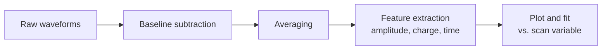

# Waveform analysis

## Basic flow



## Preprocessing

### Baseline subtraction

Subtract the mean of the pre-trigger region (before the laser pulse) as the baseline.
The standard deviation in the same region gives an estimate of the noise (RMS).

### Averaging

The laser produces nearly the same signal every time, so averaging \(N\) waveforms reduces random noise by \(1/\sqrt{N}\).

!!! warning "Caveats of averaging"
    - Large trigger jitter smears the leading edge of the averaged waveform.
    - If you want to study event-by-event fluctuations (jitter, gain fluctuations), save individual waveforms without averaging.

## Main features

| Feature | Definition | Use |
| --- | --- | --- |
| Amplitude | Maximum above the baseline | Signal size, S/N |
| Collected charge | Integral in a time window, \(Q = \frac{1}{GR}\int V\,dt\) | Full depletion voltage, gain, CCE |
| Rise time | Time from 10% to 90% of the amplitude | Speed of sensor and readout |
| CFD time | Time at which a fixed fraction (e.g. 50%) of the amplitude is crossed | Timing |
| S/N | Amplitude / noise RMS | Signal quality |

The **jitter** can be estimated from the noise and the slope of the signal.

\[
\sigma_t \approx \frac{\sigma_\text{noise}}{|dV/dt|}
\]

!!! tip "Charge collection efficiency (CCE)"
    The collected charge of an irradiated sensor divided by that of an unirradiated sensor measured under the same conditions
    is called the charge collection efficiency (CCE).
    A reference sensor is sometimes used to monitor the laser intensity and correct for its fluctuations.

## Python example

An example that computes the features above from a single waveform (arrays of time `t` and voltage `v`).
A positive signal is assumed. For a negative signal, flip the sign of `v` first.

```python
import numpy as np


def analyze_waveform(t, v, t_signal=(0.0, 10e-9), n_baseline=200,
                     gain=1.0, r_load=50.0, cfd_fraction=0.5):
    """Extract basic quantities from a single waveform.

    t : time [s] (1D array)
    v : voltage [V] (1D array, positive signal assumed)
    t_signal : time window for the charge integral [s]
    n_baseline : number of leading samples used for the baseline
    gain : amplifier gain (voltage ratio, e.g. 100 for 40 dB)
    """
    baseline = np.mean(v[:n_baseline])
    noise = np.std(v[:n_baseline])
    v = v - baseline

    i_max = np.argmax(v)
    amplitude = v[i_max]

    # collected charge: Q = ∫V dt / (G R)
    window = (t >= t_signal[0]) & (t <= t_signal[1])
    charge = np.trapezoid(v[window], t[window]) / (gain * r_load)

    def crossing_time(level):
        """Time at which the leading edge crosses level (linear interpolation)."""
        idx = np.where(v[:i_max + 1] < level)[0]
        if len(idx) == 0:
            return np.nan
        j = idx[-1]
        return t[j] + (level - v[j]) * (t[j + 1] - t[j]) / (v[j + 1] - v[j])

    t10 = crossing_time(0.1 * amplitude)
    t90 = crossing_time(0.9 * amplitude)

    return {
        "baseline": baseline,
        "noise_rms": noise,
        "amplitude": amplitude,
        "snr": amplitude / noise if noise > 0 else np.inf,
        "charge": charge,
        "rise_time": t90 - t10,
        "t_cfd": crossing_time(cfd_fraction * amplitude),
    }
```

!!! note
    `np.trapezoid` is available from NumPy 2.0. Use `np.trapz` with older versions.

### Usage example

```python
import numpy as np
import matplotlib.pyplot as plt

# Example: read a CSV file (column 1: time [s], column 2: voltage [V])
data = np.loadtxt("waveform.csv", delimiter=",")
t, v = data[:, 0], data[:, 1]

result = analyze_waveform(t, v, t_signal=(0.0, 10e-9), gain=100)
print(f"amplitude = {result['amplitude'] * 1e3:.1f} mV")
print(f"charge    = {result['charge'] * 1e15:.2f} fC")
print(f"rise time = {result['rise_time'] * 1e12:.0f} ps")

plt.plot(t * 1e9, v * 1e3)
plt.xlabel("Time [ns]")
plt.ylabel("Voltage [mV]")
plt.show()
```

## Bias scan analysis

Plot the collected charge versus bias voltage and find the full depletion voltage where the charge starts to saturate.
A common method is to fit straight lines to the rising part and the plateau and take their intersection.

## Focus scan analysis

```python
from scipy.optimize import curve_fit
from scipy.special import erf


def edge(x, a, x0, sigma, c):
    return 0.5 * a * (1 + erf((x - x0) / (np.sqrt(2) * sigma))) + c

# x: position [µm], q: collected charge at each position
popt, pcov = curve_fit(edge, x, q, p0=[q.max(), x.mean(), 5.0, 0.0])
sigma = abs(popt[2])
print(f"sigma = {sigma:.2f} um, FWHM = {2.355 * sigma:.2f} um")
```

Repeat this at each position along the beam axis \(z\) and find the \(z\) that minimizes \(\sigma\).
Depending on the edge direction \(\sigma\) can come out negative, hence the absolute value.
