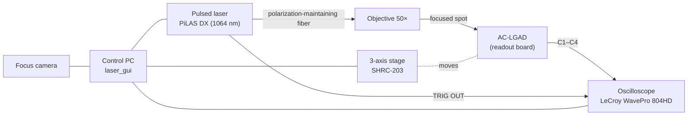

# Hiroshima TCT Wiki

This wiki explains how to use the **laser TCT (Transient Current Technique) scan setup** of the Quark Physics Laboratory at Hiroshima University.
The setup characterizes **AC-LGAD strip sensors** for the barrel TOF of the EIC-ePIC experiment by scanning them with an infrared pulsed laser at µm precision.

**The goal: with this wiki alone, a first-time user can start up the setup and take data with the control GUI.**

!!! info "日本語版"
    Use the language menu (:material-translate:) at the top right to switch to the Japanese version.

## Setup overview

- Everything is controlled with **laser_gui** (a PySide6 GUI) on the control PC. Without entering the dark room you can go all the way
  from "positioning the beam → firing the laser → checking and saving waveforms → retrieving data → quick analysis".
- For the detailed configuration, see [Hardware](setup/hardware.md).

## First measurement: reading order

1. [Safety](introduction/safety.md) — always read this first
2. [Hardware](setup/hardware.md) and [Sensor and coordinates](setup/sensor.md) — what is connected where, and how the coordinates are defined
3. [Control PC and software](setup/software.md) — installing the GUI, and practicing in simulation mode before touching the real hardware
4. [Measurement overview](measurement/procedure.md) — checklist from power-on to data taking and shutdown
5. Details of each step
    1. [Startup and connecting the devices](measurement/connect.md)
    2. [Alignment (origin finding and calibration)](measurement/alignment.md)
    3. [Adjusting the laser intensity (TUNE optimization)](measurement/tune.md)
    4. [Auto scan](measurement/scans.md)
    5. [Data retrieval and quick analysis](measurement/data.md)

!!! tip "Start in simulation mode"
    Starting the GUI with `python main.py --simulate` turns every device into a simulated one, so you can go through everything
    from origin finding to scans without the hardware. Do one full practice run before touching the real setup ([Control PC and software](setup/software.md#simulate)).

## Structure of this wiki

- :material-school: **[Introduction](introduction/what-is-tct.md)**

    An overview of TCT and the safety notes you must read before measuring.

- :material-atom: **[Principles](principle/signal-formation.md)**

    Signal formation, lasers and illumination methods, and scan types (general).

- :material-tools: **[Setup](setup/hardware.md)**

    The equipment of the Hiroshima setup, sensor geometry and coordinate system, and preparing the control PC.

- :material-gesture-tap-button: **[Measurement](measurement/procedure.md)**

    Measurement procedure with the GUI: from startup through origin finding, TUNE optimization and scans to data retrieval.

- :material-chart-line: **[Analysis](analysis/waveform.md)**

    Extracting amplitude and timing information from waveforms.

- :material-book-open-variant: **[Reference](reference/troubleshooting.md)**

    Troubleshooting, standard settings, output files, glossary, bibliography and how to edit this wiki.

## Quick links

- No signal, or the GUI shows an error → [Troubleshooting](reference/troubleshooting.md)
- Check the standard scope settings, bias, etc. → [Standard settings](reference/settings.md)
- Find where a file was saved → [Output files](reference/files.md)
- Add to this wiki → [Contributing](reference/contributing.md)

## Contact

For questions about the setup or this wiki, and for the control PC and NAS passwords, ask Matsutani (matsutani@quark.hiroshima-u.ac.jp).
The laser safety officers are Yano and Matsutani.

!!! note "Sources"
    The setup-specific content of this wiki is based on the README and source code of the control GUI `laser_gui_v4`,
    §3–4 of the analysis note "Laser TCT scan of a 500 µm pitch strip AC-LGAD" (matome),
    and answers from the people in charge of the setup (2026-11). Items not yet confirmed are marked with "To be confirmed" boxes.
