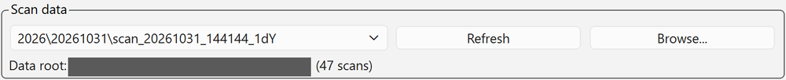
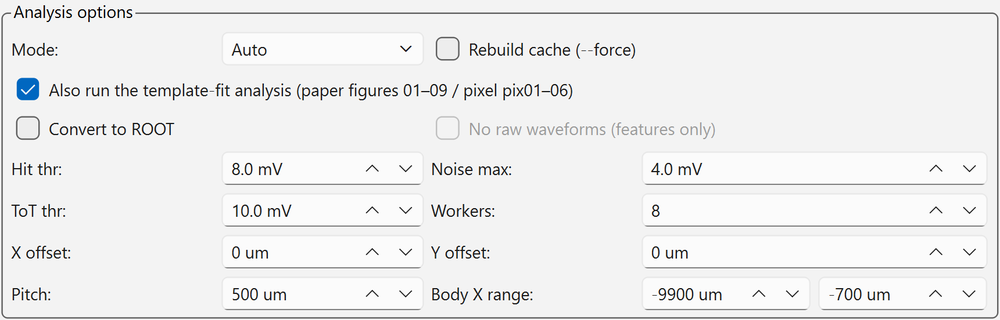

# 5. Data Retrieval and Quick Analysis

## Data retrieval (scope → PC) { #transfer }

Scan waveforms are first saved on the oscilloscope's disk. To move them to the PC, use the **[Data Retrieval] tab** of the auto scan panel.

<figure markdown="span">
  ![[Data Retrieval] tab](../images/gui/scan-transfer.png){ width="520" }
  <figcaption>[Data Retrieval] tab of the auto scan panel (the source and destination paths are blacked out)</figcaption>
</figure>

The "Source" line at the top shows the scope-side save location (`<scope_save_dir>\<year>\<date>`).

### Procedure

1. Specify [Date (YYYYMMDD)] (default is today; past dates can also be specified).
2. Check [PC destination] (default is `data` next to the GUI folder).
3. If needed, check [Delete on scope after transfer] (default **OFF**; see below).
4. Press **[Start Transfer]**.
5. Enter the SSH password when asked (user name: [Internal information](../internal.md#accounts); ask the contact person for the password).
   The password is not stored and must be entered for each transfer (within the same session the previous value is filled in).

The whole scope-side folder `<scope_save_dir>\<year>\<YYYYMMDD>` is copied over SSH/SFTP to `<transfer_dest_dir>\<year>\<YYYYMMDD>` on the PC.

### Details

- **Duplicate skipping**: files with the same name and size already on the PC are skipped automatically. If all files in a scan folder are already retrieved,
  it reports "skipped n already-retrieved folders". **If you stop midway, just run it again.**
- **Conflicts**: files with the same name but a **different size** are not overwritten and are reported as "conflicts".
- **Verification**: file sizes are compared after transfer.
- **Deletion**: with [Delete on scope after transfer] ON, the original files on the scope are deleted and empty folders cleaned up only if there were no errors, conflicts or aborts
  and the size check succeeded for all files (to free scope disk space).
- The results (path, size, status, whether deleted) are saved in `logs/transfer_<datetime>.csv`.
- **Transfer is not possible while a scan is running** (exclusive in the GUI). Also avoid transferring while the scope autosave is active.

!!! tip "Retrieving from a terminal"
    GUI retrieval uses the same SSH/SFTP protocol as copying from the scope with `scp -r` in a terminal (command: [Internal information](../internal.md#scope-scp)).

## Backup to the NAS { #backup }

Back up the data retrieved to the control PC to the NAS. Copy it with `scp -r` in a terminal on the control PC.

```bash
scp -r "<folder of the retrieved data>" <NAS user>@<NAS address>:<NAS destination>/<year>/
```

- The NAS address, user name and destination, and the actual command example, are in [Internal information](../internal.md#nas) (password protected).
- When the year changes, adjust the year folder of the destination.
- Ask the contact person for the password (there is a note on the control PC).

!!! tip "When the data on the scope may be deleted"
    Delete the data on the scope when its disk is running low, or once the move to the NAS is complete
    (use [Delete on scope after transfer] or delete it on the scope itself).
    **Delete only data that has already been retrieved to the PC.** Even when the disk is low, retrieve any scans not yet transferred with [Start Transfer] first
    ([Delete on scope after transfer] deletes only when every file passed the size check, so it is safe).

## Quick analysis ([Analysis] tab) { #analysis }

A quick analysis to check data quality right after acquisition. Run it in the **[Analysis] tab** of the main window.
The analysis runs in a separate process, so **it can be run during a measurement**.

<figure markdown="span">
  ![[Analysis] tab](../images/gui/analysis-tab.png)
  <figcaption>[Analysis] tab of the main window (before running an analysis; controls on the left, figure area on the right)</figcaption>
</figure>

Switch with the [Control] / [Analysis] tabs at the top of the window. On the left, from top to bottom, are "Scan data", "Analysis options",
[Run analysis] [Abort] [Open results] with a progress bar, and the run log; the result figures appear on the right.

### Procedure

1. Select a retrieved scan from the "Scan data" list.

    { width="640" }

    The list shows the scans under [Data root] (the destination `data` folder) in the form `<year>\<date>\scan_<datetime>_<tag>` (the number of scans is shown in parentheses on the right).
    If a scan you just retrieved does not appear, press [Refresh]; to choose a folder elsewhere, use [Browse...].

2. Check the "Analysis options". Normally the defaults are fine.

    { width="640" }

    | Item | Default | Description |
    | --- | --- | --- |
    | [Mode] | Auto | Analysis type. Determined automatically from the scan log; can also be set manually |
    | [Rebuild cache (--force)] | OFF | Rebuilds the reduced cache (`reduced.npz`) and the template-fit analysis |
    | [Also run the template-fit analysis (paper figures 01–09 / pixel pix01–06)] | **ON** | For 2dYX and pixel, runs the template-fit analysis after the quick analysis ([below](#template)). If unchecked, only the quick-analysis figures are made |
    | [Convert to ROOT] | OFF | Combines the `.trc` files into one ROOT file |
    | [No raw waveforms (features only)] | OFF | Available only with ROOT conversion. Makes the file lighter by leaving out raw waveforms |
    | [Hit thr] / [Noise max] / [ToT thr] | 8.0 / 4.0 / 10.0 mV | Hit lower limit, noise upper limit, ToT threshold |
    | [Workers] | 8 | Number of parallel workers for reduction |
    | [X offset] / [Y offset] | 0 µm | Offset from log coordinates to sensor coordinates. **For scans before 2026-09-07, X is −632** |
    | [Pitch] | 500 µm | Strip pitch |
    | [Body X range] | −9900 to −700 µm | X range used for the along-the-length fits and representative values |

3. Press **[Run analysis]**. The progress bar and run log are shown; stop with [Abort].
4. When finished, figures are shown on the right and can be switched with [Figure] at the top right. [Open results] opens the output folder.

The scan type is detected automatically from the scan log.

| Type | Analysis code | Main outputs |
| --- | --- | --- |
| 1dX (along the strip) | `analyze_1dx.py` | Amplitude, rise time, jitter, time resolution, propagation along the length |
| 1dY (across the strips) | `analyze_1dy.py` | Amplitude, rise time, jitter, position resolution, time resolution, transverse propagation velocity |
| 1dZ (focus) | `analyze_1dz.py` | Optimal Z (`best_z.txt`) |
| 2dYX (X × Y) | `analyze_2dyx.py` | All of the above (maps, in-gap, along the length) |
| tune (intensity sweep at a fixed position) | `analyze_tune.py` | TUNE for MIP-equivalent (pulse height 60–75 mV), σt vs. amplitude |
| 1d_tune (position × intensity) | `analyze_1d_tune.py` | σt vs. amplitude, intensity dependence of position resolution |
| pixel (2D on a pixel sensor) | `analyze_pixel.py` → `tt_pixel.py` | Amplitude map, amplitude distribution, rise time, jitter, time and position resolution of 2/3/4-pixel combinations, propagation (pix01–06) |

All types produce `fig_waveforms.png` (mean waveform, raw waveforms and amplitude distribution at the maximum-amplitude point), `summary.txt` and `numbers.json`.
Scans taken with a pixel sensor are detected as pixel automatically from `sensor_type=pixel` in the log header.

### Template-fit analysis { #template }

For 2dYX and pixel, the **template-fit analysis** runs automatically after the quick analysis (when [Also run the template-fit analysis ...] is ON).
It reads the `.trc` files directly, so no ROOT conversion is needed.

| Type | Output | Contents |
| --- | --- | --- |
| 2dYX (strip) | Paper figures 01–09 (PNG + PDF), `numbers.json` and `key_numbers.csv` in `results\<scan name>\paper_plots\` | 01 amplitude / 02 amplitude distribution / 03 rise time / 04 jitter / 05 position resolution / 06 time resolution / 07 propagation vs. position / 08 propagation vs. amplitude / 09 2D map |
| pixel | `results\<scan name>\pix01–06_*.png` and `pixel\` | Finds the pads automatically from the amplitude, assigns the 4 CHs to the pixel centers and analyzes them |

In the GUI's [Figure] list, the 2dYX paper figures appear as `paper_NN_*.png`.

!!! warning "The first run takes time"
    The first stage (fitting the pulse template at each point) is heavy: a 2dYX scan with 16000 points × 2000 segments takes **about 30 min** (12 workers).
    From the second run on this stage is skipped, so it finishes in a few minutes. If you only want a quick health check, uncheck the option and run the quick analysis alone.
    The analysis is a separate process, so you can keep measuring meanwhile.

### Output locations

| Output | Location |
| --- | --- |
| Figures, `summary.csv`, `summary.txt`, `numbers.json`, `mean_waveforms.root` | `<workspace>\results\<scan name>\` |
| ROOT file (with [Convert to ROOT]) | `<scan folder>.root` (next to the scan folder) |

`<workspace>` is the parent folder of the destination `data` folder.

!!! warning "Time origin in the ROOT file"
    When computing arrival times from the ROOT file, use the per-segment `trig_offset` branch as the time origin.
    Using `horiz_offset` from the waveform header adds about 29 ps of fake jitter.

!!! note
    All numbers are preliminary internal values. Time resolution is relative to the laser TRIG OUT and includes a common floor \(\sigma_\text{ref} \approx 12.5\) ps.

### Running from the command line

```bat
cd <GUI folder>\analysis

:: Detect the type automatically and analyze (scan name or path)
python run_analysis.py scan_20260826_155255_1dX

:: Analysis + ROOT conversion
python run_analysis.py scan_20260826_152932_2dYX --root

:: Rebuild the cache (reduced.npz) (also redoes all stages of the template-fit analysis)
python run_analysis.py scan_... --force

:: Quick-analysis figures only (skip the template-fit analysis)
python run_analysis.py scan_... --no-template
```

| Option | Default | Description |
| --- | --- | --- |
| `--mode` | auto | Force `1dX` `1dY` `1dZ` `2dYX` `tune` `1d_tune` `pixel` |
| `--no-template` / `--force-template` | — | Skip / redo all stages of the template-fit analysis for 2dYX / pixel (`--force` also redoes it) |
| `--x-off` / `--y-off` | 0 | Offset from log coordinates to sensor coordinates [µm]. **Scans before 2026-09-07 have a different X origin**, so pass `--x-off -632` |
| `--pitch` | 500 | Strip pitch [µm] |
| `--body-x LO HI` | −9900 −700 | X range of the "body" [µm] |
| `--hit-thr` / `--noise-max` / `--tot-thr` | 8 / 4 / 10 mV | Hit lower limit, noise upper limit, ToT threshold |
| `--workers` | 8 | Number of parallel workers for reduction |
| `--log` / `--results` | auto | Specify the log CSV and output folder |

For detailed analysis definitions, see `analysis/README.md` and the analysis notes (matome). General concepts of waveform analysis are in [Waveform analysis](../analysis/waveform.md).
