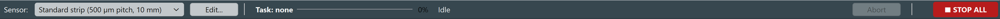
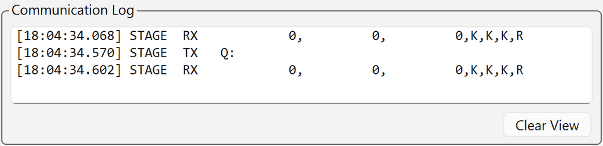
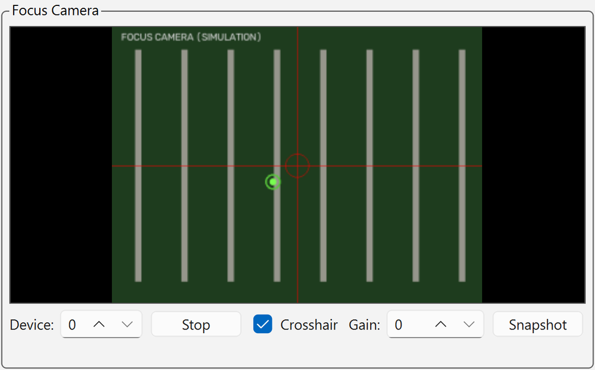
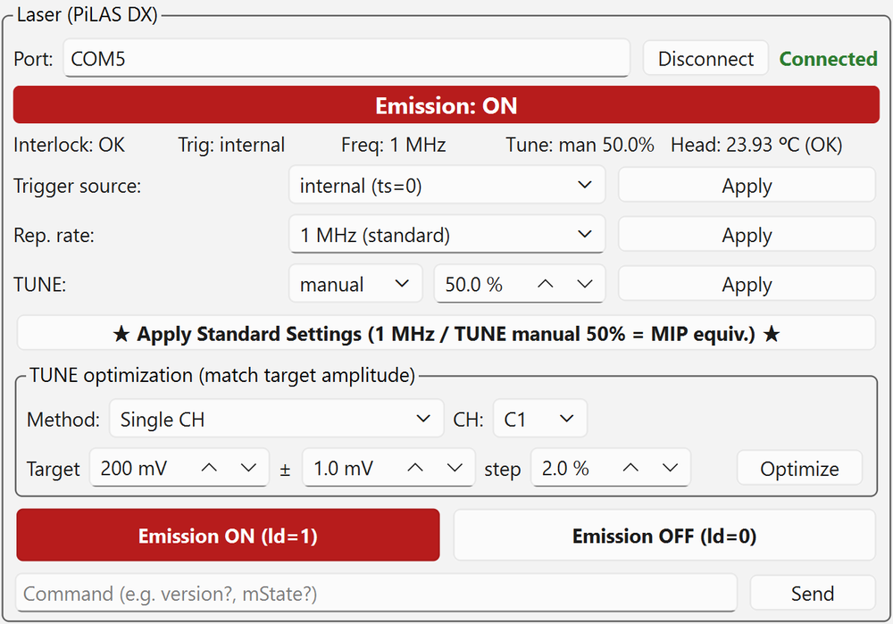

# GUI Layout

![Main window ([Control] tab)](../images/gui/main-window.png)

*The [Control] tab with all devices connected in simulation (2026-11-01 version; waveforms and camera image are dummy data, addresses are blacked out).*

The window is designed for a wide 16:9 monitor. From top to bottom it has the **toolbar**, **tabs**, **three columns of panels** and the **status bar**.
On startup it opens sized to fit the usable area of the monitor.

| Column | Panel | Main functions |
| --- | --- | --- |
| Left | [Oscilloscope](#scope) | Connection, screen mirror, Trigger/Sweep, Channels, Save and Command tabs |
| Lower left | [Communication Log](#log) | All commands sent to devices and their responses |
| Middle | [Focus Camera](#camera) | Camera image, crosshair, gain, snapshot |
| Lower middle | [3-Axis Stage](#stage) | Coordinate display; Move (jog, origin), Positions and Alignment tabs |
| Right | [Laser](#laser) | Status display, trigger/rep. rate/TUNE settings, standard settings, TUNE optimization, emission ON/OFF |
| Lower right | [Auto Scan](#scan) | Scan and Data Retrieval tabs |

## Toolbar { #toolbar }

| Position | Element | Description |
| --- | --- | --- |
| Left | [Sensor] and [Edit...] | Select the DUT to measure and edit sensor profiles ([Sensor and coordinate system](../setup/sensor.md#new-sensor)) |
| Center | Task display | Name of the running task, progress bar, status (current point, remaining time, etc.), [Abort] |
| Far right | **[■ STOP ALL]** | Stops all connected devices in this order: abort running task → laser OFF → stage stop → scope STOP |

*Toolbar during a scan (screen of an older version). It shows progress, the current point and the remaining time. Sensor switching is disabled while a task runs.*

## Tabs

| Tab | Description |
| --- | --- |
| [Control] | Three-column screen for measurement |
| [Analysis] | Quick analysis of retrieved data ([Data retrieval and quick analysis](data.md#analysis)) |

## Oscilloscope panel { #scope }

- **VISA** field: address (the default is in `config.py`; the value is in [Internal information](../internal.md#config)). Press [Connect]; on success it shows "Connected" and the button changes to [Disconnect].
- **[Start Mirror]**: shows the scope screen in the GUI (after starting, the button becomes [Stop Mirror]). Select the refresh rate with [Interval].
  The mirror keeps running during a scan and pauses automatically only while each point is being acquired.
- The four tabs below it hold the settings.

=== "Trigger/Sweep"

    ![[Trigger/Sweep] tab](../images/gui/scope-trigger.png){ width="460" }

    - [Trigger mode]: AUTO / NORM / SINGLE / STOP
    - [Source], [Level [mV]], [Slope], [Coupling] → [Apply Edge Trigger]
    - [Timebase], [Horiz. offset] → [Apply Horizontal]
    - [Sequence] and the number of segments → [Apply], [Clear Sweeps (CLSW)]
    - **[★ Apply Standard Settings ★]**: sends the standard measurement conditions in one go ([details](connect.md#scope-standard))

=== "Channels"

    ![[Channels] tab](../images/gui/scope-channels.png){ width="460" }

    For each CH (labeled with its readout pad, e.g. C1 (J8)), set On, VDIV, Offset [mV], Coupling (D50 = DC 50 Ω), Avg and Sweeps, then press [Apply].
    **Use with averaging OFF.**

=== "Save"

    ![[Save] tab](../images/gui/scope-save.png){ width="460" }

    For manual saving: [Save dir] (a folder on the scope; the default is `manual` under the current date), [Prefix], [Format], [Source], [Send Save Setup], [Save Now],
    [Autosave], and [Panel setup memory] ([Save (*SAV)] / [Recall (*RCL)]). Not used by the auto scan.

=== "Command"

    ![[Command] tab](../images/gui/scope-command.png){ width="460" }

    [Send] / [Query] remote commands (e.g. `TRMD?`, `VBS? 'return=app.Acquisition...'`) directly for operations the GUI does not support.

## Communication Log { #log }

{ width="460" }

All commands sent to devices and their responses are shown here and also saved in `logs/gui_YYYYMMDD.log`. When something goes wrong, look here first. [Clear View] only clears the display.

## Focus camera panel { #camera }

{ width="460" }

- [Device] number, [Start] / [Stop], [Crosshair], [Gain], [Snapshot] (saved to `captures/snap_<datetime>.png`).
- The camera has a manual-focus lens; there is no autofocus or exposure control. If the image is dark, adjust [Gain] and the light inside the dark room ([photos](../setup/hardware.md#equipment-photos)).
- The crosshair is a guide for positioning. It can be a few µm off from the laser spot.

## Stage panel { #stage }

The **address**, **logical coordinates** (X, Y, Z, green digits) and **machine coordinates** are always shown at the top ([Sensor and coordinate system](../setup/sensor.md)).
If the machine coordinates show "unknown (run Mechanical Home (H:W) from the GUI to start tracking)", run [Mechanical Home (H:W)].

=== "Move"

    ![[Move] tab](../images/gui/stage-move.png){ width="460" }

    - **Jog**: select the step size per move with [Step] from 2 µm to 5 mm (2, 4, 10, 20, 50, 100, 500, 1000, 5000 µm), and move with the arrow buttons.
      The number of pulses actually sent is shown next to it (e.g. `= 5/5/5 pulse (X/Y/Z)`).
        - The arrows show the **direction of motion in the camera image**; the button text shows the actual axis and sign sent (**pressing ▲ moves up in the image = stage Y−**).
        - Z uses [▲ Z+] / [▼ Z−] (focus).
    - **[Go to [µm]]**: enter X, Y, Z and press [Go]. [Now] copies the current position into the input fields.
    - **[Mechanical Home (H:W)]**, **[Reset Logical Origin (R:W)]**, **[Stop (L:W)]**, **[EMERGENCY STOP]**.

=== "Positions"

    ![[Positions] tab](../images/gui/stage-positions.png){ width="460" }

    Coarse positioning ([Go to Origin], [Go to Start]), [Save Origin], [Go to strip] ([Go to pixel] for pixel sensors),
    and saving and moving to positions. See [Startup and device connection](connect.md#coarse) for how to use them.

=== "Alignment"

    ![[Alignment] tab](../images/gui/stage-align.png){ width="460" }

    Z focus, Auto Alignment (Find Origin, Full Calibration), display of the tilt coefficients and [Edit coefficients...]. See [Alignment](alignment.md) for how to use them.

## Laser panel { #laser }

<figure markdown="span">
  
  <figcaption>Emission OFF (green band)</figcaption>
</figure>

<figure markdown="span">
  
  <figcaption>Emission ON (red band)</figcaption>
</figure>

- **Status display**: emission ON/OFF (green band when OFF, red band when ON), Interlock, Trig, Freq, Tune, Head (head temperature). Updated every 2 s with `mState?`.
- **[Trigger source]**: internal (ts=0) (standard) / ext. TTL (ts=2) / ext. Adj (ts=1).
- **[Rep. rate]**: presets from 1 kHz to 40 MHz. **"1 MHz (standard)"** is the standard for this setup ("1.25 MHz (TCT rec.)" is a general recommendation, not the standard). Any value in Hz can also be entered.
- **[TUNE]**: auto / manual and value [%]. **0 % is the strongest and 100 % the weakest.** The standard is manual 50 %.
- **[★ Apply Standard Settings (1 MHz / TUNE manual 50% = MIP equiv.) ★]**: sends trigger internal, 1 MHz and TUNE manual 50 % in one go.
- **TUNE optimization**: automatically adjusts TUNE to a target amplitude ([Laser intensity adjustment](tune.md)).
- **[Emission ON (ld=1)]** / **[Emission OFF (ld=0)]**.
- From the bottom field you can [Send] any command (e.g. `version?`, `mState?`).

To change the trigger source, rate or TUNE individually, change the input field and **press the corresponding [Apply] button to send it** (changing a field alone does not send anything).
The input fields are synchronized to the device's current values on connection.

## Auto scan panel { #scan }

=== "Scan"

    ![[Scan] tab](../images/gui/scan-conditions.png){ width="460" }

    Mode, range, TUNE, tilt correction, acquisition settings, save location, [Start Scan] / [Abort]. See [Auto scan](scans.md) for how to use it.

=== "Data Retrieval"

    ![[Data Retrieval] tab](../images/gui/scan-transfer.png){ width="460" }

    Source (scope), [Date (YYYYMMDD)], [PC destination], [Delete on scope after transfer], [Start Transfer]. See [Data retrieval](data.md#transfer) for how to use it.

## Status bar { #statusbar }

Always shows the selected sensor, reference HV and LV values (the values in `config.py`; for the actual HV, see [Safety](../introduction/safety.md#bias)),
the mapping between scope channels and readout pads, and the pitch.

## Task exclusivity

Scan, data retrieval, Z focus, Find Origin, Full Calibration and TUNE optimization all occupy the stage, scope and laser, so they never run at the same time.
While one is running, jog, Go to moves, origin operations, sensor switching and the start buttons of other tasks are disabled.

- Stop buttons ([Abort], [■ STOP ALL], [Stop (L:W)], [EMERGENCY STOP]) can always be pressed.
- Only the analysis in the [Analysis] tab runs in a separate process, so it can run in parallel with a measurement.
- During Find Origin, Z focus and TUNE optimization, the scope is switched to sequence OFF and trigger NORM. These are set again when a scan starts, so you do not need to restore them.

!!! tip "Preventing accidental changes"
    Turning the mouse wheel over a spin box or combo box does not change its value (to avoid changing values by accident when you meant to scroll).
