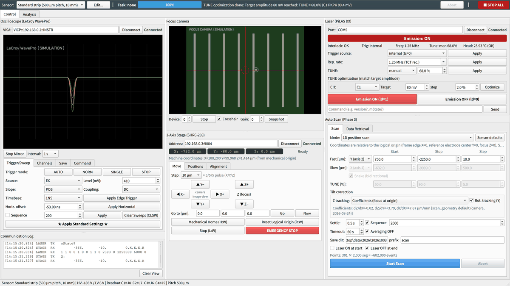
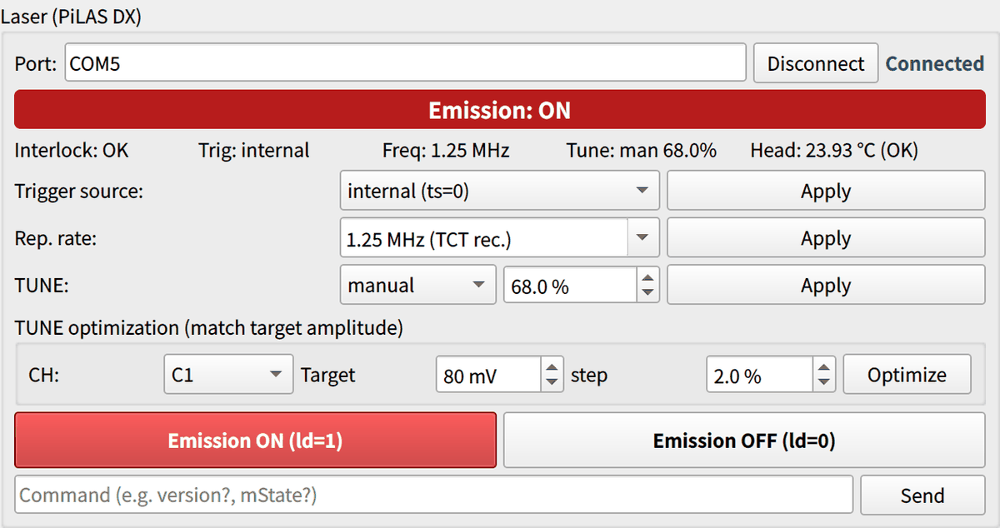

# GUI Layout

*Idle state after connecting all devices and finishing Find Origin and TUNE optimization (simulation mode; waveforms and camera image are dummy data).*

The window is designed for a wide 16:9 monitor. From top to bottom it has the **toolbar**, **tabs**, **three columns of panels** and the **status bar**.

## Toolbar

| Position | Element | Description |
| --- | --- | --- |
| Left | [Sensor] and [Edit...] | Select the DUT to measure and edit sensor profiles ([Sensor and coordinate system](../setup/sensor.md#new-sensor)) |
| Center | Task display | Name of the running task, progress bar, status (current point, remaining time, etc.), [Abort] |
| Far right | **[■ STOP ALL]** | Stops all connected devices in this order: abort running task → laser OFF → stage stop → scope STOP |

*Toolbar during a scan. It shows progress, the current point and the remaining time. Sensor switching is disabled while a task runs.*

## Tabs

| Tab | Description |
| --- | --- |
| [Control] | Three-column screen for measurement |
| [Analysis] | Quick analysis of retrieved data ([Data retrieval and quick analysis](data.md#analysis)) |

## Three-column panels

| Column | Panel | Main functions |
| --- | --- | --- |
| Left | Oscilloscope (LeCroy WavePro) | Connection, screen mirror, Trigger/Sweep, Channels, Save and Command tabs |
| Lower left | Communication Log | All commands sent to devices and their responses |
| Middle | Focus Camera | Camera image, crosshair, gain, snapshot |
| Lower middle | 3-Axis Stage (SHRC-203) | Coordinate display; Move (jog, origin), Positions and Alignment tabs |
| Right | Laser (PiLAS DX) | Status display, trigger/rep. rate/TUNE settings, TUNE optimization, emission ON/OFF |
| Lower right | Auto Scan | Scan and Data Retrieval tabs |

### Oscilloscope panel

- **VISA** field: address (default `VICP::192.168.0.2::INSTR`). Press [Connect]; on success it shows "Connected" and the button changes to [Disconnect].
- **[Start Mirror]**: shows the scope screen in the GUI. Select the refresh rate with [Interval].
  The mirror keeps running during a scan and pauses automatically only while each point is being acquired.
- **[Trigger/Sweep] tab**: trigger mode (AUTO / NORM / SINGLE / STOP), source, level, slope, coupling, timebase, horizontal offset,
  sequence mode, [Clear Sweeps (CLSW)], **[★ Apply Standard Settings ★]**.
- **[Channels] tab**: per-channel display, VDIV, offset, coupling, averaging, sweeps.
- **[Save] tab**: directory, filename, format and target for manual saving, [Save Now], autosave, panel setup memory (*SAV / *RCL).
- **[Command] tab**: [Send] / [Query] SCPI/VBS commands directly for operations the GUI does not support.

![[Trigger/Sweep] tab of the oscilloscope panel](../images/gui/scope-trigger-tab.png){ width="480" }

### Focus camera panel

- [Start] / [Stop], [Device] number, [Crosshair], [Gain], [Snapshot] (saved to `captures/snap_<datetime>.png`).
- The camera has a manual-focus lens; there is no autofocus or exposure control.

### Stage panel

The **logical coordinates** (X, Y, Z, green digits) and **machine coordinates** are always shown at the top ([Sensor and coordinate system](../setup/sensor.md)).

**[Move] tab**

- **Jog**: select the step size per move with [Step] from 2 µm to 5 mm (2, 4, 10, 20, 50, 100, 500, 1000, 5000 µm), and move with the arrow buttons.
  The number of pulses actually sent is shown next to it.
    - The arrows show the **direction of motion in the camera image**; the button text shows the actual axis and sign sent (**pressing ▲ moves up in the image = stage Y−**).
    - Z uses [▲ Z+] / [▼ Z−] (focus).
- **[Go to [µm]]**: enter X, Y, Z and press [Go]. [Now] copies the current position into the input fields.
- **[Mechanical Home (H:W)]**, **[Reset Logical Origin (R:W)]**, **[Stop (L:W)]**, **[EMERGENCY STOP]**.

**[Positions] tab**: coarse positioning, moving to strips, saving positions ([Startup and device connection](connect.md#coarse)).

**[Alignment] tab**: Z focus, Find Origin, Full Calibration, manual coefficient entry ([Alignment](alignment.md)).

### Laser panel

{ width="480" }

- **Status display**: emission ON/OFF (red band when ON), Interlock, Trig, Freq, Tune, Head (head temperature). Updated every 2 s with `mState?`.
- **[Trigger source]**: internal (ts=0) (normally this) / ext. TTL (ts=2) / ext. Adj (ts=1).
- **[Rep. rate]**: presets from 1 kHz to 40 MHz (1.25 MHz is "TCT rec."). Any value in Hz can also be entered.
- **[TUNE]**: auto / manual and value [%]. **0 % is the strongest and 100 % the weakest.**
- **TUNE optimization**: automatically adjusts TUNE to a target amplitude ([Laser intensity adjustment](tune.md)).
- **[Emission ON (ld=1)]** / **[Emission OFF (ld=0)]**.
- From the bottom field you can [Send] any command (e.g. `version?`, `mState?`).

Changing an input field does not send the setting. **Press the corresponding [Apply] button to send it.** The input fields are synchronized to the device's current values on connection.

### Auto scan panel

It has the [Scan] tab and the [Data Retrieval] tab ([Auto scan](scans.md), [Data retrieval and quick analysis](data.md)).

## Status bar

Always shows the selected sensor, reference HV and LV values, the mapping between scope channels and readout pads, and the strip pitch.
Example: `Sensor: Standard strip (500 µm pitch, 10 mm) | HV -185 V / LV 6 V | Readout C1=J8 C2=J7 C3=J6 C4=J5 | Pitch 500 µm`

## Task exclusivity

Scan, data retrieval, Z focus, Find Origin, Full Calibration and TUNE optimization all occupy the stage, scope and laser, so they never run at the same time.
While one is running, jog, Go to moves, origin operations, sensor switching and the start buttons of other tasks are disabled.

- Stop buttons ([Abort], [■ STOP ALL], [Stop (L:W)], [EMERGENCY STOP]) can always be pressed.
- Only the analysis in the [Analysis] tab runs in a separate process, so it can run in parallel with a measurement.
- During Find Origin, Z focus and TUNE optimization, the scope is switched to sequence OFF and trigger NORM. These are set again when a scan starts, so you do not need to restore them.

!!! tip "Preventing accidental changes"
    Turning the mouse wheel over a spin box or combo box does not change its value (to avoid changing values by accident when you meant to scroll).
