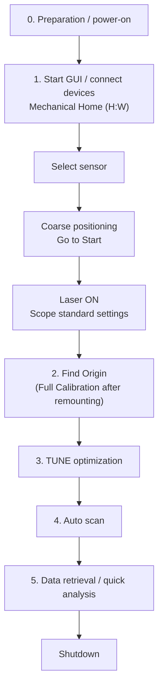

# Measurement Workflow

This page shows the flow from power-on to data taking and shutdown. Detailed operations for each step are on the linked pages.
The checkboxes are meant to be printed and used.

!!! danger
    Read [Safety](../introduction/safety.md) before you start.

## 0. Preparation and power-on { #power-on }

- [ ] Write the date, purpose, operator and sensor ID in the measurement log (e.g. electronic logbook)
- [ ] Check that the readout board is inserted in the fixing jig, the MCX–BNC cables of the channels you want to see go to scope inputs C1–C4, and TRIG OUT goes to the scope EXT input
- [ ] Turn on the devices (**the order does not matter**; for switch locations see [Power and switches](../setup/hardware.md#power))
    - [ ] Laser: turn the key to the right to switch ON
    - [ ] Stage controller: under the workbench, switch at the bottom right of the unit
    - [ ] Oscilloscope: power button at the bottom left
    - [ ] Control PC
- [ ] Bias the sensor **last**: in the order **LV → HV**. First check that the current limits are HV 1.0 mA and LV 1.0 A
    - [ ] LV: button at the bottom left to switch ON → CH1 → OUTPUT button to turn the output ON (lights blue). 6 V
    - [ ] HV: switch ON → black button to SET (−190 to −195 V at 33 °C; **do not exceed −220 V**) → red button to turn the bias ON (ramp-up is automatic)
    - [ ] Check that the currents are normal (HV about 0.4–5 µA, LV about 0.450 A)
- [ ] Before leaving the dark room, turn **the camera light OFF** (switch at the bottom right of the unit; always OFF during measurement)

## 1. Startup and device connection → [Details](connect.md)

- [ ] Start the GUI in a terminal on the control PC (`cd workspace/laser_gui_en` → `python ./main.py`)
- [ ] Press [Connect] on the oscilloscope, stage and laser, and [Start] on the camera; check that all show "Connected"
- [ ] In the stage panel [Move] tab, press **[Mechanical Home (H:W)]** (all axes move a lot — watch for collisions)
- [ ] Select the DUT to measure with [Sensor] in the toolbar
- [ ] Do the coarse positioning with **[Go to Start]** in the [Positions] tab (the first time and after remounting, jog while watching the camera)
- [ ] In the laser panel, press **[★ Apply Standard Settings (1 MHz / TUNE manual 50% = MIP equiv.) ★]**, then **[Emission ON (ld=1)]** ([details](connect.md#laser-on))
- [ ] In the oscilloscope panel, press [Start Mirror], then **[★ Apply Standard Settings ★]** in the [Trigger/Sweep] tab
- [ ] Check that a signal is visible on the scope screen

## 2. Alignment → [Details](alignment.md)

- [ ] In the stage panel [Alignment] tab, press **[Find Origin (Z→Y→X→R:W)]** (about 7–12 min with fine finishing ON)
- [ ] If you remounted the sensor or changed the jig, run **[Full Calibration (origin+tilt)]** instead
- [ ] Check the residuals and fit errors in the completion dialog and record them in the measurement log

## 3. Laser intensity adjustment → [Details](tune.md)

- [ ] Under the standard conditions (1 MHz, TUNE manual 50 %) the intensity is already adjusted to MIP-equivalent, so **normally leave it unchanged**
- [ ] If you change the repetition rate or the amplitude is not as expected, adjust it with **TUNE optimization** in the laser panel

## 4. Auto scan → [Details](scans.md)

- [ ] In the auto scan panel, set the mode, range, step, number of sequence segments and tilt correction
- [ ] Press [Start Scan] → check the contents of the confirmation dialog (number of points, range, Z travel, Y shift, save directory) and run
- [ ] On the first line, check that "the signal is almost 0 directly above the electrode and rises sharply at the electrode edge"

## 5. Data retrieval and quick analysis → [Details](data.md)

- [ ] In the auto scan panel [Data Retrieval] tab, specify the date and press [Start Transfer]
- [ ] In the [Analysis] tab, select the scan, press [Run analysis], and check data quality in the figures

## Shutdown

- [ ] Press **[Emission OFF (ld=0)]** in the laser panel (closing the GUI does not stop the laser)
- [ ] Finish data retrieval if needed
- [ ] [Disconnect] each panel and close the GUI
- [ ] Turn the HV bias OFF, and once the HV display reads 0 V, turn the LV OUTPUT OFF
- [ ] Turn off everything **except the control PC** (all devices in the dark room: laser, stage, camera light, oscilloscope, HV and LV supplies). Leave the control PC on for remote control
- [ ] Back up the retrieved data to the NAS ([Details](data.md#backup))
- [ ] Complete the measurement log

## What to record in the measurement log

| Item | Example |
| --- | --- |
| Sensor | Sensor name in the GUI, sensor ID |
| Bias | HV, LV, leakage current, sensor temperature |
| Laser | Repetition rate, TUNE (method, target amplitude, result), camera light ON/OFF |
| Alignment | Find Origin / Full Calibration results (residuals, tilt coefficients) |
| Scan | Scan name (`scan_<datetime>_<tag>`), mode, range, step, number of sequence segments, Z tracking method |
| Other | Observations, errors, whether the run was aborted |

Scan conditions are also saved automatically in the header of the PC-side scan log (`logs/scan_<datetime>.csv`) (see [Output files](../reference/files.md#scan-log)).
