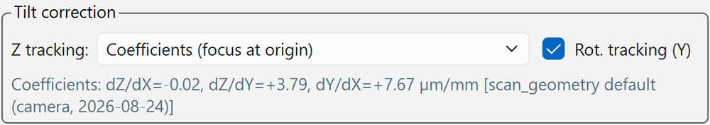
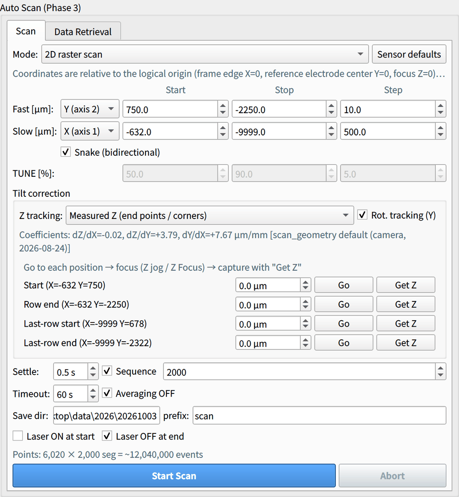

# 4. Auto Scan

Set the conditions in the [Scan] tab of the **auto scan panel** in the right column and run the scan.
All coordinates are entered in **µm relative to the logical origin** ([Sensor and coordinate system](../setup/sensor.md#logical)).

<figure markdown="span">
  ![[Scan] tab of the auto scan panel](../images/gui/scan-conditions.png){ width="560" }
  <figcaption>[Scan] tab of the auto scan panel (1D position scan, default range of the standard sensor)</figcaption>
</figure>

| Area | Contents | Details |
| --- | --- | --- |
| [Mode] and [Sensor defaults] | Scan type; reset the range to the defaults | [Modes](#mode), [Range](#range) |
| Rows for Fast, Slow and TUNE [%] | Start, stop and step. Rows that are not used are grayed out | [Range](#range) |
| "Tilt correction" group | Z tracking method, rotation tracking, current coefficients | [Tilt correction](#tilt) |
| Settle through Save dir / prefix | Acquisition settings for each point | [Acquisition settings](#acquisition) |
| Bottom | Estimated number of points, [Start Scan], [Abort] | [Running, progress and aborting](#run) |

## Before the scan

- [ ] [Find Origin](alignment.md#origin) is done ([Full Calibration](alignment.md#full-calibration) after remounting)
- [ ] The laser is at the standard conditions (1 MHz, TUNE manual 50 % via [★ Apply Standard Settings ★](connect.md#laser-on)) or at conditions matched with [TUNE optimization](tune.md)
- [ ] [★ Apply Standard Settings ★] has been applied to the scope (set channels, EXT trigger and timebase in the oscilloscope panel before the scan)
- [ ] The laser is ON (or [Laser ON at start] is checked)

## Modes { #mode }

| Mode | Use | Log tag |
| --- | --- | --- |
| **1D position scan** | Moves one fast axis. Example: across strips (Y) | `1dY`, `1dX`, etc. |
| **2D raster scan** | Scans an area with fast axis (Y) × slow axis (X). [Snake (bidirectional)] is ON by default | `2dYX` |
| **1D + TUNE (energy scan at each point)** | Combined scan of position on one axis × TUNE. TUNE is swept at each position (position is the outer loop, so the stage only moves when the position changes). When selected, the position step changes automatically to 50 µm | `1dYtune`, etc. |
| **TUNE scan (fixed position)** | Sweeps only TUNE at a fixed position | `tune` |

Axes that are not scanned stay at the current position at the start (Z follows the [Z tracking](#z-follow) method).

## Range { #range }

Specify [Start], [Stop] and [Step] for the fast and slow axes. The initial values are the per-sensor defaults; [Sensor defaults] restores them.

Default range for the standard sensor:

| Axis | Start → End | Step | Meaning |
| --- | --- | --- | --- |
| Fast Y | +750 → −2250 µm | 10 µm | Half a pitch outside C0 → half a pitch outside C5 |
| Slow X | −632 → −9999 µm | 500 µm | Readout-side end of the exposed area → beyond the far end (end gap) |

In the 2D raster scan, the default slow-axis X step of 500 µm is a coarse setting that spaces rows along the strip length.
For a fine area scan, change the step and check the estimated number of points and the duration.

The default range for pixel sensors is **600 × 600 µm from the pad corner (logical origin) in the −X and −Y directions, in 10 µm steps**
(fast axis Y: 0 → −600 µm, slow axis X: 0 → −600 µm; [Pixel sensors](../setup/sensor.md#pixel)).
With the standard 2×2 layout, the 4-pixel corner (−300, −300) is at the center of the range.

In modes that sweep TUNE, also specify the start, end and step of [TUNE [%]] (initial values 50 → 90 %, 5 %).

## Acquisition settings { #acquisition }

| Item | Default | Description |
| --- | --- | --- |
| [Sequence] segments | 2000 | Events per point (2000 seg/point = 2000 events/step) |
| [Settle] | 0.5 s | Wait time after a move |
| [Timeout] | 60 s | Maximum wait for one point's acquisition to finish |
| [Averaging OFF] | ON | **Do not uncheck.** Otherwise completion detection does not work |
| [Save dir] / [prefix] | Today's date folder / `scan` | Save directory on the scope and file name prefix |
| [Laser ON at start] | OFF | Turns the laser ON automatically at scan start |
| [Laser OFF at end] | ON | Turns an automatically enabled laser back OFF at the end or on abort |

The estimate line below shows the number of points and total events (e.g. `Points: 301 × 2,000 seg = ~602,000 events`).

!!! note "Manually enabled laser"
    A laser you turned ON manually stays ON after the scan. Press [Emission OFF (ld=0)] yourself when you are done.

## Tilt correction { #tilt }

Settings to follow the sensor tilt. The coefficients are the Full Calibration values of the current sensor (or manually entered values; for an uncalibrated standard sensor,
the values measured on 2026-08-24 in `scan_geometry.py`) and are shown below the fields ([Source of the coefficients](alignment.md#coefficients)).

{ width="560" }

The `[...]` after the coefficients is their source. Right after a Full Calibration, the date and time of that calibration should appear here. If the source is not what you expect, check [Sensor] in the toolbar.

### Rot. tracking (Y)

Shifts Y for each X, relative to the X scan start position, to follow the in-plane rotation dY/dX of the strips. The strip then appears at the same scan Y coordinate in every X row,
and even a 1D scan along the strip does not leave the strip (for the standard sensor, without correction the offset is about 72 µm over the full length).

### Z tracking { #z-follow }

Choose one of four ways to move Z to keep the focus (x, y are logical coordinates).

| Method | How Z is determined | When to use |
| --- | --- | --- |
| **Coefficients (focus at origin)** (default) | \(z = (dZ/dX)\,x + (dZ/dY)\,y\). The plane is fixed at the logical origin | Right after Find Origin. Z is the same regardless of the stage position at the start |
| Coefficients (focus at current pos.) | The plane with the same tilt is fixed at the current position at the start | When starting from a position where you focused manually (e.g. with [Z Focus](alignment.md#z-focus)) |
| Measured Z (end points / corners) | Interpolates linearly or bilinearly the focus Z measured at the start and end points (1D) or the four corners (2D) | For DUTs without calibrated coefficients, or when the calibration is doubtful. **Simple and reliable** |
| Off | Z does not move | E.g. when scanning Z itself |

#### Measured Z method procedure

<figure markdown="span">
  { width="520" }
  <figcaption>Measured Z method selected for a 2D raster scan (screen of an older version; the rows for the four corners appear in the current version as well)</figcaption>
</figure>

1. Select the Measured Z method in [Z tracking]; rows for the start and end points (the four corners in 2D) appear.
2. Press [Go] on each row to move to that XY position.
3. Focus with the Z jog or [Z Focus] (put the beam on silicon).
4. Press [Get Z] to take the value.

The values are absolute Z in logical coordinates, so they do not depend on the stage position at scan start.

## Running, progress and aborting { #run }

1. Press **[Start Scan]** to open the confirmation dialog. It shows **the number of points, the range of each axis, the Z travel, the Y shift and the save directory**; check that they are as intended before proceeding.
   If the Z of the first point is **30 µm or more** away from the current Z, a warning appears here.
2. At scan start, the following always runs automatically in this order.
    1. **Scope setup**: averaging OFF if ON → sequence setup → save setup
    2. **Laser setup** (automatic ON if [Laser ON at start] is checked)
    3. **Scan start**
3. At each point it proceeds: **move → settle → reset accumulation → SINGLE acquisition → wait for completion → save**.
4. Progress and remaining time are shown in the toolbar. If the screen mirror is running, you can also see the last acquired waveform at each point
   (the mirror pauses automatically only during each point's acquisition and resumes during moves and settling).
5. To stop, press **[Abort]** in the toolbar or the scan panel, or **[■ STOP ALL]** at the right end of the toolbar.
   On abort the stage stops and the scope goes to STOP. An automatically enabled laser is turned back OFF.

!!! tip "Check data quality on the first line"
    The beam radius is a few µm, so when in focus **the signal drops almost to 0 directly above an electrode and rises sharply at the electrode edge**.
    Check this on the first line of the scan (across the strips). If it does not drop to 0, or rises gradually, suspect defocus or a coordinate offset.

### Sequential numbering of saved files

The GUI (PC side) manages the sequential numbers of saved files. Each point is saved with a number such as `scan--00042`, so file names look like
`C2--scan--00042.trc` and always match the `index` column of the scan log.
In addition, the number of files in the scope-side folder is checked at each point, and **if it does not increase for 2 points in a row, the scan is aborted automatically** with an error
(a countermeasure for a case where the scope's built-in counter caused same-name overwrites and all points were lost).

## Output

| Output | Location |
| --- | --- |
| Waveforms | Scope disk `<scope_save_dir>\<year>\<YYYYMMDD>\scan_<datetime>_<tag>\C<n>--<prefix>--<number>.trc` (one file per point per CH) |
| Coordinate record (scan log) | PC side `logs/scan_<datetime>.csv` |

The datetime in the scan folder name is the same as in the PC-side scan log `scan_<datetime>.csv`; use it to match the two.
For the scan log format, see [Output files](../reference/files.md#scan-log).
Move the waveforms to the PC with the next step, [Data retrieval](data.md).

## Estimated duration

The time per point is set by the settle time and the acquisition and saving of 2000 sequence segments. The confirmation dialog and the toolbar show an estimate of the remaining time; use it as a guide.

!!! note "Reference: 2D scans in the analysis notes"
    Some 2D scans in the analysis notes (matome) took 1.7 h (BP) to 17 h (FS) to acquire. For long scans, also consider laser intensity drift (about 1.3 %/h).
