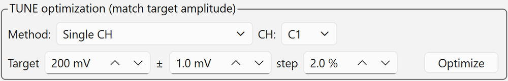

# 3. Laser Intensity Adjustment (TUNE Optimization)

!!! tip "Under standard conditions you do not need to change TUNE"
    As of 2026-11, at the standard repetition rate of 1 MHz, **TUNE manual 50 % is already adjusted to MIP-equivalent**.
    Pressing **[★ Apply Standard Settings (1 MHz / TUNE manual 50% = MIP equiv.) ★]** on the laser panel
    sends trigger internal, 1 MHz and TUNE manual 50 % in one go ([Start emission](connect.md#laser-on)). Normally measure with these settings.
    Run the TUNE optimization on this page when you change the repetition rate or the optical conditions, or when the amplitude is not as expected.

## What TUNE is

TUNE is the setting that determines the PiLAS pulse intensity. Note the direction: **0 % gives the strongest pulse and 100 % the weakest.**

- The relation between TUNE and signal amplitude changes with the **repetition rate**, the **camera light ON/OFF** and the optical conditions (alignment).
  Always turn the camera light **OFF** before adjusting.
  There is no fixed conversion, so match the amplitude by measurement every time.
- The optimal TUNE depends on the repetition rate. If you change the rate while keeping a manual TUNE tuned for another rate, the laser can drop below the lasing threshold and emit no light
  (TRIG OUT keeps coming, so the scope waveform keeps updating but stays flat). **Redo TUNE optimization after changing the rate.**
- For a quick check you can also set TUNE to **auto** (the controller uses calibration values for each rate).
  However, the standard condition is **manual 50 %**. For measurements where the pulse height must be matched, do not use auto; use the standard settings or TUNE optimization.
- The status line at the top of the laser panel (e.g. `Tune: man 50.0%`) shows the current TUNE mode and value.

## Using TUNE optimization

Use the "TUNE optimization (match target amplitude)" group in the laser panel.

<figure markdown="span">
  { width="560" }
  <figcaption>The "TUNE optimization" group in the middle of the laser panel (with [Method] set to Single CH)</figcaption>
</figure>

When [Method] is set to "Adjacent 2ch sum (MIP equivalent)", [CH] changes to a CH pair (e.g. C1+C2) and
the checkbox **[Move to the Y midway between the 2 strips]** (at the current X; returns afterwards) appears.
For the layout of the whole panel, see [GUI Layout](gui-overview.md#laser).

### Prerequisites

- [ ] Laser ON, oscilloscope connected, signal present with the EXT trigger
- [ ] Focus is set by [Find Origin](alignment.md#origin) or [Z Focus](alignment.md#z-focus)
- [ ] The beam is at a suitable position for the measurement (see the table below for each method)

### Methods

| Method | What is measured | Beam position | Default target |
| --- | --- | --- | --- |
| Single CH | Amplitude (PKPK) of the selected CH | On the silicon next to a strip (where the signal is clearly visible) | 200 mV |
| Adjacent 2ch sum (MIP equivalent) | Sum of the amplitudes of the CHs reading two adjacent strips \(A_\text{lead} + A_\text{sub}\) | **Midway between the 2 strips** (250 µm from the electrode for a 500 µm pitch) | **64 mV** |

The adjacent 2ch sum uses the property of AC-LGADs that \(A_\text{lead} + A_\text{sub}\) changes little when the beam moves between two strips
(the charge is only shared). Matching the sum at the strip midpoint **sets a MIP-equivalent signal level that is insensitive to position offsets**.
The 64 mV target comes from the DESY beam test (2026): 64 ± 1 mV at the strip midpoint (for reference, 77 mV for a single CH near a strip).

To re-match to MIP-equivalent, use "Adjacent 2ch sum (MIP equivalent)" with a target of 64 mV.
The standard TUNE manual 50 % (1 MHz) is also the value obtained by matching the sum at the strip midpoint to 64 mV with this method.

For pixel sensors, the pairs of adjacent pixel CHs and their midpoint positions are determined from the geometry in the sensor profile
([Registering sensors](../setup/sensor.md)).

### Procedure

1. Select the [Method].
    - Single CH: select the [CH].
    - Adjacent 2ch sum: select the CH pair (e.g. C1+C2). Only adjacent pairs, determined from the geometry in the sensor profile, are listed.
2. Check the [Target] amplitude, the tolerance [±] (default ±1 mV) and the coarse-sweep [step] (default 2 %). When you switch methods, the target resets to the value for that method.
3. For the adjacent 2ch sum, with **[Move to the Y midway between the 2 strips]** (default ON),
   the stage moves automatically, at the current X, to the Y midway between the electrode centers of the selected CH pair (Y and Z corrected for in-plane rotation and tilt), and returns to the original position after finishing or aborting.
   This requires the stage to be connected and the beam to be in focus at the current position. If OFF, it measures at the current position.
4. Press **[Optimize]** and press [Yes] in the confirmation dialog.

### What it does

1. **Coarse sweep**: lowers TUNE from 100 % (weak-light side) by [step] while measuring the amplitude (PAVA).
2. **Fine sweep**: sweeps the interval that crossed the target **in 0.5 % steps with many reads (median)**, and sets the TUNE closest to target ± tolerance.
3. **Verification**: measures the amplitude again at the set TUNE.

It takes from a few tens of seconds to 1 min. With the coarse sweep alone, the threshold crossing would be determined by read noise of ± a few mV, so a fine sweep is done.

### Result

- On success, "TUNE optimization done" is shown and TUNE is set. The progress and the [Abort] button are shown in the toolbar.
- If the target is never reached, **TUNE is set to the value with the maximum amplitude and a warning is shown** (decide whether the maximum output at that rate meets your requirements).
- If even TUNE 100 % (weakest) exceeds the target, a warning says that attenuation is needed.
- On abort or failure, **the original TUNE is restored** (the 2026-11-01 version fixed a bug where TUNE ended up at 100 % after an abort).
- After connecting, the input fields are synced to the laser's current values, so a TUNE changed by the optimization does not automatically return to 50 % even if you restart the GUI. To go back to the standard, press [★ Apply Standard Settings ★].
- The sweep curve is saved in `logs/tuneopt_<datetime>.csv` (phase = coarse / fine / verify, amplitude per CH, sum, spread).
  The lasing threshold at that rate can also be read from it.

## About MIP-equivalent intensity

In the analysis notes (matome), scans where the pulse height measured next to a strip is 0.7–1.3 times the beam Landau MPV (76 mV), i.e. 53–99 mV, are called "MIP-equivalent".
The laser has no Landau fluctuations, so the time resolution obtained at MIP-equivalent intensity is interpreted as a lower limit (floor) for MIPs.

## Sending TUNE by command

The GUI shows and accepts TUNE in %, but the units are different when you send it directly from the command field at the bottom of the laser panel.

| Command / response | Unit | Example |
| --- | --- | --- |
| `tune=` | 4 digits in 0.1 % units | `tune=0650` → 65.0 % |
| TUNE in the `mState?` response | 0.01 % units | `6500` → 65.00 % |
