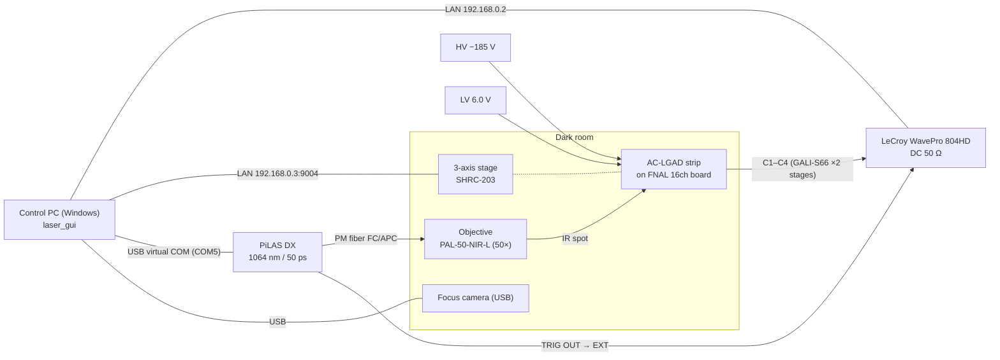

# Hardware

## Overall configuration

Light from the pulsed laser is guided into the dark room through a polarization-maintaining fiber and focused onto the sensor surface by an objective.
The readout board carrying the sensor sits on a 3-axis stage, and the stage moves to scan the illumination point.
Four strips, C1–C4, are read out through the on-board amplifiers into the DC 50 Ω inputs of the oscilloscope.
The time reference is the laser **TRIG OUT**, fed into the external trigger (EXT) of the oscilloscope. All devices are operated from the GUI on the control PC.

!!! note "Photos"
    Photos of the whole dark room and of the objective and readout board are in Fig. 2 of the analysis note matome.

    !!! question "To be confirmed"
        Whether the photos may be published on the public site.

## Equipment

| Device | Model / specification | Setting / measured value in this measurement |
| --- | --- | --- |
| Laser | NKT Photonics PiLAS DX (head NPIL1-106-40FC, controller EGI-D2-40). Wavelength 1064 nm (1063.4 nm in the test report), pulse width 50 ps, repetition rate adjustable up to 40 MHz, trigger jitter < 3 ps rms | Intensity set with TUNE [%] (0 % strongest, 100 % weakest) |
| Fiber | Polarization-maintaining single mode (PANDA type), FC/APC | — |
| Objective | OptoSigma PAL-50-NIR-L: 50×, NA 0.45, working distance 15.1 mm, focal length 4 mm. PAL-10-NIR-A (10×, NA 0.30) for coarse positioning | Spot σ ≲ 1.2 µm (in focus) |
| Stage | OptoSigma SHRC-203 (3 axes, 5-phase stepper motors), joystick JS-301 | 2 µm/pulse (X and Y confirmed on the hardware, Z unconfirmed) |
| Oscilloscope | Teledyne LeCroy WavePro 804HD (8 GHz, 12 bit) | 10 GS/s, sequence mode 2000 segments/point, 50 mV/div, DC 50 Ω |
| Sensor | HPK strip AC-LGAD: pitch 500 µm, metal electrode width 50 µm, exposed length 9318 µm, thickness 50 µm, n+ sheet resistance 1600 Ω/□, coupling capacitance 600 pF/mm². C1–C4 of the 6 strips (C0–C5) are read out | HV −185 V. Measured at dark-room temperature |
| Readout board | FNAL 16-channel board. Two stages of Mini-Circuits GALI-S66 per strip | LV 6.0 V |
| Focus camera | USB camera (manual-focus lens, no autofocus) | Read with OpenCV, device index 0 |
| Control PC | Windows, Python 3.10 or later. GUI laid out for a 16:9 wide monitor (EX-LDHU431DB) | IP 192.168.0.1 |

!!! question "To be confirmed"
    - Length of the signal cables (readout board → scope) (the documents say "1 m, to be confirmed")
    - Models of the HV and LV supplies
    - Whether the 10× objective is used in practice, and if so, how to switch

## Connections and addresses

The GUI controls 4 devices, and each panel on the screen corresponds to one device. The defaults are in `config.py`;
per-PC differences are overridden in `config_local.json` ([Control PC and software](software.md#config)).

| Panel | Device | Connection | Default address |
| --- | --- | --- | --- |
| Oscilloscope | LeCroy WavePro | LAN. VICP (default) or VXI-11. On connect, the `*IDN?` response is checked; if it fails, the other protocol is tried automatically | `VICP::192.168.0.2::INSTR` |
| Stage | SHRC-203 (3 axes) | LAN (TCP) or RS-232C. SHOT-compatible commands, CRLF delimiter | `192.168.0.3:9004` |
| Laser | PiLAS DX (EGI-D2-40) | USB virtual COM port (19200 baud, 8N1, CR terminated). Requires the FTDI VCP driver | `COM5` |
| Camera | Focus camera | USB. OpenCV (DirectShow preferred on Windows) | Device index `0` |

- Set the IP address of the control PC to **192.168.0.1**.
- The oscilloscope is synchronized by feeding the laser TRIG OUT into its external trigger (EXT).
- Scope data are retrieved to the PC over SSH/SFTP (user name `lcrydmin`; ask the administrator for the password).

### Readout channel map (standard sensor) { #readout-map }

| Scope CH | Board pad | Strip | Electrode center Y (logical coordinates) |
| --- | --- | --- | --- |
| C1 | J8 | C1 (reference CH) | 0 µm |
| C2 | J7 | C2 | −500 µm |
| C3 | J6 | C3 | −1000 µm |
| C4 | J5 | C4 | −1500 µm |

C0 (+500 µm) and C5 (−2000 µm) are outer strips that are not read out.
This map can be set per sensor profile and is shown in the GUI status bar and in the CH labels of the oscilloscope panel.

## Time reference { #time-reference }

Arrival times are measured from the trigger time of each scope segment (LeCroy TRIGTIME).
For the time resolution relative to TRIG OUT, laser synchronization and digitizer jitter add a floor common to all channels,
\(\sigma_\text{ref} \approx 12.5\) ps. This floor cancels in the time difference between two strips.

!!! warning "Do not use horiz_offset as the time origin"
    `horiz_offset` in the `.trc` file header is a random number within one sampling period; using it as the time origin
    adds about 29 ps of fake jitter. In ROOT-converted files, use the `trig_offset` branch.

## Setup performance (reference)

Measured values from the analysis note matome (all numbers are preliminary).

| Item | Value |
| --- | --- |
| Spot size | σ ≲ 1.2 µm (in focus, error-function fit to the metal edge). 1.3–1.5 µm when 6–10 µm out of focus |
| Laser intensity stability | Drift of about 1.3 %/h, ±2–3 % over the whole period |
| Baseline noise | RMS about 1.7 mV (S/N about 40) |
| Stage reproducibility | Residual RMS of straight-line fits to strip centers 1.8–2.6 µm |
| Common time floor | \(\sigma_\text{ref} = 12.5 \pm 0.5\) ps |
