# Hardware

## Overall configuration

Light from the pulsed laser is guided into the dark room through a polarization-maintaining fiber and focused onto the sensor surface by an objective.
The readout board carrying the sensor sits on a 3-axis stage, and the stage moves to scan the illumination point.
Four strips, C1–C4, are read out through the on-board amplifiers into the DC 50 Ω inputs of the oscilloscope.
The time reference is the laser **TRIG OUT**, fed into the external trigger (EXT) of the oscilloscope. All devices are operated from the GUI on the control PC.

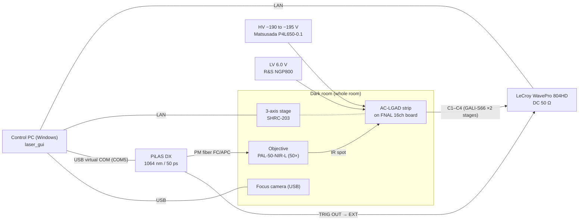

## Photos { #photos }

<figure markdown="span">
  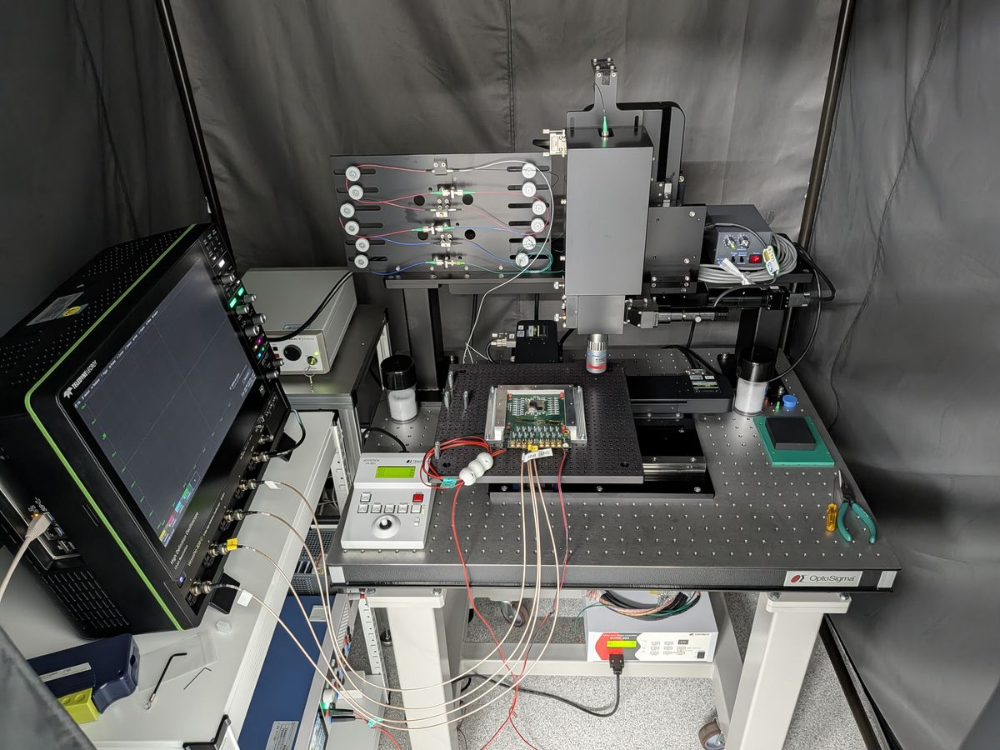{ loading=lazy }
  <figcaption>The measurement table inside the dark room (the whole room). Oscilloscope on the left, fiber and optics at the back center, stage on the right</figcaption>
</figure>

<figure markdown="span">
  { loading=lazy }
  <figcaption>Close-up of the measurement table. From left: oscilloscope, fiber and optics, objective and stage. The joystick JS-301 is in front</figcaption>
</figure>

<figure markdown="span">
  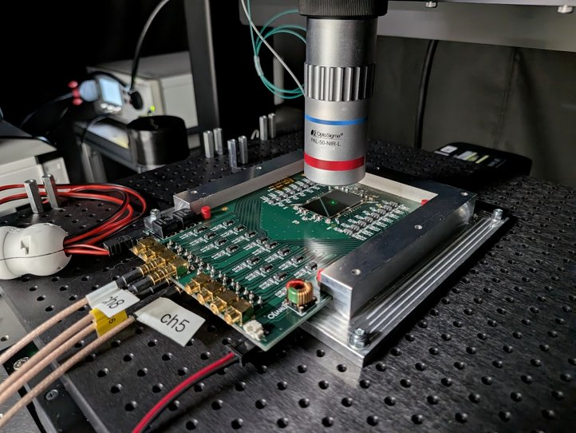{ loading=lazy }
  <figcaption>50× objective (PAL-50-NIR-L) and the readout board on the stage</figcaption>
</figure>

<figure markdown="span">
  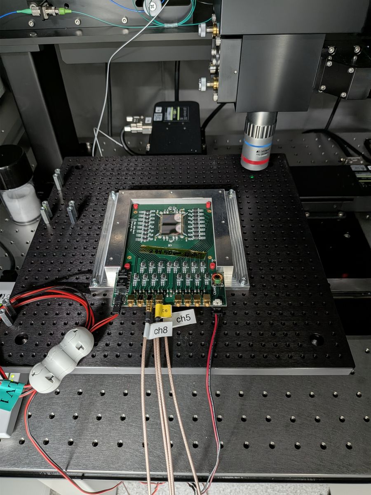{ loading=lazy }
  <figcaption>Readout board inserted in the fixing jig on the stage. The MCX–BNC cables in front carry CH labels (ch5, ch8, etc.)</figcaption>
</figure>

### Individual devices { #equipment-photos }

<figure markdown="span">
  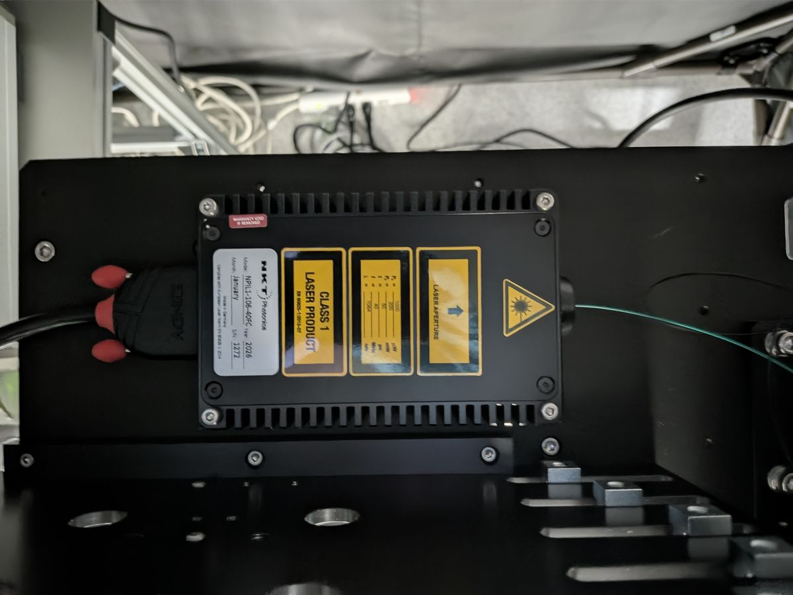{ loading=lazy }
  <figcaption>PiLAS laser head with the "CLASS 1 LASER PRODUCT" label</figcaption>
</figure>

<figure markdown="span">
  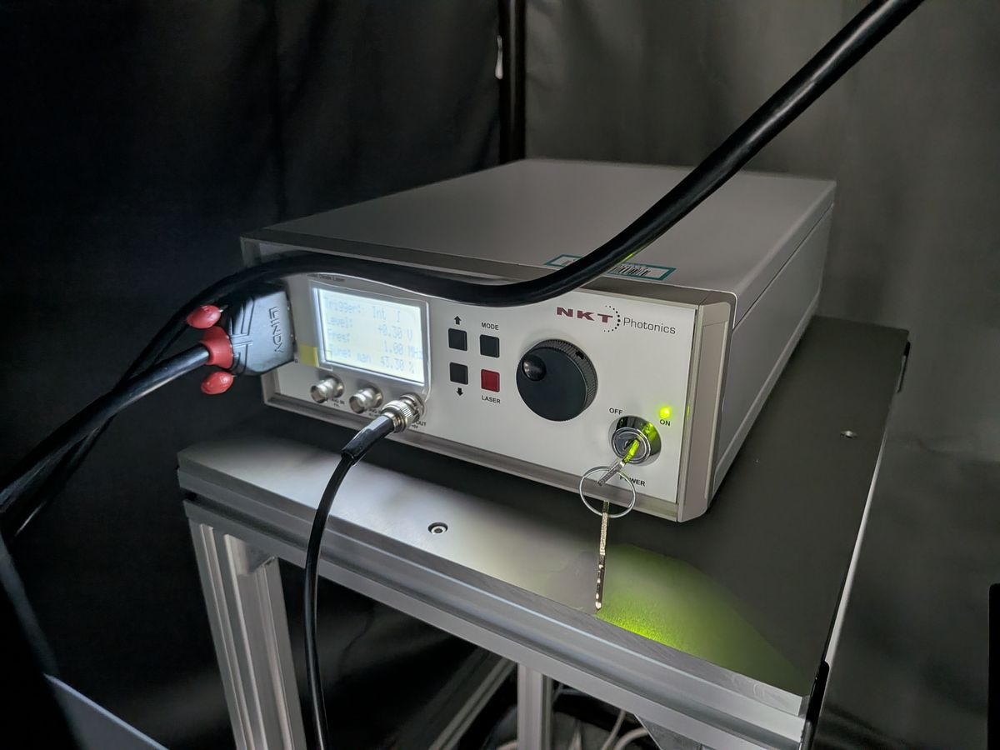{ loading=lazy }
  <figcaption>PiLAS controller (back left of the dark room). Switch the power ON with the key at the bottom right</figcaption>
</figure>

<figure markdown="span">
  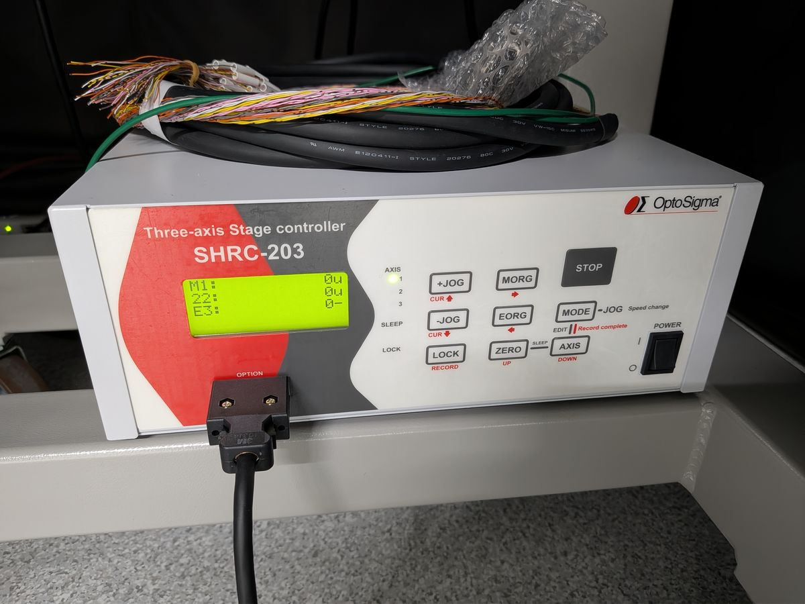{ loading=lazy }
  <figcaption>Stage controller SHRC-203 (under the workbench). The power switch is at the bottom right</figcaption>
</figure>

<figure markdown="span">
  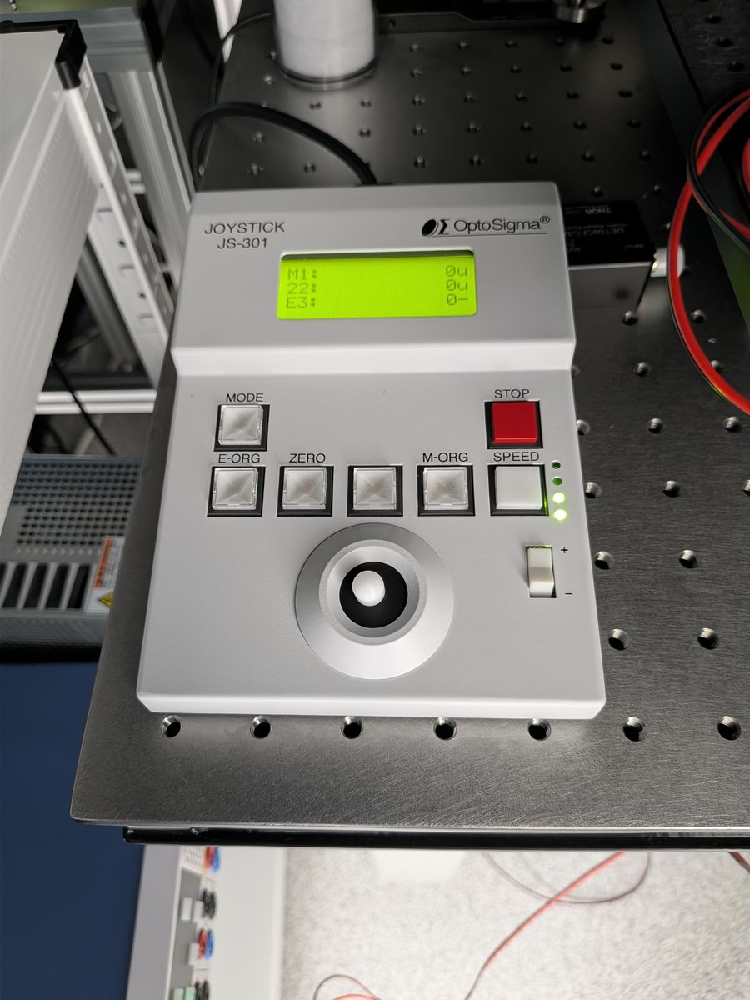{ loading=lazy }
  <figcaption markdown="span">Joystick JS-301. M-ORG can return it to the origin, but use [Mechanical Home (H:W)] in the GUI instead ([why](sensor.md#machine))</figcaption>
</figure>

<figure markdown="span">
  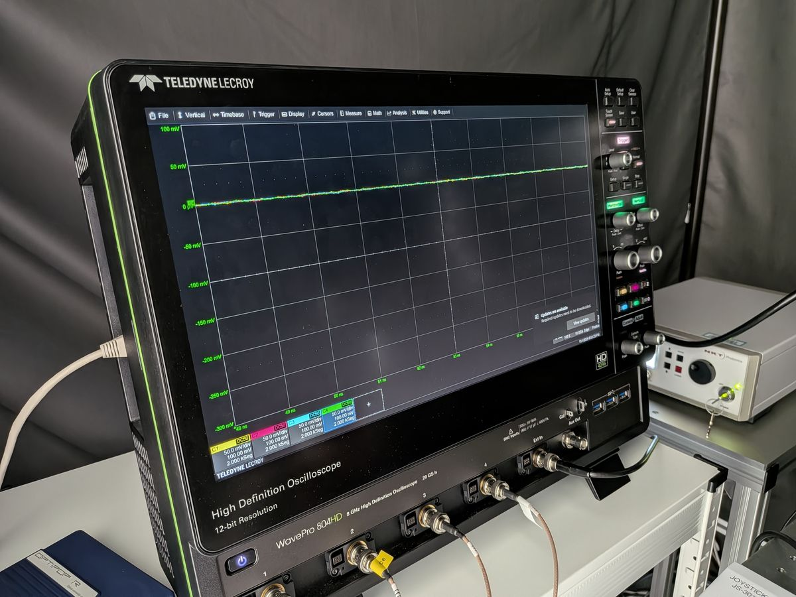{ loading=lazy }
  <figcaption>Oscilloscope LeCroy WavePro 804HD (left side of the dark room). The power button is at the bottom left</figcaption>
</figure>

<figure markdown="span">
  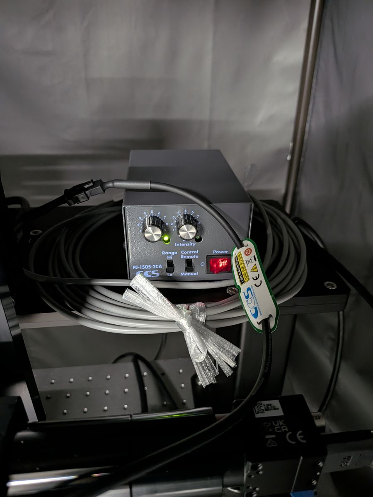{ loading=lazy }
  <figcaption>Visible light source for the camera. ON/OFF with the red switch at the bottom right. <strong>Always OFF during measurement</strong></figcaption>
</figure>

## Equipment

| Device | Model / specification | Setting / measured value in this measurement |
| --- | --- | --- |
| Laser | NKT Photonics PiLAS DX (head NPIL1-106-40FC, controller EGI-D2-40). Wavelength 1064 nm (1063.4 nm in the test report), pulse width 50 ps, repetition rate adjustable up to 40 MHz, trigger jitter < 3 ps rms | Intensity set with TUNE [%] (0 % strongest, 100 % weakest) |
| Fiber | Polarization-maintaining single mode (PANDA type), FC/APC | — |
| Objective | OptoSigma PAL-50-NIR-L: 50×, NA 0.45, working distance 15.1 mm, focal length 4 mm (a 10× PAL-10-NIR-A also exists, but it is not swapped in for use) | Spot σ ≲ 1.2 µm (in focus) |
| Stage | OptoSigma SHRC-203 (3 axes, 5-phase stepper motors), joystick JS-301 | 2 µm/pulse (X, Y and Z, confirmed on the hardware) |
| Oscilloscope | Teledyne LeCroy WavePro 804HD (8 GHz, 12 bit) | 10 GS/s, sequence mode 2000 segments/point, 50 mV/div, DC 50 Ω |
| Sensor | HPK strip AC-LGAD: pitch 500 µm, metal electrode width 50 µm, exposed length 9318 µm, thickness 50 µm, n+ sheet resistance 1600 Ω/□, coupling capacitance 600 pF/mm². C1–C4 of the 6 strips (C0–C5) are read out | HV −190 to −195 V (at a sensor temperature of 33 °C). No cooling |
| Readout board | FNAL 16-channel board. Two stages of Mini-Circuits GALI-S66 per strip. Mounted by inserting it into a fixing jig | LV 6.0 V |
| Signal cables | MCX–BNC, 75 cm long | Change the connection on the board side to the channels you want to see |
| LV supply | Rohde & Schwarz NGP800 series | 6.0 V (manual operation) |
| HV supply | Matsusada P4L650-0.1 | −190 to −195 V (manual operation, changed with temperature; limit −220 V) |
| Focus camera | USB camera (manual-focus lens, no autofocus) | Read with OpenCV, device index 0 |
| Control PC | Windows, Python 3.10 or later. GUI laid out for a 16:9 wide monitor (EX-LDHU431DB) | Fixed IP on the instrument LAN |

!!! note "Differences from the analysis note"
    The analysis note matome gives the cable length as "1 m (to be confirmed)" and the sensor temperature as "about 35 °C (not finalized)",
    but the actual values are a cable length of 75 cm and a sensor temperature of 33 °C.

## Power and switches { #power }

The devices can be powered on in any order. However, **bias the sensor last, in the order LV → HV**.

| Device | Location | Operation |
| --- | --- | --- |
| Laser (PiLAS controller EGI-D2-40) | Back left | **Turn the key to the right to switch ON.** Normally control emission from the GUI with [Emission ON (ld=1)] / [Emission OFF (ld=0)]. When working inside the dark room, use the **red button** on the unit |
| Stage controller SHRC-203 | Under the workbench | Switch at the bottom right of the unit |
| Visible light for the camera (illumination) | Upper right side | Switch at the bottom right of the unit. **Always OFF during measurement** |
| Oscilloscope | Left side of the dark room | Power button at the bottom left |
| LV supply (R&S NGP800) | Left side of the shelf below the oscilloscope | Button at the bottom left to switch ON → select CH1 → **OUTPUT button to turn the output ON (lights blue)**. Fixed at 6 V, current limit 1.0 A |
| HV supply (Matsusada P4L650-0.1) | Right side of the shelf below the oscilloscope | Switch for power ON/OFF → black button at the top to SET the HV → **red button to turn the bias ON**. The supply ramps up automatically. Limit −220 V, current limit 1.0 mA |

<figure markdown="span">
  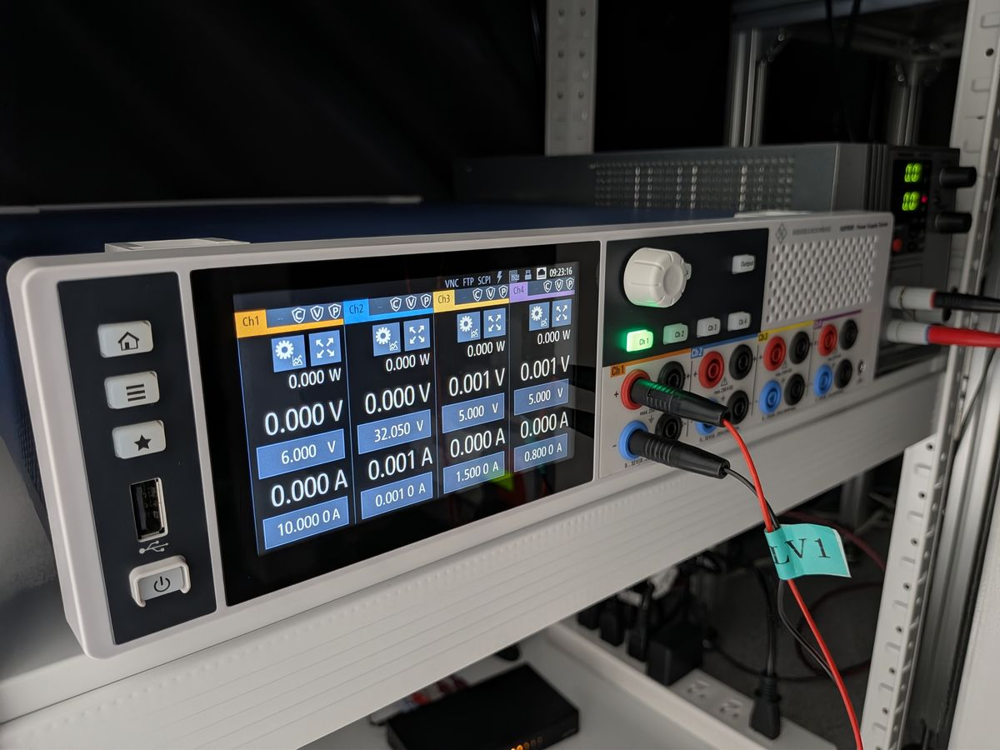{ loading=lazy }
  <figcaption>LV supply (R&S NGP800) with the output OFF</figcaption>
</figure>

<figure markdown="span">
  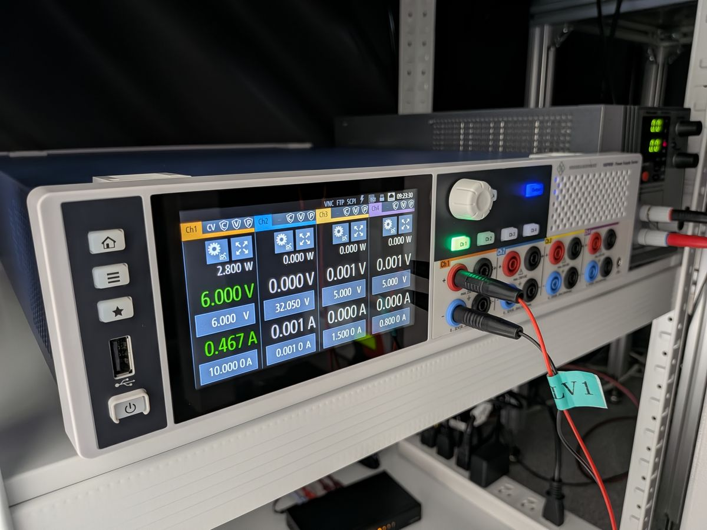{ loading=lazy }
  <figcaption>LV output ON (CH1: 6.000 V, about 0.47 A). The OUTPUT button lights blue</figcaption>
</figure>

<figure markdown="span">
  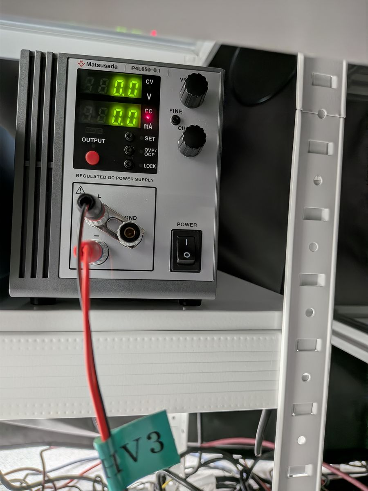{ loading=lazy }
  <figcaption>HV supply (Matsusada P4L650-0.1) with the bias OFF</figcaption>
</figure>

<figure markdown="span">
  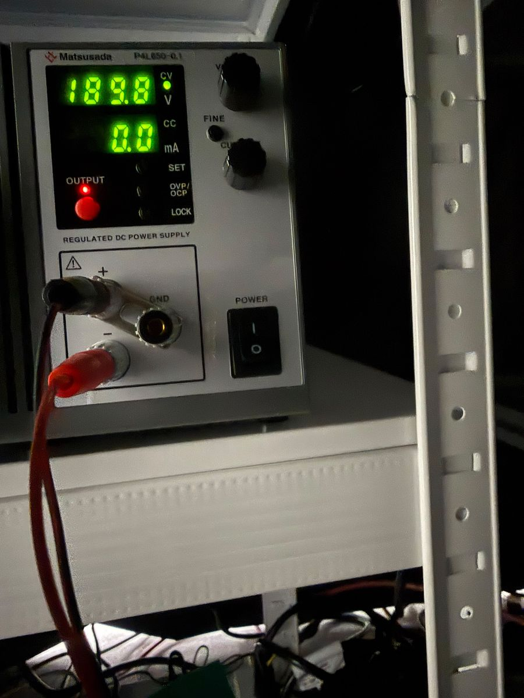{ loading=lazy }
  <figcaption>Bias ON (display 189.8 V; a current display of 0.0 mA is normal). Turn the bias ON with the red button at the bottom left</figcaption>
</figure>

**Typical currents**: the current limits are set to 1.0 mA (HV) and 1.0 A (LV). In normal operation the HV current is about 0.4–5 µA (depends on the bias voltage; the supply displays 0.0 mA)
and the LV current is about 0.450 A. If the readings are far from these, turn the bias OFF and find the cause.

**At the end**, turn off everything except the control PC (all devices in the dark room). Leave the control PC on for remote control.

## Swapping the readout board { #board-swap }

The readout board is mounted by inserting it into a fixing jig. For the first time we recommend having an experienced person mount it, but it is not a particularly dangerous task.

1. Set the laser to [Emission OFF (ld=0)] and turn the HV bias OFF. The supply ramps down automatically, so **wait until the HV display reads 0 V** before turning the LV OUTPUT OFF.
2. Disconnect the MCX–BNC cables.
3. The red fixing rods (the red pins at both ends of the board in the photo below) are hard to remove by hand, so **pull it out with thin pliers**. **Take care not to damage the sensor or the objective.**
4. Pull the board out of the fixing jig and insert the new board. Tape or the like stuck on the board makes it hard to insert, so peel it off.
5. Connect the MCX–BNC cables to the channels you want to see.
6. Select that sensor in the GUI ([register](sensor.md#new-sensor) it if it is new). The position changes after a swap, so run a [Full Calibration](../measurement/alignment.md#full-calibration).

<figure markdown="span">
  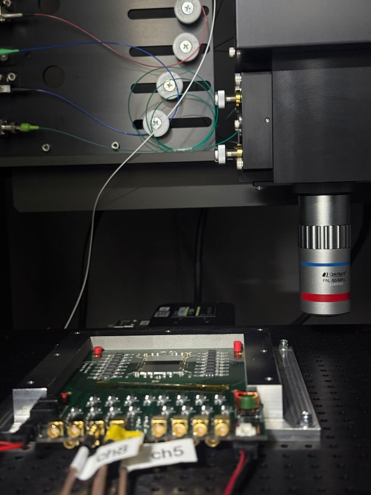{ loading=lazy }
  <figcaption>Board inserted in the fixing jig. The red pins at both ends are the fixing rods. The objective is directly above, so do not hit it when pulling them out</figcaption>
</figure>

<figure markdown="span">
  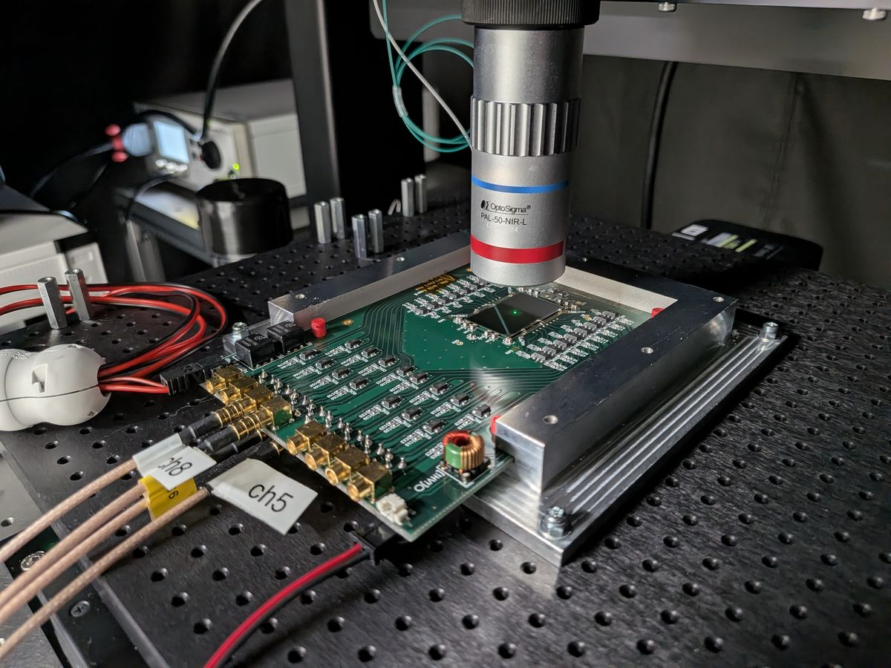{ loading=lazy }
  <figcaption>MCX connectors on the board and the MCX–BNC cables. Check the CH by the cable labels</figcaption>
</figure>

<figure markdown="span">
  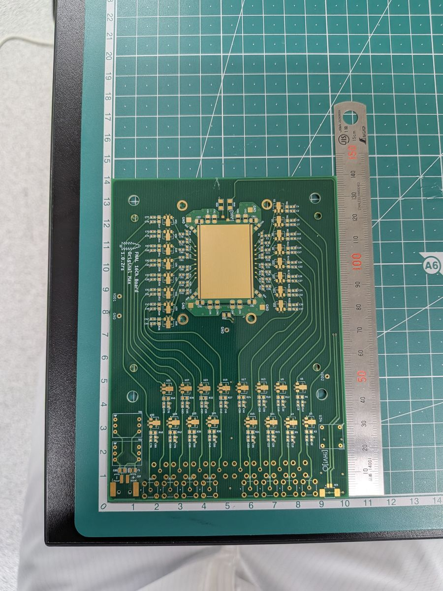{ loading=lazy }
  <figcaption>The readout board on its own (with a ruler for scale; graduations in cm)</figcaption>
</figure>

## Connections and addresses

The GUI controls 4 devices, and each panel on the screen corresponds to one device. The defaults are in `config.py`;
per-PC differences are overridden in `config_local.json` ([Control PC and software](software.md#config)).

| Panel | Device | Connection | Default address |
| --- | --- | --- | --- |
| Oscilloscope | LeCroy WavePro | LAN. VICP (default) or VXI-11. On connect, the `*IDN?` response is checked; if it fails, the other protocol is tried automatically | `VICP::<scope IP>::INSTR` |
| Stage | SHRC-203 (3 axes) | LAN (TCP) or RS-232C. SHOT-compatible commands, CRLF delimiter | `<stage IP>:<port>` |
| Laser | PiLAS DX (EGI-D2-40) | USB virtual COM port (19200 baud, 8N1, CR terminated). Requires the FTDI VCP driver | `COM5` |
| Camera | Focus camera | USB. OpenCV (DirectShow preferred on Windows) | Device index `0` |

- The IP addresses, ports and user names of the devices are in [Internal information](../internal.md#network) (password protected).
- The control PC and the devices are on the same LAN segment. Set the control PC's **subnet mask to 255.255.255.0**
  (with 255.255.255.255, even devices on the same segment are not reached directly and the stage stops responding; see [Troubleshooting](../reference/troubleshooting.md#connection)).
- The oscilloscope is synchronized by feeding the laser TRIG OUT into its external trigger (EXT).
- Scope data are retrieved to the PC over SSH/SFTP (user name: [Internal information](../internal.md#accounts); ask the contact person for the password).

### Readout channel map (standard sensor) { #readout-map }

| Scope CH | Board pad | Strip | Electrode center Y (logical coordinates) |
| --- | --- | --- | --- |
| C1 | J8 | C1 (reference CH) | 0 µm |
| C2 | J7 | C2 | −500 µm |
| C3 | J6 | C3 | −1000 µm |
| C4 | J5 | C4 | −1500 µm |

C0 (+500 µm) and C5 (−2000 µm) are outer strips that are not read out.
The signals go to the scope through MCX–BNC cables (75 cm); change the connection on the board side to the channels you want to see.
This map can be set per sensor profile and is shown in the GUI status bar and in the CH labels of the oscilloscope panel.

## Time reference { #time-reference }

Arrival times are measured from the trigger time of each scope segment (LeCroy TRIGTIME).
For the time resolution relative to TRIG OUT, laser synchronization and digitizer jitter add a floor common to all channels,
\(\sigma_\text{ref} \approx 12.5\) ps. This floor cancels in the time difference between two strips.

!!! warning "Do not use horiz_offset as the time origin"
    `horiz_offset` in the `.trc` file header is a random number within one sampling period; using it as the time origin
    adds about 29 ps of fake jitter. In ROOT-converted files, use the `trig_offset` branch.

## Setup performance (reference)

Measured values from the analysis note matome (all numbers are preliminary).

| Item | Value |
| --- | --- |
| Spot size | σ ≲ 1.2 µm (in focus, error-function fit to the metal edge). 1.3–1.5 µm when 6–10 µm out of focus |
| Laser intensity stability | Drift of about 1.3 %/h, ±2–3 % over the whole period |
| Baseline noise | RMS about 1.7 mV (S/N about 40) |
| Stage reproducibility | Residual RMS of straight-line fits to strip centers 1.8–2.6 µm |
| Common time floor | \(\sigma_\text{ref} = 12.5 \pm 0.5\) ps |
