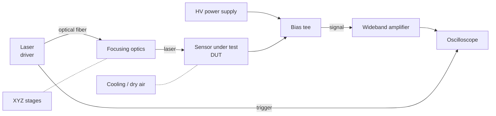

# Hardware

## Overview

A control PC drives the stages, HV power supply, oscilloscope and laser to automate the scans.

## Components and requirements

| Component | Role | Typical requirement |
| --- | --- | --- |
| Pulsed laser | Charge generation | Pulse width ≲ 100 ps, adjustable intensity, external trigger output |
| Optical fiber and focusing optics | Focusing the beam | Focus size of a few µm to a little over 10 µm |
| XYZ stages | Scanning the illumination point | Repeatability ≲ 1 µm |
| HV power supply | Sensor bias | Up to ~1 kV, current limit, leakage current monitoring |
| Bias tee | Separating DC bias and RF signal | Wideband, sufficient voltage rating |
| Wideband amplifier | Amplifying the current signal | Bandwidth ≳ 1 GHz, 50 Ω input |
| Oscilloscope | Recording waveforms | Bandwidth ≳ 1 GHz, ≳ 5 GS/s, averaging |
| Cooling system | Sensor temperature control | Peltier element with chiller, temperature and humidity sensors |
| Dark box | Light shielding and interlock | Blocks stray light, opening the door stops the laser |

!!! tip "Triggering"
    Trigger the oscilloscope on the **laser trigger output**, not on the sensor signal.
    Waveforms are then acquired at a fixed timing regardless of signal size, and the jitter is smaller.

## Our setup (to be filled in)

!!! note "TODO"
    Fill in the models and settings of the equipment actually in use.

| Component | Model | Notes |
| --- | --- | --- |
| Laser (red) | TODO | Wavelength, max. repetition rate |
| Laser (infrared) | TODO | Wavelength, max. repetition rate |
| Stages | TODO | Travel, resolution |
| HV power supply | TODO | Max. voltage, GPIB / USB address |
| Amplifier | TODO | Gain (dB), bandwidth |
| Oscilloscope | TODO | Bandwidth, sampling rate, IP address |
| Cooling | TODO | Lowest temperature, control method |

## Mounting the sensor

- Mount the sensor on a PCB with good RF properties (50 Ω transmission line for the signal).
- Keep the signal line and the wire bonds as short as possible.
- As a rule, ground the neighboring electrodes you do not read out (leaving them floating changes the weighting field).
- If there is a guard ring, record how it is connected.
