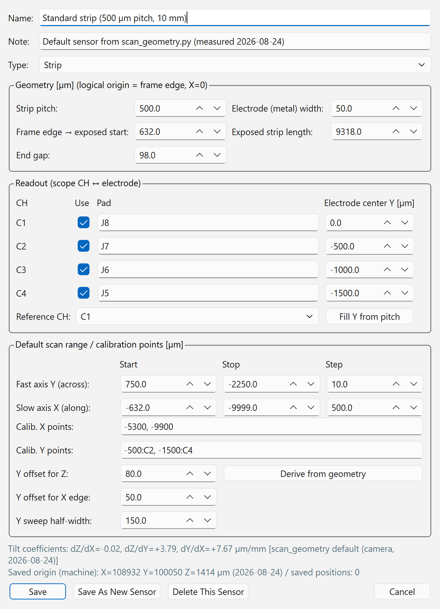
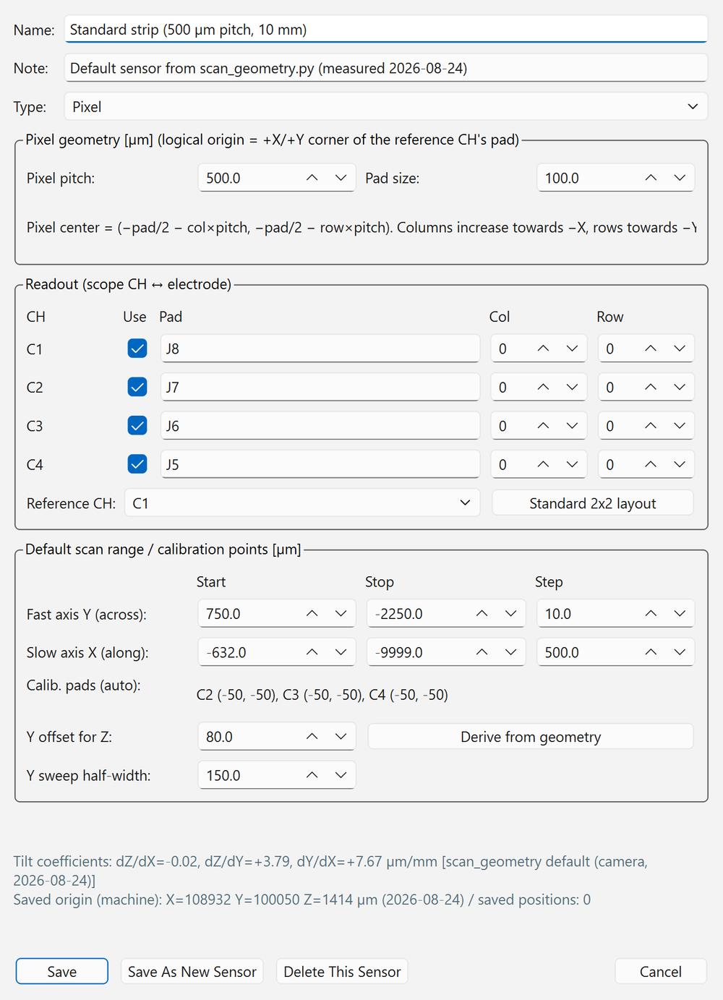

# Sensor and coordinates

Coordinates, scan ranges and origin finding in the GUI all work in the "logical coordinates of the sensor".
To use the GUI correctly, first understand how the coordinates are defined on this page.

There are two kinds of sensors, **strip type** and **pixel type**, selected with [Type] in the sensor editor (since the 2026-10-16 version).
The type changes the definition of the logical origin, the Find Origin and Full Calibration procedures, the default scan range, the stage's [Go to strip] / [Go to pixel], and the analysis type.
Unless otherwise noted, the following describes the standard sensor (strip type). For the pixel type, see [Pixel sensors](#pixel).

## Geometry of the standard sensor

The standard sensor is an HPK strip AC-LGAD with 500 µm pitch and about 10 mm length.
X runs along the strips, Y across the strips, and Z along the optical axis (focus).

Along X, starting from the edge of the sensor frame (GND) on the readout side, the regions are:

| Region | Width | Logical X [µm] |
| --- | --- | --- |
| ⓪ Between frame and strip metal end | 52 µm | 0 → −52 |
| ① Stub | 380 µm | −52 → −432 |
| ② Bonding pad region | 200 µm | −432 → −632 |
| ③ Exposed strip | 9318 µm | **−632 → −9950** |
| ④ End gap | 98 µm | −9950 → −10048 |
| Beyond | — | Next strip region (not read out) |

- **X = −10 mm is the middle of the end gap ④** (the boundary between two strip regions).
- Along Y, six strips C0–C5 are arranged at 500 µm pitch, and C1–C4 are read out ([Readout channel map](hardware.md#readout-map)).

## Logical coordinates and logical origin { #logical }

Positions shown on screen, Go-to moves and scan ranges are all in **logical coordinates** (in µm).

| Axis | Definition of the logical origin (0) | Direction |
| --- | --- | --- |
| X | Edge of the sensor frame (GND) | Strips extend to **negative** X |
| Y | Electrode center of the reference CH (C1 by default) | More negative for higher CH numbers (C2 = −500 µm …) |
| Z | In-focus position (focus) | — |

The logical origin is determined automatically by [origin finding](../measurement/alignment.md#origin), and the controller coordinates are reset to 0 at that position (R:W).
All stage moves are **relative moves (M:W)** to logical coordinates (absolute moves A:W are not used because they were buggy).

## Machine coordinates { #machine }

Machine coordinates are measured from the **mechanical origin (H:W)** and are shown below the logical coordinates on the stage panel.

- R:W resets the controller coordinates to 0, so the GUI accumulates "the machine coordinates of the logical origin" and
  saves them in `logs/stage_frame.json` (reset to 0 on H:W, and the previous coordinates are added on each R:W).
  This value is kept across GUI restarts.
- Tracking is lost if you do M-ORG from the joystick JS-301, restart the controller, or interrupt a homing; the panel then shows
  "Machine coordinates: unknown". Run [Mechanical Home (H:W)] from the GUI again.
- Machine coordinates can change with each M-ORG, so use them only **as a guide for coarse positioning**.

## Sensor tilt and correction coefficients { #tilt }

The sensor is mounted slightly tilted, so three coefficients are used to correct for it.

| Coefficient | Meaning | Default for the standard sensor |
| --- | --- | --- |
| dZ/dX | Tilt of the focal plane along X | −0.02 µm/mm (nearly flat) |
| dZ/dY | Tilt of the focal plane along Y | +3.79 µm/mm |
| dY/dX | In-plane rotation of the strips | +7.67 µm/mm |

Without the rotation correction, Y shifts by about 72 µm over the full strip length (about 9.4 mm).

- The screen display and the [Edit coefficients...] input use **µm/mm**; the keys in `sensors.json` and the scan log (`dzdx`, `dzdy`, `dydx`) use **µm/µm**.
- The coefficients are taken in this order of priority:
    1. Values saved in the sensor profile ([Full Calibration](../measurement/alignment.md#full-calibration) or manual input)
    2. For the standard sensor only, the measured values in `scan_geometry.py` (camera measurement, 2026-08-24)
    3. 0 for any other uncalibrated sensor
- The active coefficients and their source are shown both on the [Alignment] tab of the stage panel and in the [Tilt correction] box of the auto scan panel.

## Sensor dictionary (sensor profiles)

So that boards or sensors can be swapped without editing code, the information for each sensor is collected in one profile and
saved in `logs/sensors.json`. Switching with [Sensor] in the toolbar replaces the default scan range, tilt coefficients,
saved positions and the scope CH to readout pad map with those of that sensor.

| Item | Content |
| --- | --- |
| Name, note | Name shown in the list, and a free-text note |
| Type | Strip / Pixel |
| Geometry (strip) | Strip pitch, electrode (metal) width, offset from the frame edge to the start of the exposed strip, exposed strip length, end gap |
| Geometry (pixel) | Pixel pitch, bonding-pad size (the signal-free square; the ruler for Find Origin) |
| Readout | For each scope CH, used or not and the pad name; reference CH. Strip: electrode center Y (reference CH = 0). Pixel: pixel (column, row) |
| Default scan range | Start, stop and step of the fast axis Y and the slow axis X |
| Full calibration points | Strip: X points, Y points (in the form "Y:CH"), Y offsets for Z measurement and X-edge detection, half-width of the Y sweep. Pixel: pad centers of the readout pixels other than the reference (automatic), Y offset for Z measurement, half-width of the Y sweep |
| Tilt coefficients | dZ/dX, dZ/dY, dY/dX |
| Saved origin | Machine coordinates of the logical origin. Updated automatically on each origin finding |
| Saved positions | Name and coordinates (logical or machine coordinates) |

As of 2026-11-01, `sensors.json` on the control PC contains the following 7 profiles.

| Sensor (ID) | Type | Status / use |
| --- | --- | --- |
| Standard strip (500 µm pitch, 10 mm) (`strip500_std`) | Strip | Contains measured values (`scan_geometry.py`). Normally use this one |
| 4col (1000 µm pitch) (`4col_1000`) | Strip | **Template with unconfirmed dimensions except the pitch.** Correct them to measured values before use |
| Variable pitch (500 µm section) (`varpitch_500`) | Strip | Same as above |
| Standard strip 2x2 measurement (500 µm pitch, 10 mm) (`2x2_500_m_10_mm`) | Strip | Profile for the scan across 2 columns (the segment boundary) in the central region of the 2×2 segmented sensor (SEG scan `scan_20261008_151544_2dYX` in the analysis note matome, 5 µm rows) |
| pixel#3 2x2 measurement (`pixel_3_2x2`) | Pixel | Measurement of the HPK S16694 pixel sensor read out as 2×2 (2026-10-15). Created with an older version and migrated to the pixel type automatically when the 2026-10-16 version started |
| pixel#4 2x2 measurement (`pixel_4_2x2`) | Pixel | Measurement of pixel#4 of the same type read out as 2×2 |
| pixel#4 1x4 measurement (`pixel_4_1x4`) | Pixel | Measurement of 4 pixels of pixel#4 read out in one row (C1→C4 one pitch apart in the +X direction) |

The GUI's initial profiles (when it is first started on a new PC) are the first three above and the pixel-type template
"Pixel 2x2 (500 µm pitch, 100 µm pad)" (`pixel_2x2_500`, the layout of pixel#3 on 2026-10-15).

## Pixel sensors { #pixel }

For the pixel type, the **bonding pad** (a metal-covered square that gives no signal) is used as the ruler instead of the "frame edge and electrode center" of the strip type.

| Quantity | Definition |
| --- | --- |
| Logical origin | **The +X/+Y corner of the reference CH's pad.** The pad spans x, y ∈ [−pad size, 0] |
| Pixel center | Same as the pad center. Center of the pixel at (column, row) = (−pad/2 − column × pitch, −pad/2 − row × pitch) |
| Column, row | The reference CH is (0, 0). Columns increase by 1 toward −X, rows toward −Y |
| 4-pixel corner | (−pad/2 − pitch/2, −pad/2 − pitch/2) |
| Default scan range | 600 × 600 µm from the pad corner, in 10 µm steps |

In the standard 2×2 layout (pitch 500 µm, pad 100 µm), the C1 pad center is (−50, −50), C2 is the −X neighbor, C3 the −Y neighbor, C4 the diagonal neighbor,
and the 4-pixel corner is at (−300, −300) µm.

- The Find Origin and Full Calibration procedures also switch to the pixel versions ([Find Origin for pixel sensors](../measurement/alignment.md#pixel)).
- The move button in the [Positions] tab of the stage panel becomes [Go to pixel], which can move to "Beside pad (signal)", "Pad center (no signal)" and "4-pixel corner".
- The adjacent 2ch pairs and midpoint positions for TUNE optimization are also determined from this geometry.
- `sensor_type=pixel` is written in the scan log header, and the [Analysis] tab automatically selects the `pixel` analysis ([Analysis](../measurement/data.md#analysis)).
- The analysis (`tt_pixel.py`) detects the pad positions automatically from the amplitude, so a small offset of the origin does not change the analysis results.

### Registering a new DUT { #new-sensor }

=== "Strip type"

    <figure markdown="span">
      { width="460" }
      <figcaption>The standard strip opened in the editor</figcaption>
    </figure>

=== "Pixel type"

    <figure markdown="span">
      { width="460" }
      <figcaption>[Type] switched to Pixel (switched on the standard strip profile for illustration; columns and rows are still 0)</figcaption>
    </figure>

The bottom of the dialog shows the sensor's tilt coefficients and their source, the saved origin (machine coordinates), and the number of saved positions.
The screenshots were taken in simulation, so the numbers differ from the real setup.

1. Select a similar sensor with [Sensor] in the toolbar.
2. Press [Edit...].
3. Update [Name] and [Note], and select the [Type].
4. Update the geometry.
    - Strip: pitch, electrode width, frame edge → strip start offset, exposed length, end gap
    - Pixel: pixel pitch, pad size
5. Update the readout (use flag and pad name for each CH, reference CH).
    - Strip: electrode center Y. For equal spacing, use [Fill Y from pitch].
    - Pixel: (column, row) of each CH. For 2×2, [Standard 2x2 layout] fills in C1 (0,0), C2 (1,0), C3 (0,1), C4 (1,1).
6. Press [Derive from geometry] to regenerate the scan range and calibration points.
7. Press [Save As New Sensor]. To just fix an existing sensor, press [Save].

!!! note
    A sensor saved under a new name does **not inherit** tilt coefficients, saved origin or saved positions.
    Run a [Full Calibration](../measurement/alignment.md#full-calibration) first on a new sensor.

!!! tip "Matching the X origin to the real dimensions"
    Origin finding takes "the X edge where the signal disappears (boundary between pad region and exposed strip) + the design offset of 632 µm" as the frame edge.
    If the real dimensions differ from the design, adjust "Frame edge → exposed start" in the sensor editor.

