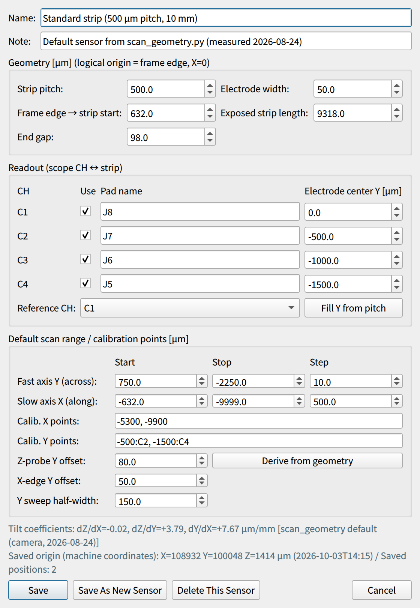

# Sensor and coordinates

Coordinates, scan ranges and origin finding in the GUI all work in the "logical coordinates of the sensor".
To use the GUI correctly, first understand how the coordinates are defined on this page.

## Geometry of the standard sensor

The standard sensor is an HPK strip AC-LGAD with 500 µm pitch and about 10 mm length.
X runs along the strips, Y across the strips, and Z along the optical axis (focus).

Along X, starting from the edge of the sensor frame (GND) on the readout side, the regions are:

| Region | Width | Logical X [µm] |
| --- | --- | --- |
| ⓪ Between frame and strip metal end | 52 µm | 0 → −52 |
| ① Stub | 380 µm | −52 → −432 |
| ② Bonding pad region | 200 µm | −432 → −632 |
| ③ Exposed strip | 9318 µm | **−632 → −9950** |
| ④ End gap | 98 µm | −9950 → −10048 |
| Beyond | — | Next strip region (not read out) |

- **X = −10 mm is the middle of the end gap ④** (the boundary between two strip regions).
- Along Y, six strips C0–C5 are arranged at 500 µm pitch, and C1–C4 are read out ([Readout channel map](hardware.md#readout-map)).

## Logical coordinates and logical origin { #logical }

Positions shown on screen, Go-to moves and scan ranges are all in **logical coordinates** (in µm).

| Axis | Definition of the logical origin (0) | Direction |
| --- | --- | --- |
| X | Edge of the sensor frame (GND) | Strips extend to **negative** X |
| Y | Electrode center of the reference CH (C1 by default) | More negative for higher CH numbers (C2 = −500 µm …) |
| Z | In-focus position (focus) | — |

The logical origin is determined automatically by [origin finding](../measurement/alignment.md#origin), and the controller coordinates are reset to 0 at that position (R:W).
All stage moves are **relative moves (M:W)** to logical coordinates (absolute moves A:W are not used because they were buggy).

## Machine coordinates { #machine }

Machine coordinates are measured from the **mechanical origin (H:W)** and are shown below the logical coordinates on the stage panel.

- R:W resets the controller coordinates to 0, so the GUI accumulates "the machine coordinates of the logical origin" and
  saves them in `logs/stage_frame.json` (reset to 0 on H:W, and the previous coordinates are added on each R:W).
  This value is kept across GUI restarts.
- Tracking is lost if you do M-ORG from the joystick JS-301, restart the controller, or interrupt a homing; the panel then shows
  "Machine coordinates: unknown". Run [Mechanical Home (H:W)] from the GUI again.
- Machine coordinates can change with each M-ORG, so use them only **as a guide for coarse positioning**.

## Sensor tilt and correction coefficients { #tilt }

The sensor is mounted slightly tilted, so three coefficients are used to correct for it.

| Coefficient | Meaning | Default for the standard sensor |
| --- | --- | --- |
| dZ/dX | Tilt of the focal plane along X | −0.02 µm/mm (nearly flat) |
| dZ/dY | Tilt of the focal plane along Y | +3.79 µm/mm |
| dY/dX | In-plane rotation of the strips | +7.67 µm/mm |

Without the rotation correction, Y shifts by about 72 µm over the full strip length (about 9.4 mm).

- The screen display and the [Edit coefficients...] input use **µm/mm**; the keys in `sensors.json` and the scan log (`dzdx`, `dzdy`, `dydx`) use **µm/µm**.
- The coefficients are taken in this order of priority:
    1. Values saved in the sensor profile ([Full Calibration](../measurement/alignment.md#full-calibration) or manual input)
    2. For the standard sensor only, the measured values in `scan_geometry.py` (camera measurement, 2026-08-24)
    3. 0 for any other uncalibrated sensor
- The active coefficients and their source are shown both on the [Alignment] tab of the stage panel and in the [Tilt correction] box of the auto scan panel.

## Sensor dictionary (sensor profiles)

So that boards or sensors can be swapped without editing code, the information for each sensor is collected in one profile and
saved in `logs/sensors.json`. Switching with [Sensor] in the toolbar replaces the default scan range, tilt coefficients,
saved positions and the scope CH to readout pad map with those of that sensor.

| Item | Content |
| --- | --- |
| Geometry | Strip pitch, electrode (metal) width, offset from the frame edge to the start of the exposed strip, exposed strip length, end gap |
| Readout | Pad name for each scope CH, electrode center Y (reference CH = 0), used or not, reference CH |
| Default scan range | Start, stop and step of the fast axis Y and the slow axis X |
| Full calibration points | X points, Y points (in the form "Y:CH"), Y offset from the electrode center for Z measurement and X-edge detection, half-width of the Y sweep |
| Tilt coefficients | dZ/dX, dZ/dY, dY/dX |
| Saved origin | Machine coordinates of the logical origin. Updated automatically on each origin finding |
| Saved positions | Name and coordinates (logical or machine coordinates) |

Three profiles are registered from the start:

| Sensor | Status |
| --- | --- |
| Standard strip (500 µm pitch, 10 mm) | Contains measured values (`scan_geometry.py`) |
| 4col (1000 µm pitch) | **Template with unconfirmed dimensions except the pitch.** Correct them to measured values before use |
| Variable pitch (500 µm section) | Same as above |

`sensors.json` on the control PC also has a 4th profile, "標準ストリップ 2x2 測定 (500 µm ピッチ, 10 mm)" (standard strip 2x2 measurement, ID `2x2_500_m_10_mm`).
This is the profile used for the scan across 2 columns (the segment boundary) in the central region of the 2×2 segmented sensor
(SEG scan `scan_20261008_151544_2dYX` in the analysis note matome, 5 µm rows).

### Registering a new DUT { #new-sensor }

{ width="420" align=right }

1. Select a similar sensor with [Sensor] in the toolbar.
2. Press [Edit...] (figure on the right).
3. Update the geometry (pitch, electrode width, frame edge → strip start offset, exposed length, end gap).
4. Update the readout (pad name, electrode center Y and use flag for each CH, reference CH).
   For equal spacing, use [Fill Y from pitch].
5. Press [Derive from geometry] to regenerate the scan range and calibration points.
6. Press [Save As New Sensor].

!!! note
    A sensor saved under a new name does **not inherit** tilt coefficients, saved origin or saved positions.
    Run a [Full Calibration](../measurement/alignment.md#full-calibration) first on a new sensor.

!!! tip "Matching the X origin to the real dimensions"
    Origin finding takes "the X edge where the signal disappears (boundary between pad region and exposed strip) + the design offset of 632 µm" as the frame edge.
    If the real dimensions differ from the design, adjust "Frame edge → strip start" in the sensor editor.

