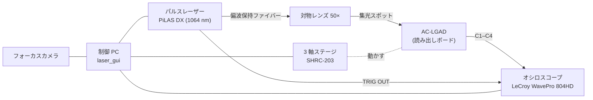

# Hiroshima TCT Wiki

広島大学 クォーク物理学研究室の **レーザー TCT (Transient Current Technique) スキャン装置** の使い方をまとめた Wiki です。
EIC-ePIC 実験のバレル TOF 用 **AC-LGAD ストリップセンサー** を、赤外パルスレーザーで µm 精度に走査して評価します。

**この Wiki だけを見て、初めての人でも装置を立ち上げ、制御 GUI でデータを取得できること** を目標にしています。

!!! info "English version"
    ページ右上の言語切替メニュー（:material-translate:）から英語版に切り替えられます。

## 装置の概要

- 制御はすべて制御 PC の **laser_gui**（PySide6 製の GUI）で行います。暗室に入らずに
  「照射位置決め → レーザー照射 → 波形の確認・保存 → データ回収 → 簡易解析」まで完結します。
- 詳しい構成は [システム構成](setup/hardware.md) を見てください。

## 初めて測定する人へ：読む順番

1. [安全上の注意](introduction/safety.md) — 必ず最初に読む
2. [システム構成](setup/hardware.md) と [センサーと座標系](setup/sensor.md) — 何をどこにつないでいて、座標がどう決まっているか
3. [制御 PC とソフトウェア](setup/software.md) — GUI の導入と、実機に触る前のシミュレーションモードでの練習
4. [測定の全体の流れ](measurement/procedure.md) — 電源投入からデータ取得・終了までのチェックリスト
5. 各ステップの詳細
    1. [起動と機器の接続](measurement/connect.md)
    2. [位置合わせ（原点出し・較正）](measurement/alignment.md)
    3. [レーザー強度の調整（TUNE 最適化）](measurement/tune.md)
    4. [自動スキャン](measurement/scans.md)
    5. [データ回収と簡易解析](measurement/data.md)

!!! tip "まずはシミュレーションモードで"
    `python main.py --simulate` で GUI を起動すると、全機器が疑似デバイスになり、原点出しからスキャンまでを
    実機なしで最後まで試せます。実機に触る前に一度通しで練習してください（[制御 PC とソフトウェア](setup/software.md#simulate)）。

## この Wiki の構成

- :material-school: **[はじめに](introduction/what-is-tct.md)**

    TCT の概要と、測定前に必ず読むべき安全上の注意。

- :material-atom: **[原理](principle/signal-formation.md)**

    信号形成、レーザーと照射方式、スキャンの種類（一般論）。

- :material-tools: **[セットアップ](setup/hardware.md)**

    広島の装置の機器構成、センサーの幾何と座標系、制御 PC の準備。

- :material-gesture-tap-button: **[測定](measurement/procedure.md)**

    GUI を使った測定の手順。起動から原点出し、TUNE 最適化、スキャン、データ回収まで。

- :material-chart-line: **[解析](analysis/waveform.md)**

    波形からの振幅・時間情報の求め方。

- :material-book-open-variant: **[リファレンス](reference/troubleshooting.md)**

    トラブルシューティング、標準設定値、出力ファイル、用語集、参考文献、Wiki の編集方法。

## クイックリンク

- 信号が出ない・GUI がエラーを出す → [トラブルシューティング](reference/troubleshooting.md)
- 標準のオシロ設定・バイアスなどを確認したい → [標準設定値一覧](reference/settings.md)
- ファイルがどこに保存されたか知りたい → [出力ファイル一覧](reference/files.md)
- Wiki に追記したい → [Wiki の編集方法](reference/contributing.md)

!!! note "情報の出典"
    この Wiki の装置固有の記述は、制御 GUI `laser_gui_v4` の README とソースコード、および解析ノート
    「500 µm ピッチ Strip AC-LGAD のレーザー TCT スキャン」（matome）の §3–4 に基づいています。
    まだ確認できていない項目は「要確認」の囲みで示しています。
