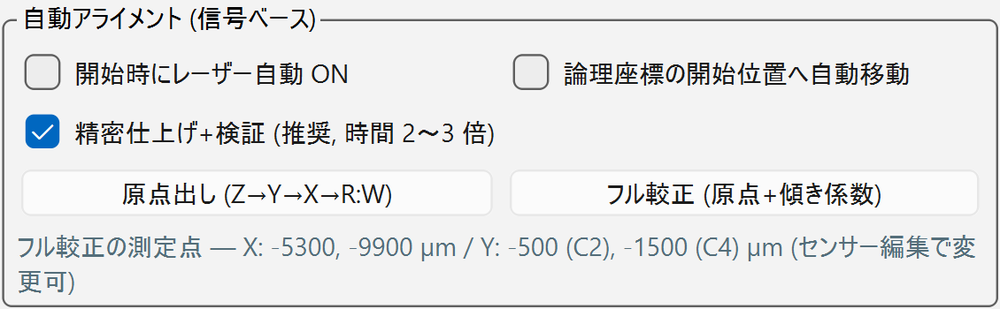

# 2. 位置合わせ（原点出し・較正）

スキャンの座標は [論理原点](../setup/sensor.md#logical)（外枠エッジ・基準電極中心・焦点）を基準にします。
このページでは、論理原点を決める **原点出し**、センサーの傾きを測る **フル較正**、焦点だけを合わせる **Z フォーカス** を説明します。
操作はすべてステージパネルの **[アライメント] タブ** で行います。

<figure markdown="span">
  ![ステージパネルの [アライメント] タブ](../images/gui/stage-align.png){ width="560" }
  <figcaption>ステージパネルの [アライメント] タブ</figcaption>
</figure>

| 場所 | 内容 | 説明 |
| --- | --- | --- |
| 上段（CH・Z範囲・step・方式・[Z フォーカス]） | 焦点だけを合わせる | [Z フォーカス](#z-focus) |
| 「自動アライメント (信号ベース)」の枠 | [原点出し] と [フル較正]、そのオプション | [原点出し](#origin)、[フル較正](#full-calibration) |
| 枠の下の灰色の文字 | フル較正の測定点（センサー編集で変更できる） | [フル較正](#full-calibration) |
| 最下段の「傾き補正係数」 | いま有効な dZ/dX、dZ/dY、dY/dX と、その出典 | [係数の出典](#coefficients) |

## 位置の物差しはレーザー信号そのもの

原点出しはカメラではなく、レーザーが作る信号そのものを位置センサーとして使います。
金属電極の上では光が通らず信号がゼロになり、その境目はビーム半径（数 µm）の鋭さで切れるので、
振幅プロファイルのディップとエッジから位置が µm の精度で分かります。振幅は PAVA（波形パラメータ）で読みます。

## 焦点の判定は「振幅最小」 { #focus }

!!! warning "焦点が合うほど振幅は小さくなる"
    焦点が合うほど局所的なキャリア密度が上がり、LGAD のゲインが抑制されて振幅が **下がります**（プラズマ効果）。
    そのため **振幅最小の Z を焦点** とします（2026-09-07 実測で確定。旧「振幅最大 = 焦点」は誤り）。

- 電極の直上ではデフォーカスしても振幅が 0 のままで谷が見えないので、Z の掃引は必ず **ストリップ横のシリコン上** で行います。
- ゲイン抑制の谷は浅い（数十 %）ので、谷が見つからないときは範囲を広げます。

## 原点出しの前に

- [ ] レーザーが ON で、オシロの EXT トリガーで信号が見えている（[開始時にレーザー自動 ON] で自動で ON にすることもできる）
- [ ] ビームが **基準ストリップ（C1）の上、露出部の読み出し側端から 50〜200 µm 内側** にある（[粗寄せ](connect.md#coarse)。±100 µm の精度で十分）
- [ ] ツールバーの [センサー] が正しい

## 原点出し { #origin }

**[原点出し (Z→Y→X→R:W)]** を押します。

{ width="560" }

| オプション | 既定 | 内容 |
| --- | --- | --- |
| [開始時にレーザー自動 ON] | OFF | レーザーが OFF でも自動で ON にして始める |
| [論理座標の開始位置へ自動移動] | OFF | 原点出し済みの状態（論理原点 = 外枠エッジ上で信号なし）から続けてやり直すときに ON。現在の論理原点を基準に開始位置（基準ストリップ上・端から 100 µm 内側）へ移動してから始める |
| [精密仕上げ+検証 (推奨, 時間 2〜3 倍)] | ON | 1 パルス刻みの精密掃引とフィット、R:W 後の検証 |

所要時間は、粗検出のみで約 2〜3 分、精密仕上げ+検証 ON で約 7〜12 分です。進捗はツールバーに出て、[中断] で止められます。

### 処理の中身

1. **Y の粗い掃引**：基準電極のディップを検出し、電極中心の当たりを付ける。
2. **Z の掃引**：電極から 80 µm 横のシリコン上で、振幅最小の Z（= 焦点）を探す。谷が掃引の端にかかったら自動で再センタリングする。
3. **Y の細かい掃引**：焦点が合った状態で電極中心 Y を確定する。
4. **X の掃引**：+ 側（パッド領域側）へ掃引し、信号が消えるエッジ（パッド領域と露出部の境界）を検出する。X エッジ検出は電極中心から 50 µm 横で行う。
5. **Z の再確認**：シリコン上で焦点を再確認する。
6. **R:W**：エッジから設計オフセット **+632 µm**（= 外枠 GND エッジ）へ全軸を負側から進入して、論理原点リセット (R:W) を行う。
   論理原点の機械座標を現在のセンサーに自動登録する。

**精密仕上げ+検証（既定 ON）** では、3〜5 の後に次を行います。

- 各量を **ステージの 1 パルス（2 µm）刻み・1 点 4 回読み（中央値）** で掃引し直し、モデルフィットでサブ µm に決める。
    - Y 電極中心：両エッジを個別に erf（誤差関数）でフィットして中点。2 回掃引して差を再現性として表示し、
      逆方向に 1 回掃引して昇順との差を **バックラッシュ推定** として表示する。
    - X 信号エッジ：同じ erf フィット（2 回 + 逆方向 1 回）。
    - Z 焦点：谷をローレンツ型 + 一次基線でフィットし、曲線の最小点を焦点とする。
- **検証**：R:W の後に電極中心 Y・信号エッジ X・焦点 Z を同じ精密掃引で再測定し、残差が 1 パルス以上の軸があれば補正して R:W をやり直す（最大 2 回）。

### 結果の確認

完了ダイアログに、最終残差、バックラッシュ推定、フィット誤差が出ます。測定ログに記録してください。

- 1 µm 未満の残差は 2 µm パルス格子の丸め残りで、これ以上は詰められません。
- 全掃引の生データは `logs/alignment_<日時>.csv` に残ります。

!!! note "カメラで決めた原点との差"
    信号ベースの測定自体は 1 µm 以下で自己整合しています（2026-10-05 の実機ログ解析）。
    カメラの十字線で決めた原点と数 µm 違うのは、十字線とレーザースポットのずれ、パッド端→外枠端の設計値 632 µm と実寸の差、
    進入方向（バックラッシュ）といった **基準の定義差** によると考えられます。

## フル較正 { #full-calibration }

**センサーを載せ替えたとき・治具を変えたとき** は、原点出しの代わりに **[フル較正 (原点+傾き係数)]** を実行します。
所要は粗で約 8〜12 分、精密で約 15〜25 分です。

原点出しに続けて、標準センサーでは次の点で電極中心と合焦 Z を実測します。

| 測定点 | 求めるもの |
| --- | --- |
| X = −5.3 mm と −9.9 mm | 電極中心 Y と焦点 Z → dY/dX（回転）、dZ/dX |
| C2 と C4 の電極（Y = −500, −1500 µm） | 焦点 Z → dZ/dY、隣接電極の間隔 |

結果の係数は **現在のセンサープロファイルに保存** され、履歴は `logs/sensor_calibration_<センサーID>_<日時>.json` に残ります。
結果のダイアログには、隣接電極の間隔の実測値と直線フィットの残差が出ます。

!!! warning "結果を鵜呑みにしない"
    Z は 2 µm 刻みでしか決まらず、谷も浅いので、**Z の残差が数 µm を超えるとき** や、**係数が前回から大きく変わったとき** は、
    再実行するか、スキャンの Z 追従を「実測 Z」方式にしてください（[自動スキャン](scans.md#z-follow)）。

測定点・オフセットは現在のセンサープロファイルから来ます。[フル較正] ボタンの下に、いまのセンサーの測定点が灰色の文字で出ています。
標準以外のセンサーでは、センサー編集で測定点を確認してください。

## ピクセル型センサーの原点出し・フル較正 { #pixel }

ツールバーの [センサー] で **ピクセル型** のプロファイルを選ぶと、同じ [原点出し] と [フル較正] ボタンの手順が自動でピクセル用に切り替わります。

- **開始位置**：ビームを **基準 CH のボンディングパッドの上、またはパッドから ±50 µm 以内** に置きます（ストリップ型の「端から 50〜200 µm 内側」とは違います）。
- **論理原点**：基準 CH のパッドの **+X/+Y 側の角** です。座標の定義は [センサーの登録](../setup/sensor.md#pixel) を見てください。

| | ストリップ型 | ピクセル型 |
| --- | --- | --- |
| 物差し | 電極（信号ゼロの線）と、露出部の端 | ボンディングパッド（信号ゼロの正方形） |
| 原点出し | Y 掃引 → Z → Y 精密 → X エッジ → R:W | パッドの **Y ディップ** → パッド横のシリコン上で **Z（振幅最小）** → パッドの **X ディップ** → パッドの角で R:W |
| 精密仕上げ+検証 | あり | あり |
| フル較正 | X 2 点と隣の電極で電極中心と Z を実測 | **他の読み出しピクセルのパッド中心** で同じ測定をして、平面フィット（dZ/dX、dZ/dY）、行方向の dY/dX、ピッチを確認 |

!!! warning "ピクセルのフル較正は実機で未実行"
    2026-11-01 時点で、ピクセル型の原点出しとフル較正は模擬センサーで 1 パルス以内に合うことを確認済みですが、**実機ではまだ実行していません**。
    結果は前回値やカメラでの目視と比べ、おかしければ使わないでください。
    フル較正のレバーアームは 1 ピッチ（500 µm 程度）しかないので、係数は粗い目安です。
    なお、ピクセル解析はパッドの位置を振幅から自動検出するので、原点が多少ずれていても解析結果は変わりません。

## 係数の出典 { #coefficients }

スキャンの傾き補正に使う係数は、次の順で決まります。

1. センサープロファイルに保存された係数（フル較正、または [係数を手動入力...]）
2. 標準センサーだけ、`scan_geometry.py` の既定値（2026-08-24 のカメラ実測）
3. それ以外の未較正センサーは 0（補正なし）

いま有効な係数と出典は、[アライメント] タブ最下段と、自動スキャンパネルの「傾き補正」欄の両方に出ます。
較正・手動入力・センサー切り替えのたびに更新されます。上の画面例の `[scan_geometry 既定 (2026-08-24 カメラ実測)]` は、
標準センサーをまだフル較正していない状態です。

## 係数を手動で入力する

[係数を手動入力...] で dZ/dX、dZ/dY、dY/dX を µm/mm 単位で入力できます。入力値はセンサープロファイルに保存され、
履歴は `logs/sensor_calibration_*.json` に残ります。

## Z フォーカス（焦点だけを合わせる） { #z-focus }

現在の XY 位置で Z だけを掃引して焦点へ移動します。通常は原点出しがこの処理を含むので、主に
スキャンの [実測 Z 方式](scans.md#z-follow) の端点合わせや、手動で焦点を合わせ直すときに使います。

1. レーザー ON、ビームを **ストリップ横のシリコン上**（信号がはっきり見える位置。電極直上は不可）に置く。
2. [CH]、[Z範囲 ±]（既定 ±20 µm）、[step]（既定 2 µm = Z の分解能）、方式（既定「振幅最小 (焦点)」）を選ぶ。
3. **[Z フォーカス]** を押す。下から一方向に掃引し（バックラッシュ対策）、谷の中心の Z へ自動で移動する。約 20〜30 秒。
4. そのままスキャンを始めるときは、Z 追従を「較正係数 (現在位置で合焦)」にすると、この Z を基準面として全域に展開します（[Z 追従](scans.md#z-follow)）。

実行中はオシロのシーケンスが OFF、トリガーが NORM に切り替わります（スキャン開始時に設定し直されるので、戻す必要はありません）。

- 掃引カーブは `logs/autofocus_<日時>.csv` に残ります。
- 「谷を特定できない」と出たら、範囲を ±30〜50 µm に広げるか、ビームの位置を置き直して再実行します。
- 中断・エラー時は元の Z に戻ります。

## うまくいかないとき

| メッセージ | 対処 |
| --- | --- |
| 「明確なディップがありません」「明確なエッジがありません」 | ビームが基準ストリップ上で端から 50〜200 µm 内側にあるか、レーザーが ON か、信号が見えているかを確かめて再実行する |
| 「谷が浅すぎます」・谷を特定できない | Z 範囲を ±30〜50 µm に広げる、カメラで粗くフォーカスを合わせてから再実行する |

中断・エラー時は、R:W 前なら開始位置へ、R:W 後なら原点 (0, 0, 0) へ戻ります。
