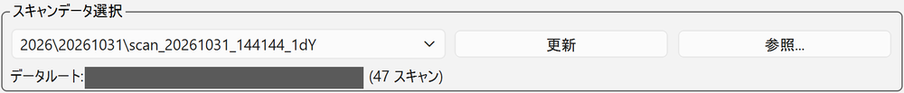
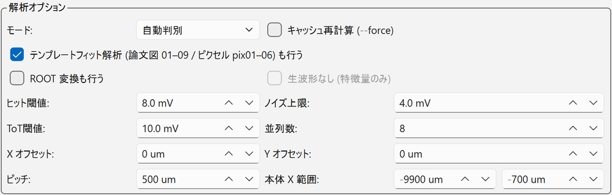

# 5. データ回収と簡易解析

## データ回収（オシロ → PC） { #transfer }

スキャンの波形は、まずオシロ本体のディスクに保存されます。PC へ移すには、自動スキャンパネルの **[データ回収] タブ** を使います。

<figure markdown="span">
  ![[データ回収] タブ](../images/gui/scan-transfer.png){ width="520" }
  <figcaption>自動スキャンパネルの [データ回収] タブ（回収元と保存先のパスは伏せています）</figcaption>
</figure>

上段の「回収元」に、オシロ側の保存先（`<scope_save_dir>\<年>\<日付>`）が表示されます。

### 手順

1. [日付 (YYYYMMDD)] を指定する（既定は当日。過去の日付も指定できる）。
2. [PC側保存先] を確認する（既定は GUI フォルダの隣の `data`）。
3. 必要なら [転送後にオシロ側を削除] にチェックを入れる（既定 **OFF**、下記）。
4. **[転送開始]** を押す。
5. SSH のパスワードを聞かれるので入力する（ユーザー名は [内部情報](../internal.md#accounts)。パスワードは問い合わせ先に聞く）。
   パスワードは保存されず、転送のたびに入力します（同じセッション中は前回の値が入っています）。

オシロ側の `<scope_save_dir>\<年>\<YYYYMMDD>` フォルダが丸ごと、SSH/SFTP で PC 側の `<transfer_dest_dir>\<年>\<YYYYMMDD>` へコピーされます。

### 動作の詳細

- **重複スキップ**：PC 側に同名・同サイズのファイルがあれば自動でスキップします。スキャンフォルダ内の全ファイルが回収済みなら
  「回収済みフォルダ n 個をスキップ」と報告されます。**途中で止めても、再実行すればよい** です。
- **競合**：同名で **サイズが違う** ファイルは上書きせず、「競合」として報告します。
- **検証**：転送後にファイルサイズを照合します。
- **削除**：[転送後にオシロ側を削除] を ON にすると、エラー・競合・中断が 1 件もなく、全ファイルのサイズ検証に成功した場合に限って、
  オシロ側の元ファイルを消し、空フォルダを片付けます（オシロのディスク容量の確保）。
- 結果（パス、サイズ、状態、削除の有無）は `logs/transfer_<日時>.csv` に残ります。
- **スキャンの実行中は転送できません**（GUI 上で排他）。オシロのオートセーブ動作中の転送も避けてください。

!!! tip "ターミナルからの回収"
    GUI の回収は、ターミナルで `scp -r` でオシロからコピーするのと同じ SSH/SFTP プロトコルです（コマンドは [内部情報](../internal.md#scope-scp)）。

## NAS へのバックアップ { #backup }

制御 PC へ回収したデータは、NAS にバックアップします。制御 PC のターミナルで `scp -r` を使ってコピーします。

```bash
scp -r "<回収したデータのフォルダ>" <NAS のユーザー>@<NAS のアドレス>:<NAS の保存先>/<年>/
```

- NAS のアドレス・ユーザー名・保存先と、実際のコマンド例は [内部情報](../internal.md#nas)（パスワード付き）にあります。
- 年が変わったら、コピー先の年のフォルダを合わせます。
- パスワードは問い合わせ先に聞いてください（制御 PC にメモがあります）。

!!! tip "オシロ側のデータを消してよいとき"
    オシロのディスク容量が少なくなったとき、または NAS への移動が完了したときに、オシロ側のデータを消します
    （[転送後にオシロ側を削除] を使うか、オシロ本体で削除する）。
    **消してよいのは、PC への回収が終わったデータだけ** です。容量が足りなくても、未回収のスキャンは先に [転送開始] で回収してから消してください
    （[転送後にオシロ側を削除] は、全ファイルのサイズ検証に成功した場合にしか消さないので安全です）。

## 簡易解析（[解析] タブ） { #analysis }

取得直後にデータの健全性を確かめるための簡易解析です。メインウィンドウの **[解析] タブ** で実行します。
解析は別プロセスで走るので、**測定中でも実行できます**。

<figure markdown="span">
  ![[解析] タブ](../images/gui/analysis-tab.png)
  <figcaption>メインウィンドウの [解析] タブ（解析を始める前。左が操作欄、右が図の表示欄）</figcaption>
</figure>

ウィンドウ上部の [制御] / [解析] のタブで切り替えます。左側の上から「スキャンデータ選択」「解析オプション」、
[解析開始] [中断] [結果フォルダを開く] と進捗バー、実行ログの欄が並び、右側に結果の図が出ます。

### 手順

1. 「スキャンデータ選択」の一覧から、回収済みのスキャンを選ぶ。

    { width="640" }

    一覧は `<年>\<日付>\scan_<日時>_<タグ>` の形で、[データルート]（回収先 `data` フォルダ）の下にあるスキャンが並びます（右の括弧に件数）。
    回収したばかりのスキャンが出ないときは [更新]、別の場所のフォルダは [参照...] で選びます。

2. 「解析オプション」を確認する。通常は既定のままでよいです。

    { width="640" }

    | 項目 | 既定 | 内容 |
    | --- | --- | --- |
    | [モード] | 自動判別 | 解析の種類。スキャンログから自動で決まる。手動で指定もできる |
    | [キャッシュ再計算 (--force)] | OFF | 縮約キャッシュ（`reduced.npz`）とテンプレートフィット解析を作り直す |
    | [テンプレートフィット解析 (論文図 01–09 / ピクセル pix01–06) も行う] | **ON** | 2dYX と pixel のとき、簡易解析に続けてテンプレートフィット解析を走らせる（[下記](#template)）。外すと簡易解析の図だけ |
    | [ROOT 変換も行う] | OFF | `.trc` を 1 つの ROOT ファイルにまとめる |
    | [生波形なし (特徴量のみ)] | OFF | ROOT 変換のときだけ選べる。生波形を入れずに軽くする |
    | [ヒット閾値] / [ノイズ上限] / [ToT閾値] | 8.0 / 4.0 / 10.0 mV | hit の下限、ノイズ上限、ToT 閾値 |
    | [並列数] | 8 | 縮約の並列数 |
    | [X オフセット] / [Y オフセット] | 0 µm | ログ座標 → センサー座標のオフセット。**2026-09-07 より前のスキャンは X に −632** |
    | [ピッチ] | 500 µm | ストリップピッチ |
    | [本体 X 範囲] | −9900 〜 −700 µm | 長さ方向のフィットと代表値に使う X の範囲 |

3. **[解析開始]** を押す。進捗バーと実行ログが表示され、[中断] で止められる。
4. 終わると右側に図が表示され、右上の [図] の欄で切り替えられる。[結果フォルダを開く] で出力先が開く。

スキャンの種類は、スキャンログから自動で判別されます。

| 種類 | 解析コード | 主な出力 |
| --- | --- | --- |
| 1dX（ストリップに沿う） | `analyze_1dx.py` | 振幅・立ち上がり・ジッター・時間分解能・長さ方向の伝搬 |
| 1dY（ストリップを横切る） | `analyze_1dy.py` | 振幅・立ち上がり・ジッター・位置分解能・時間分解能・横方向の伝搬速度 |
| 1dZ（フォーカス） | `analyze_1dz.py` | 最適 Z（`best_z.txt`） |
| 2dYX（X × Y） | `analyze_2dyx.py` | 上記すべて（マップ、ギャップ内、長さ方向） |
| tune（位置固定で強度掃引） | `analyze_tune.py` | MIP 相当（波高 60–75 mV）の TUNE、σt 対振幅 |
| 1d_tune（位置 × 強度） | `analyze_1d_tune.py` | σt 対振幅、位置分解能の強度依存 |
| pixel（ピクセル型の 2D） | `analyze_pixel.py` → `tt_pixel.py` | 振幅マップ、振幅分布、立ち上がり、ジッター、2/3/4 ピクセル合成の時間分解能・位置分解能、伝搬（pix01–06） |

全種類共通で、`fig_waveforms.png`（最大振幅点の平均波形・生波形・振幅分布）、`summary.txt`、`numbers.json` が出ます。
ピクセル型のセンサーで取ったスキャンは、ログのヘッダの `sensor_type=pixel` から自動で pixel と判別されます。

### テンプレートフィット解析 { #template }

2dYX と pixel では、簡易解析のあとに **テンプレートフィット解析** が自動で続けて走ります（[テンプレートフィット解析 ... も行う] が ON のとき）。
`.trc` を直接読むので ROOT 変換は要りません。

| 種類 | 出力 | 内容 |
| --- | --- | --- |
| 2dYX（ストリップ） | `results\<スキャン名>\paper_plots\` に論文図 01–09（PNG + PDF）と `numbers.json`、`key_numbers.csv` | 01 振幅 / 02 振幅分布 / 03 立ち上がり / 04 ジッター / 05 位置分解能 / 06 時間分解能 / 07 伝搬 vs 位置 / 08 伝搬 vs 振幅 / 09 2D マップ |
| pixel | `results\<スキャン名>\pix01–06_*.png` と `pixel\` | パッドを振幅から自動検出し、4 CH をピクセル中心に割り当てて解析 |

GUI の [図] の一覧には、2dYX の論文図が `paper_NN_*.png` として出ます。

!!! warning "初回は時間がかかる"
    最初の段階（点ごとのパルステンプレートのフィット）は重く、16000 点 × 2000 セグメントの 2dYX で **約 30 分**（12 並列）かかります。
    2 回目以降はこの段階を省くので数分で終わります。急いで健全性だけ見たいときは、チェックを外して簡易解析だけを走らせてください。
    解析は別プロセスなので、その間も測定は続けられます。

### 出力先

| 出力 | 場所 |
| --- | --- |
| 図・`summary.csv`・`summary.txt`・`numbers.json`・`mean_waveforms.root` | `<workspace>\results\<スキャン名>\` |
| ROOT ファイル（[ROOT 変換も行う] のとき） | `<スキャンフォルダ>.root`（スキャンフォルダの隣） |

`<workspace>` は回収先 `data` フォルダの親フォルダです。

!!! warning "ROOT ファイルの時刻原点"
    ROOT ファイルから到達時刻を求めるときは、セグメントごとの `trig_offset` ブランチを時刻原点に使います。
    波形ヘッダーの `horiz_offset` を使うと、約 29 ps の偽のジッターが乗ります。

!!! note
    数値はすべて解析途中（preliminary）の内部値です。時間分解能はレーザー TRIG OUT 基準で、共通の床 \(\sigma_\text{ref} \approx 12.5\) ps を含みます。

### コマンドラインから実行する

```bat
cd <GUI のフォルダ>\analysis

:: 種類を自動判別して解析 (スキャン名でもパスでも可)
python run_analysis.py scan_20260826_155255_1dX

:: 解析 + ROOT 変換
python run_analysis.py scan_20260826_152932_2dYX --root

:: キャッシュ (reduced.npz) を作り直す (テンプレートフィット解析も全段階やり直す)
python run_analysis.py scan_... --force

:: 簡易解析の図だけ (テンプレートフィット解析を省く)
python run_analysis.py scan_... --no-template
```

| オプション | 既定 | 内容 |
| --- | --- | --- |
| `--mode` | 自動 | `1dX` `1dY` `1dZ` `2dYX` `tune` `1d_tune` `pixel` を強制 |
| `--no-template` / `--force-template` | — | 2dYX / pixel のテンプレートフィット解析を省く / 全段階やり直す（`--force` でもやり直す） |
| `--x-off` / `--y-off` | 0 | ログ座標 → センサー座標のオフセット [µm]。**2026-09-07 より前のスキャンは X の原点が違う** ので `--x-off -632` を渡す |
| `--pitch` | 500 | ストリップピッチ [µm] |
| `--body-x LO HI` | −9900 −700 | 「本体」の X 範囲 [µm] |
| `--hit-thr` / `--noise-max` / `--tot-thr` | 8 / 4 / 10 mV | hit の下限、ノイズ上限、ToT 閾値 |
| `--workers` | 8 | 縮約の並列数 |
| `--log` / `--results` | 自動 | ログ CSV・出力先の指定 |

詳しい解析の定義は `analysis/README.md` と解析ノート matome を見てください。波形解析の一般的な考え方は [波形解析](../analysis/waveform.md) にあります。
