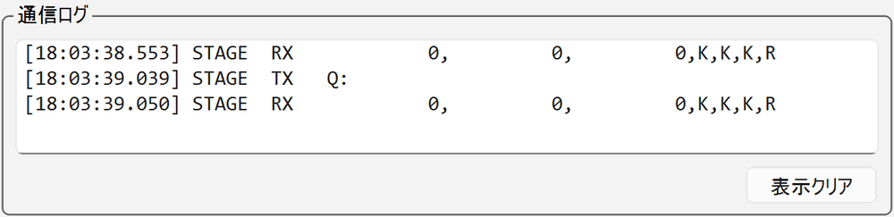
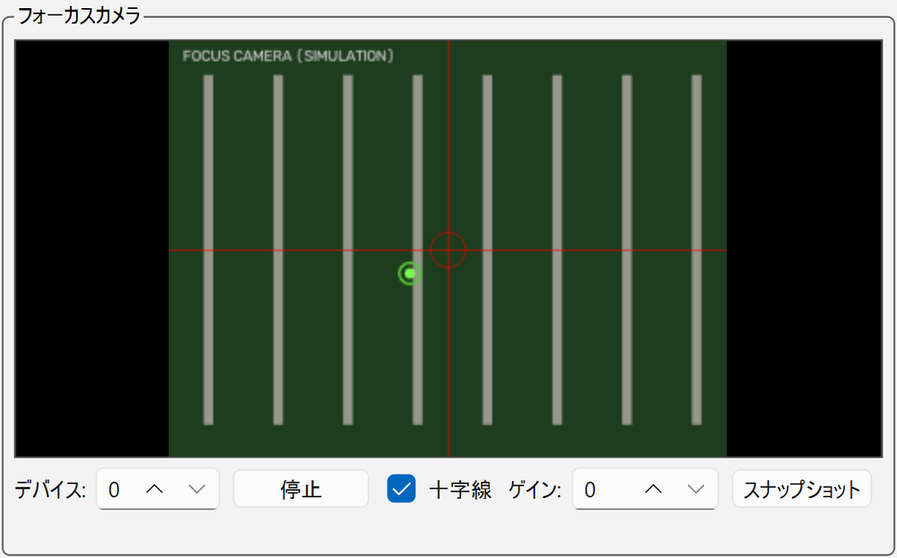
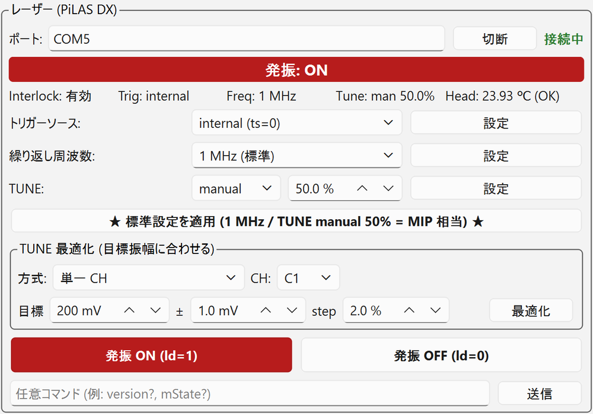
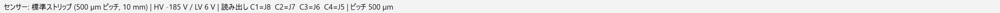

# GUI の画面構成

![メインウィンドウ（[制御] タブ）](../images/gui/main-window.png)

*全機器をシミュレーションで接続した状態の [制御] タブ（2026-11-01 版。波形とカメラ画像は疑似データ、接続先は塗りつぶし）。*

画面は 16:9 の横長モニター向けで、上から **ツールバー**、**タブ**、**3 カラムのパネル**、**ステータスバー** が並びます。
起動時にモニターの利用可能領域に収まるように開きます。

| カラム | パネル | 主な機能 |
| --- | --- | --- |
| 左 | [オシロスコープ](#scope) | 接続、画面ミラー、トリガー/掃引・チャンネル・保存・コマンドのタブ |
| 左下 | [通信ログ](#log) | 機器へ送った全コマンドと応答 |
| 中 | [フォーカスカメラ](#camera) | カメラ画像、十字線、ゲイン、スナップショット |
| 中下 | [3 軸ステージ](#stage) | 座標表示、操作（ジョグ・原点）・位置登録・アライメントのタブ |
| 右 | [レーザー](#laser) | 状態表示、トリガー・周波数・TUNE の設定、標準設定、TUNE 最適化、発振 ON/OFF |
| 右下 | [自動スキャン](#scan) | スキャン条件・データ回収のタブ |

## ツールバー { #toolbar }

| 位置 | 要素 | 内容 |
| --- | --- | --- |
| 左 | [センサー] と [編集...] | 測定する DUT の選択と、センサープロファイルの編集（[センサーと座標系](../setup/sensor.md#new-sensor)） |
| 中央 | タスク表示 | 実行中のタスク名、進捗バー、状況（現在の点、残り時間など）、[中断] |
| 右端 | **[■ 全停止]** | 実行中タスクの中断 → レーザー OFF → ステージ停止 → オシロ STOP の順に、接続中の全機器を止める |

*スキャン実行中のツールバー（旧版の画面）。進捗、現在の点、残り時間が出る。実行中はセンサーの切り替えが無効になる。*

## タブ

| タブ | 内容 |
| --- | --- |
| [制御] | 測定用の 3 カラム画面 |
| [解析] | 回収済みデータの簡易解析（[データ回収と簡易解析](data.md#analysis)） |

## オシロスコープパネル { #scope }

- **VISA** 欄：接続先（既定値は `config.py`。値は [内部情報](../internal.md#config)）。[接続] で接続し、成功すると「接続中」と表示され、ボタンは [切断] に変わります。
- **[ミラー開始]**：オシロ本体の画面を GUI に表示します（開始後は [ミラー停止]）。[更新間隔] で頻度を選びます。
  スキャン中もミラーは止まらず、点ごとの取得中だけ自動で一時停止します。
- その下の 4 つのタブで設定します。

=== "トリガー/掃引"

    ![[トリガー/掃引] タブ](../images/gui/scope-trigger.png){ width="460" }

    - [トリガーモード]：AUTO / NORM / SINGLE / STOP
    - [ソース]・[レベル [mV]]・[スロープ]・[結合] → [エッジトリガー適用]
    - [タイムベース]・[水平オフセット] → [横軸適用]
    - [シーケンスモード] とセグメント数 → [適用]、[スイープクリア]
    - **[★ 標準設定を一括適用 ★]**：測定の標準条件をまとめて送る（[内容](connect.md#scope-standard)）

=== "チャンネル"

    ![[チャンネル] タブ](../images/gui/scope-channels.png){ width="460" }

    CH ごと（ラベルは読み出しパッド。例：C1 (J8)）に、表示、VDIV、オフセット [mV]、結合（D50 = DC 50 Ω）、平均、スイープを設定して [適用]。
    **平均（アベレージング）は OFF** で使います。

=== "保存"

    ![[保存] タブ](../images/gui/scope-save.png){ width="460" }

    手動保存の [保存先]（オシロ本体のフォルダ。既定は当日の `manual`）、[ファイル名]、[形式]、[対象]、[保存設定を送信]、[今すぐ保存]、
    [オートセーブ]、[本体設定メモリ]（[保存 (*SAV)] / [呼出 (*RCL)]）。自動スキャンでは使いません。

=== "コマンド"

    ![[コマンド] タブ](../images/gui/scope-command.png){ width="460" }

    GUI が対応していない操作を、リモートコマンド（例：`TRMD?`、`VBS? 'return=app.Acquisition...'`）で直接 [送信] / [クエリ] できます。

## 通信ログ { #log }

{ width="460" }

機器へ送ったコマンドと応答がすべて表示され、`logs/gui_YYYYMMDD.log` にも残ります。トラブルのときはまずここを見ます。[表示クリア] は表示を消すだけです。

## フォーカスカメラパネル { #camera }

{ width="460" }

- [デバイス] 番号、[開始] / [停止]、[十字線]、[ゲイン]、[スナップショット]（`captures/snap_<日時>.png` に保存）。
- カメラは手動フォーカスレンズで、オートフォーカスや露出の操作はありません。画像が暗いときは [ゲイン] と、暗室内の照明（[写真](../setup/hardware.md#equipment-photos)）で調整します。
- 十字線は位置合わせの目安です。レーザースポットとは数 µm ずれることがあります。

## ステージパネル { #stage }

上部に **接続先**、**論理座標**（X・Y・Z、緑の数字）と **機械座標** が常に表示されます（[センサーと座標系](../setup/sensor.md)）。
機械座標が「不明 (GUI から機械原点復帰 (H:W) すると追跡開始)」と出ているときは、[機械原点復帰 (H:W)] を実行します。

=== "操作"

    ![[操作] タブ](../images/gui/stage-move.png){ width="460" }

    - **ジョグ**：[ステップ] で 1 回の移動量を 2 µm〜5 mm（2, 4, 10, 20, 50, 100, 500, 1000, 5000 µm）から選び、矢印ボタンで動かします。
      横に実際に送るパルス数が表示されます（例：`= 5/5/5 pulse (X/Y/Z)`）。
        - 矢印は **カメラ画像の上で動く向き**、ボタンの文字は実際に送る軸と符号です（**▲ を押すと画像上で上へ = ステージ Y−**）。
        - Z は [▲ Z+] / [▼ Z−]（フォーカス）。
    - **[座標指定 [µm]]**：X・Y・Z を入力して [移動]。[現在値] で現在位置を入力欄に写します。
    - **[機械原点復帰 (H:W)]**、**[論理原点リセット (R:W)]**、**[停止 (L:W)]**、**[非常停止]**。

=== "位置登録"

    ![[位置登録] タブ](../images/gui/stage-positions.png){ width="460" }

    粗寄せ（[登録原点へ移動]、[原点出し開始位置へ]）、[現在の論理原点を登録]、[ストリップへ移動]（ピクセル型では [ピクセルへ移動]）、
    位置の登録と移動。使い方は [起動と機器の接続](connect.md#coarse)。

=== "アライメント"

    ![[アライメント] タブ](../images/gui/stage-align.png){ width="460" }

    Z フォーカス、自動アライメント（原点出し・フル較正）、傾き係数の表示と [係数を手動入力...]。使い方は [位置合わせ](alignment.md)。

## レーザーパネル { #laser }

<figure markdown="span">
  
  <figcaption>発振 OFF（緑帯）</figcaption>
</figure>

<figure markdown="span">
  
  <figcaption>発振 ON（赤帯）</figcaption>
</figure>

- **状態表示**：発振 ON/OFF（OFF は緑帯、ON は赤帯）、Interlock、Trig、Freq、Tune、Head（ヘッド温度）。2 秒ごとに `mState?` で更新されます。
- **[トリガーソース]**：internal (ts=0)（標準）/ ext. TTL (ts=2) / ext. Adj (ts=1)。
- **[繰り返し周波数]**：1 kHz〜40 MHz のプリセット。**「1 MHz (標準)」** がこの装置の標準です（「1.25 MHz (TCT推奨)」は一般的な推奨値で、標準ではありません）。任意の Hz 値も入力できます。
- **[TUNE]**：auto / manual と値 [%]。**0 % が最も強く、100 % が最も弱い** です。標準は manual 50 %。
- **[★ 標準設定を適用 (1 MHz / TUNE manual 50% = MIP 相当) ★]**：トリガー internal、1 MHz、TUNE manual 50 % を一括で送ります。
- **TUNE 最適化**：目標振幅に TUNE を自動で合わせます（[レーザー強度の調整](tune.md)）。
- **[発振 ON (ld=1)]** / **[発振 OFF (ld=0)]**。
- 一番下の欄から任意のコマンド（例：`version?`、`mState?`）を [送信] できます。

トリガーソース・周波数・TUNE を個別に変えるときは、入力欄を変えて **それぞれの [設定] を押して送信** します（入力欄を変えただけでは送られません）。
入力欄は接続時に実機の現在値へ同期されます。

## 自動スキャンパネル { #scan }

=== "スキャン条件"

    ![[スキャン条件] タブ](../images/gui/scan-conditions.png){ width="460" }

    モード、範囲、TUNE、傾き補正、取得条件、保存先、[スキャン開始] / [中断]。使い方は [自動スキャン](scans.md)。

=== "データ回収"

    ![[データ回収] タブ](../images/gui/scan-transfer.png){ width="460" }

    回収元（オシロ）、[日付 (YYYYMMDD)]、[PC側保存先]、[転送後にオシロ側を削除]、[転送開始]。使い方は [データ回収](data.md#transfer)。

## ステータスバー { #statusbar }

選択中のセンサー、HV と LV の参考値（`config.py` の値。実際の HV は [安全上の注意](../introduction/safety.md#bias) を参照）、
オシロ CH と読み出しパッドの対応、ピッチが常に表示されます。

## タスクの排他

スキャン、データ回収、Z フォーカス、原点出し、フル較正、TUNE 最適化は、どれもステージ・オシロ・レーザーを占有するので同時には走りません。
1 つが実行中の間は、ジョグ、座標指定の移動、原点操作、センサーの切り替え、他のタスクの開始ボタンが無効になります。

- 停止系のボタン（[中断]、[■ 全停止]、[停止 (L:W)]、[非常停止]）は常に押せます。
- [解析] タブの解析だけは別プロセスなので、測定と並行して実行できます。
- 原点出し、Z フォーカス、TUNE 最適化の間、オシロはシーケンス OFF・トリガー NORM に切り替わります。スキャンの開始時に設定し直されるので、戻す必要はありません。

!!! tip "誤操作の防止"
    スピンボックスやコンボボックスの上でマウスホイールを回しても値は変わりません（スクロールのつもりで値を変えてしまう事故の対策）。
