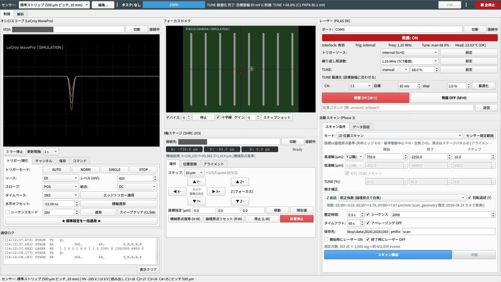

# GUI の画面構成

*全機器を接続し、原点出しと TUNE 最適化を終えた待機状態（シミュレーションモード。波形とカメラ画像は疑似データ）。*

画面は 16:9 の横長モニター向けで、上から **ツールバー**、**タブ**、**3 カラムのパネル**、**ステータスバー** が並びます。

## ツールバー

| 位置 | 要素 | 内容 |
| --- | --- | --- |
| 左 | [センサー] と [編集...] | 測定する DUT の選択と、センサープロファイルの編集（[センサーと座標系](../setup/sensor.md#new-sensor)） |
| 中央 | タスク表示 | 実行中のタスク名、進捗バー、状況（現在の点、残り時間など）、[中断] |
| 右端 | **[■ 全停止]** | 実行中タスクの中断 → レーザー OFF → ステージ停止 → オシロ STOP の順に、接続中の全機器を止める |

*スキャン実行中のツールバー。進捗、現在の点、残り時間が出る。実行中はセンサーの切り替えが無効になる。*

## タブ

| タブ | 内容 |
| --- | --- |
| [制御] | 測定用の 3 カラム画面 |
| [解析] | 回収済みデータの簡易解析（[データ回収と簡易解析](data.md#analysis)） |

## 3 カラムのパネル

| カラム | パネル | 主な機能 |
| --- | --- | --- |
| 左 | オシロスコープ (LeCroy WavePro) | 接続、画面ミラー、トリガー/掃引・チャンネル・保存・コマンドのタブ |
| 左下 | 通信ログ | 機器へ送った全コマンドと応答 |
| 中 | フォーカスカメラ | カメラ画像、十字線、ゲイン、スナップショット |
| 中下 | 3 軸ステージ (SHRC-203) | 座標表示、操作（ジョグ・原点）・位置登録・アライメントのタブ |
| 右 | レーザー (PiLAS DX) | 状態表示、トリガー・周波数・TUNE の設定、TUNE 最適化、発振 ON/OFF |
| 右下 | 自動スキャン | スキャン条件・データ回収のタブ |

### オシロスコープパネル

- **VISA** 欄：接続先（既定 `VICP::<オシロの IP>::INSTR`）。[接続] で接続し、成功すると「接続中」と表示され、ボタンは [切断] に変わります。
- **[ミラー開始]**：オシロ本体の画面を GUI に表示します。[更新間隔] で頻度を選びます。
  スキャン中もミラーは止まらず、点ごとの取得中だけ自動で一時停止します。
- **[トリガー/掃引] タブ**：トリガーモード（AUTO / NORM / SINGLE / STOP）、ソース、レベル、スロープ、結合、タイムベース、水平オフセット、
  シーケンスモード、[スイープクリア (CLSW)]、**[★ 標準設定を一括適用 ★]**。
- **[チャンネル] タブ**：CH ごとの表示、VDIV、オフセット、結合、平均、スイープ。
- **[保存] タブ**：手動保存の保存先・ファイル名・形式・対象、[今すぐ保存]、オートセーブ、本体設定メモリ（*SAV / *RCL）。
- **[コマンド] タブ**：GUI が対応していない操作を、SCPI/VBS コマンドで直接 [送信] / [クエリ] できます。

![オシロパネルの [トリガー/掃引] タブ](../images/gui/scope-trigger-tab.png){ width="480" }

### フォーカスカメラパネル

- [開始] / [停止]、[デバイス] 番号、[十字線]、[ゲイン]、[スナップショット]（`captures/snap_<日時>.png` に保存）。
- カメラは手動フォーカスレンズで、オートフォーカスや露出の操作はありません。

### ステージパネル

上部に **論理座標**（X・Y・Z、緑の数字）と **機械座標** が常に表示されます（[センサーと座標系](../setup/sensor.md)）。

**[操作] タブ**

- **ジョグ**：[ステップ] で 1 回の移動量を 2 µm〜5 mm（2, 4, 10, 20, 50, 100, 500, 1000, 5000 µm）から選び、矢印ボタンで動かします。
  横に実際に送るパルス数が表示されます。
    - 矢印は **カメラ画像の上で動く向き**、ボタンの文字は実際に送る軸と符号です（**▲ を押すと画像上で上へ = ステージ Y−**）。
    - Z は [▲ Z+] / [▼ Z−]（フォーカス）。
- **[座標指定 [µm]]**：X・Y・Z を入力して [移動]。[現在値] で現在位置を入力欄に写します。
- **[機械原点復帰 (H:W)]**、**[論理原点リセット (R:W)]**、**[停止 (L:W)]**、**[非常停止]**。

**[位置登録] タブ**：粗寄せ、ストリップへの移動、位置の登録（[起動と機器の接続](connect.md#coarse)）。

**[アライメント] タブ**：Z フォーカス、原点出し、フル較正、係数の手動入力（[位置合わせ](alignment.md)）。

### レーザーパネル

{ width="480" }

- **状態表示**：発振 ON/OFF（ON は赤帯）、Interlock、Trig、Freq、Tune、Head（ヘッド温度）。2 秒ごとに `mState?` で更新されます。
- **[トリガーソース]**：internal (ts=0)（通常これ）/ ext. TTL (ts=2) / ext. Adj (ts=1)。
- **[繰り返し周波数]**：1 kHz〜40 MHz のプリセット（1.25 MHz は「TCT 推奨」と表示されるが、**この装置の標準は 1 MHz**）。任意の Hz 値も入力できます。
- **[TUNE]**：auto / manual と値 [%]。**0 % が最も強く、100 % が最も弱い** です。
- **TUNE 最適化**：目標振幅に TUNE を自動で合わせます（[レーザー強度の調整](tune.md)）。
- **[発振 ON (ld=1)]** / **[発振 OFF (ld=0)]**。
- 一番下の欄から任意のコマンド（例：`version?`、`mState?`）を [送信] できます。

各設定は入力欄を変えただけでは送られません。**それぞれの [設定] を押して送信** します。入力欄は接続時に実機の現在値へ同期されます。

### 自動スキャンパネル

[スキャン条件] タブと [データ回収] タブがあります（[自動スキャン](scans.md)、[データ回収と簡易解析](data.md)）。

## ステータスバー

選択中のセンサー、HV と LV の参考値（`config.py` の値。実際の HV は [安全上の注意](../introduction/safety.md#bias) を参照）、オシロ CH と読み出しパッドの対応、ストリップピッチが常に表示されます。
例：`センサー: 標準ストリップ (500 µm ピッチ, 10 mm) | HV -185 V / LV 6 V | 読み出し C1=J8 C2=J7 C3=J6 C4=J5 | ピッチ 500 µm`

## タスクの排他

スキャン、データ回収、Z フォーカス、原点出し、フル較正、TUNE 最適化は、どれもステージ・オシロ・レーザーを占有するので同時には走りません。
1 つが実行中の間は、ジョグ、座標指定の移動、原点操作、センサーの切り替え、他のタスクの開始ボタンが無効になります。

- 停止系のボタン（[中断]、[■ 全停止]、[停止 (L:W)]、[非常停止]）は常に押せます。
- [解析] タブの解析だけは別プロセスなので、測定と並行して実行できます。
- 原点出し、Z フォーカス、TUNE 最適化の間、オシロはシーケンス OFF・トリガー NORM に切り替わります。スキャンの開始時に設定し直されるので、戻す必要はありません。

!!! tip "誤操作の防止"
    スピンボックスやコンボボックスの上でマウスホイールを回しても値は変わりません（スクロールのつもりで値を変えてしまう事故の対策）。
