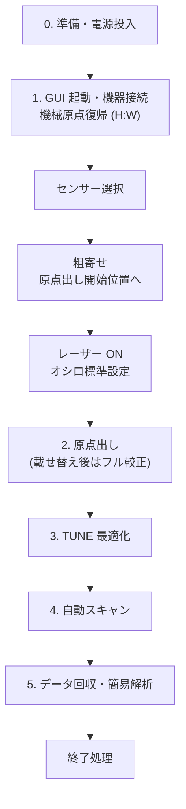

# 測定の全体の流れ

電源投入からデータ取得・終了までの流れです。各ステップの詳しい操作はリンク先のページにあります。
チェックボックスは印刷して使うことを想定しています。

!!! danger
    作業前に [安全上の注意](../introduction/safety.md) を読んでください。

## 0. 準備と電源投入 { #power-on }

- [ ] 測定ログ（電子ログブックなど）に日付・目的・測定者・センサー ID を記入する
- [ ] 読み出しボードが固定ジグに差し込まれ、見たいチャンネルの MCX–BNC ケーブルがオシロの C1–C4 に、TRIG OUT がオシロの EXT につながっていることを確認する
- [ ] 機器の電源を入れる（**順番は問わない**。スイッチの場所は [電源とスイッチ](../setup/hardware.md#power)）
    - [ ] レーザー：鍵を右にひねって ON
    - [ ] ステージコントローラ：作業台の下、本体右下のスイッチ
    - [ ] オシロスコープ：左下の電源ボタン
    - [ ] 制御 PC
- [ ] **最後に** センサーにバイアスをかける：**LV → HV** の順。電流制限が HV 1.0 mA・LV 1.0 A になっていることを先に確認する
    - [ ] LV：左下のボタンで ON → CH1 → OUTPUT ボタンで出力 ON（青色に点灯）。6 V
    - [ ] HV：スイッチで ON → 黒ボタンで SET（33 °C なら −190〜−195 V、**−220 V を超えない**）→ 赤ボタンでバイアス ON（昇圧は自動）
    - [ ] 電流が正常か確認する（HV 0.4〜5 µA 程度、LV 約 0.450 A）
- [ ] 暗室を出る前に、**カメラ用照明を OFF** にする（本体右下のスイッチ。測定中は必ず OFF）

## 1. 起動と機器の接続 → [詳細](connect.md)

- [ ] 制御 PC のターミナルで GUI を起動する（`cd workspace/laser_gui_v4` → `python ./main.py`）
- [ ] オシロ・ステージ・レーザーの [接続]、カメラの [開始] を押し、すべて「接続中」になることを確認する
- [ ] ステージパネル [操作] タブで **[機械原点復帰 (H:W)]**（全軸が大きく動くので干渉に注意）
- [ ] ツールバーの [センサー] で測定する DUT を選ぶ
- [ ] [位置登録] タブの **[原点出し開始位置へ]** で粗寄せする（初回・載せ替え後はカメラを見ながらジョグ）
- [ ] レーザーパネルでトリガーソース・繰り返し周波数・TUNE を設定し、**[発振 ON (ld=1)]**
- [ ] オシロパネルで [ミラー開始]、[トリガー/掃引] タブの **[★ 標準設定を一括適用 ★]**
- [ ] オシロの画面で信号が見えることを確認する

## 2. 位置合わせ → [詳細](alignment.md)

- [ ] ステージパネル [アライメント] タブで **[原点出し (Z→Y→X→R:W)]**（精密仕上げ ON で約 7〜12 分）
- [ ] センサーを載せ替えた・治具を変えたときは代わりに **[フル較正 (原点+傾き係数)]**
- [ ] 完了ダイアログの残差・フィット誤差を確認し、測定ログに記録する

## 3. レーザー強度の調整 → [詳細](tune.md)

- [ ] 標準条件（1 MHz、TUNE 50 %）では MIP 相当に調整済みなので、**通常は変えない**
- [ ] 繰り返し周波数を変えたとき・振幅が想定と違うときは、レーザーパネルの **TUNE 最適化** で合わせる

## 4. 自動スキャン → [詳細](scans.md)

- [ ] 自動スキャンパネルでモード・範囲・ステップ・シーケンス数・傾き補正を設定する
- [ ] [スキャン開始] → 確認ダイアログの内容（点数、範囲、Z の移動範囲、Y シフト、保存先）を確認して実行
- [ ] 最初の行で「電極の直上で信号がほぼ 0、電極端で急に立ち上がる」ことを確認する

## 5. データ回収と簡易解析 → [詳細](data.md)

- [ ] 自動スキャンパネル [データ回収] タブで日付を指定して [転送開始]
- [ ] [解析] タブでスキャンを選んで [解析開始]、図でデータの健全性を確認する

## 終了処理

- [ ] レーザーパネルで **[発振 OFF (ld=0)]** を押す（GUI を閉じてもレーザーは止まらない）
- [ ] 必要ならデータ回収を済ませる
- [ ] 各パネルで [切断] し、GUI を閉じる
- [ ] HV のバイアスを OFF にし、HV の表示が 0 V になってから LV の OUTPUT を OFF にする
- [ ] **制御 PC 以外** の電源（暗室内の機器すべて：レーザー、ステージ、カメラ用照明、オシロ、HV・LV 電源）を切る。制御 PC はリモート操作のため入れたままにする
- [ ] 回収したデータを NAS にバックアップする（[詳細](data.md#backup)）
- [ ] 測定ログを完成させる

## 測定ログに記録する項目

| 項目 | 例 |
| --- | --- |
| センサー | GUI のセンサー名、センサー ID |
| バイアス | HV、LV、リーク電流、センサー温度 |
| レーザー | 繰り返し周波数、TUNE（方式・目標振幅・結果）、カメラ照明の ON/OFF |
| 位置合わせ | 原点出し / フル較正の結果（残差、傾き係数） |
| スキャン | スキャン名（`scan_<日時>_<タグ>`）、モード、範囲、ステップ、シーケンス数、Z 追従の方式 |
| その他 | 気付いたこと、エラー、中断の有無 |

スキャンの条件は PC 側のスキャンログ（`logs/scan_<日時>.csv`）のヘッダーにも自動で残ります（[出力ファイル一覧](../reference/files.md#scan-log)）。
