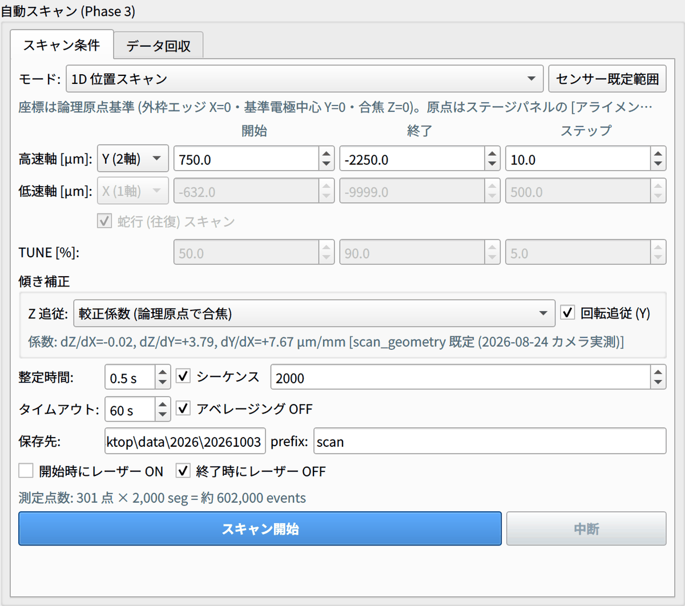
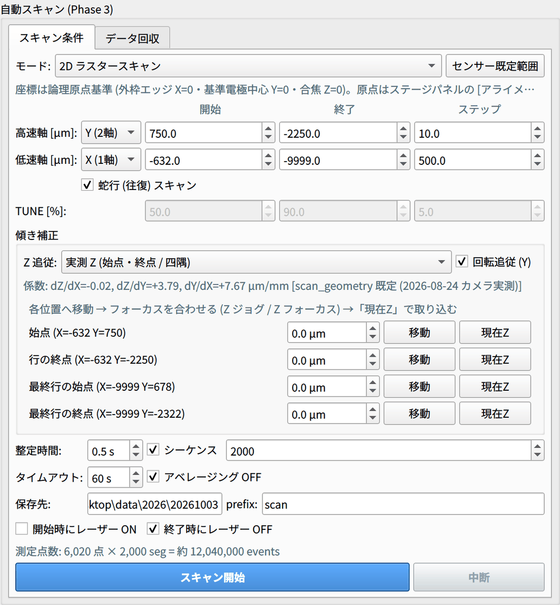

# 4. 自動スキャン

右カラムの **自動スキャンパネル** の [スキャン条件] タブで条件を決めて実行します。
座標はすべて **論理原点を基準にした µm** で入力します（[センサーと座標系](../setup/sensor.md#logical)）。

{ width="520" }

## スキャンの前に

- [ ] [原点出し](alignment.md#origin)（載せ替え後は [フル較正](alignment.md#full-calibration)）が終わっている
- [ ] [TUNE 最適化](tune.md) で振幅を合わせた
- [ ] オシロに [★ 標準設定を一括適用 ★] 済み（チャンネル・トリガー EXT・タイムベースはスキャン前にオシロパネルで設定しておく）
- [ ] レーザーが ON（または [開始時にレーザー ON] にチェック）

## モード

| モード | 用途 | ログのタグ |
| --- | --- | --- |
| **1D 位置スキャン** | 高速軸 1 本を動かす。例：ストリップ横断（Y） | `1dY`、`1dX` など |
| **2D ラスタースキャン** | 高速軸（Y）× 低速軸（X）で面を走査。[蛇行 (往復) スキャン] が既定で ON | `2dYX` |
| **1D + TUNE (各点でエネルギースキャン)** | 1 軸の位置 × TUNE の複合スキャン。各位置で TUNE を掃引する（位置が外側のループなので、ステージは位置が変わるときだけ動く）。選ぶと位置のステップが 50 µm に自動で変わる | `1dYtune` など |
| **TUNE スキャン (固定位置)** | 位置を固定して TUNE だけを掃引する | `tune` |

スキャンしない軸は、開始時の現在位置に固定されます（Z は [Z 追従](#z-follow) の方式に従う）。

## 範囲

高速軸と低速軸それぞれの [開始]、[終了]、[ステップ] で指定します。初期値はセンサーごとの既定範囲で、[センサー既定範囲] を押すとこの値に戻ります。

標準センサーの既定範囲：

| 軸 | 開始 → 終了 | ステップ | 意味 |
| --- | --- | --- | --- |
| 高速軸 Y | +750 → −2250 µm | 10 µm | C0 の外側半ピッチ → C5 の外側半ピッチ |
| 低速軸 X | −632 → −9999 µm | 500 µm | 露出部の読み出し側端 → 遠端の先（端ギャップ） |

TUNE を掃引するモードでは、[TUNE [%]] の開始・終了・ステップ（初期値 50 → 90 %、5 %）も指定します。

## 取得条件

| 項目 | 既定 | 内容 |
| --- | --- | --- |
| [シーケンス] セグメント数 | 2000 | 1 点あたりのイベント数（2000 seg/点 = 2000 events/step） |
| [整定時間] | 0.5 s | 移動後に待つ時間 |
| [タイムアウト] | 60 s | 1 点の取得完了を待つ上限 |
| [アベレージング OFF] | ON | **外さない**。ON のままだと完了判定が働かない |
| [保存先] / [prefix] | 当日の日付フォルダ / `scan` | オシロ本体側の保存先とファイル名の prefix |
| [開始時にレーザー ON] | OFF | スキャン開始時にレーザーを自動で ON にする |
| [終了時にレーザー OFF] | ON | 自動で ON にしたレーザーを、終了時・中断時に OFF に戻す |

その下の見積もりの行に、測定点数とイベント総数が出ます（例：`測定点数: 301 点 × 2,000 seg = 約 602,000 events`）。

!!! note "手動で ON にしたレーザー"
    手動で ON にしたレーザーは、スキャンが終わっても ON のままです。終わったら自分で [発振 OFF (ld=0)] を押します。

## 傾き補正 { #tilt }

センサーの傾きに追従するための設定です。係数は現在のセンサーのフル較正値（または手動入力値。標準センサーで未較正なら
`scan_geometry.py` の 2026-08-24 実測値）で、欄の下に表示されます。

### 回転追従 (Y)

ストリップの面内回転 dY/dX に合わせて、X スキャン開始位置を基準に X ごとに Y をずらします。どの X 行でもストリップが同じスキャン Y 座標に現れ、
長手方向の 1D スキャンでもストリップから外れません（標準センサーでは補正なしだと全長で約 72 µm ずれる）。

### Z 追従 { #z-follow }

フォーカスを保つための Z の動かし方を 4 つから選びます（x, y は論理座標）。

| 方式 | Z の決め方 | 使う場面 |
| --- | --- | --- |
| **較正係数 (論理原点で合焦)**（既定） | \(z = (dZ/dX)\,x + (dZ/dY)\,y\)。平面を論理原点に固定する | 原点出しの直後。開始時のステージ位置によらず同じ Z になる |
| 較正係数 (現在位置で合焦) | 同じ傾きの平面を、開始時の現在位置に固定する | 手動で（[Z フォーカス](alignment.md#z-focus) などで）焦点を合わせた位置から始めるとき |
| 実測 Z (始点・終点 / 四隅) | 1D は始点と終点、2D は四隅で実測した合焦 Z を、線形または双線形に補間する | 係数を較正していない DUT や、較正結果が疑わしいとき。**簡単で確実** |
| なし | Z を動かさない | Z そのものをスキャンするときなど |

#### 実測 Z 方式の手順

{ width="520" }

1. [Z 追従] で実測 Z 方式を選ぶと、始点・終点（2D では四隅）の行が現れる。
2. 各行の [移動] でその位置へ XY 移動する。
3. Z のジョグか [Z フォーカス] で焦点を合わせる（ビームはシリコン上に置く）。
4. [現在Z] で値を取り込む。

値は論理座標の絶対 Z なので、スキャン開始時のステージ位置には依存しません。

## 実行・進捗・中断

1. **[スキャン開始]** を押すと確認ダイアログが出る。**測定点数、各軸の範囲、Z の移動範囲、Y のシフト量、保存先** が表示されるので、意図どおりか確かめてから進める。
   最初の点の Z が現在の Z から **30 µm 以上** 離れていると、ここで警告が出る。
2. スキャン開始時は、必ず次の順で自動実行される。
    1. **オシロ設定**：アベレージングが ON なら OFF にする → シーケンス設定 → 保存設定
    2. **レーザー設定**（[開始時にレーザー ON] 指定時の自動 ON）
    3. **スキャン開始**
3. 各点では、**移動 → 整定待ち → 積算リセット → SINGLE 取得 → 完了待ち → 保存** の順に進む。
4. 進捗と残り時間はツールバーに表示される。画面ミラーを動かしておけば、点ごとに直前の取得波形も確認できる
   （ミラーは点ごとの取得中だけ自動で一時停止し、移動・整定中は再開される）。
5. 止めたいときは、ツールバーかスキャンパネルの **[中断]**、またはツールバー右端の **[■ 全停止]**。
   中断するとステージが止まり、オシロは STOP になる。自動で ON にしたレーザーは OFF に戻る。

!!! tip "データの健全性を最初の行で確認する"
    ビーム半径は数 µm なので、フォーカスが合っていれば **電極の直上で信号がほぼ 0 に落ち、電極の端で急に立ち上がります**。
    スキャンの最初の行（横断方向）でこれを確かめてください。0 まで落ちない、または立ち上がりがなだらかなら、デフォーカスか座標のずれを疑います。

### 保存ファイルの連番

保存ファイルの連番は GUI（PC 側）が管理します。点ごとに `scan--00042` のような連番を付けて保存するので、ファイル名は
`C2--scan--00042.trc` のようになり、スキャンログの `index` 列と常に一致します。
さらに点ごとにオシロ側フォルダのファイル数を検証し、**2 点連続で増えなければスキャンを自動で中断** してエラーを表示します
（オシロ内蔵の連番カウンタで同名上書きが起き、全点が消えた事例への対策）。

## 出力

| 出力 | 場所 |
| --- | --- |
| 波形 | オシロ本体ディスク `<scope_save_dir>\<年>\<YYYYMMDD>\scan_<日時>_<タグ>\C<n>--<prefix>--<連番>.trc`（1 点・1 CH ごとに 1 ファイル） |
| 座標記録（スキャンログ） | PC 側 `logs/scan_<日時>.csv` |

スキャンフォルダ名の日時は、PC 側のスキャンログ `scan_<日時>.csv` と同じなので、両者はこれで対応づけます。
スキャンログの書式は [出力ファイル一覧](../reference/files.md#scan-log) を見てください。
波形は次の [データ回収](data.md) で PC へ移します。

## 所要時間の目安

1 点あたりの時間は、整定時間とシーケンス 2000 セグメントの取得・保存で決まります。確認ダイアログとツールバーに残り時間の見積もりが出るので、それを目安にしてください。

!!! note "参考：解析ノートの 2D スキャン"
    解析ノート matome の 2D スキャンでは、取得に 1.7 h（BP）〜17 h（FS）かかったものがあります。長時間のスキャンでは、レーザー強度のドリフト（1.3 %/h 程度）も考慮してください。
