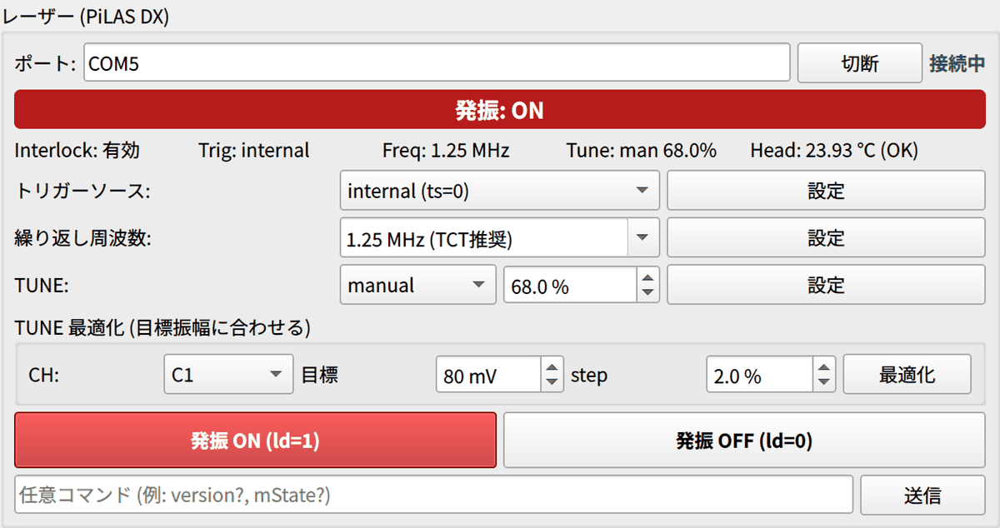

# 3. レーザー強度の調整（TUNE 最適化）

!!! tip "標準条件では TUNE を変えなくてよい"
    2026-10 時点で、標準の繰り返し周波数 1 MHz では **TUNE 50 % で MIP 相当** に調整済みです。通常はこの値のまま測定します。
    繰り返し周波数を変えたとき、光学条件を変えたとき、振幅が想定と違うときに、このページの TUNE 最適化を行います。

## TUNE とは

TUNE は PiLAS のパルスの強さを決める設定値です。**0 % でパルスが最も強く、100 % で最も弱い** という向きに注意してください。

- TUNE と信号振幅の関係は、**繰り返し周波数** や **カメラ用照明の ON/OFF**、光学条件（アライメント）で変わります。
  カメラ用照明は **必ず OFF** にしてから合わせてください。
  固定の換算値は持たないので、振幅は毎回、実測で合わせます。
- 最適な TUNE は繰り返し周波数で変わります。ある周波数で合わせた manual の TUNE のまま周波数を変えると、発振閾値を下回って光が出なくなることがあります
  （TRIG OUT は出続けるので、オシロの波形は更新されるのに平坦なまま）。**周波数を変えたら TUNE 最適化をやり直します。**
- 簡易確認として TUNE を **auto** にする方法もあります（コントローラが周波数ごとの校正値を使う）。波高を揃えたい測定では TUNE 最適化で合わせる方が確実です。

## TUNE 最適化の使い方

レーザーパネルの「TUNE 最適化 (目標振幅に合わせる)」の欄で行います。

{ width="480" }

*写真は旧版の画面で、現行版には [方式] 欄と許容誤差 [±] 欄、[2 ストリップの中間 Y へ移動して測定] のチェックがあります。*

!!! note "英語 UI 版との違い"
    以下は日本語 UI 版（`laser_gui_v4`）の動作です。2026-10 時点の英語 UI 版（`laser_gui_v4_en`）は旧仕様で、
    [方式] 欄・許容誤差・精密掃引・中間 Y への自動移動がなく、単一 CH の振幅を TUNE 100 % から [step] ずつ下げて、
    目標に達した TUNE に設定して止まります。

### 前提

- [ ] レーザー ON、オシロ接続済み、EXT トリガーで信号が出ている
- [ ] [原点出し](alignment.md#origin) または [Z フォーカス](alignment.md#z-focus) で焦点が合っている
- [ ] ビームが測定に適した位置にある（方式ごとに下表）

### 方式

| 方式 | 測るもの | ビーム位置 | 目標の既定 |
| --- | --- | --- | --- |
| 単一 CH | 選んだ CH の振幅（PKPK） | ストリップ横のシリコン上（信号がはっきり見える位置） | 200 mV |
| 隣接 2ch 合計 (MIP 相当) | 隣り合う 2 ストリップを読む CH の振幅の合計 \(A_\text{lead} + A_\text{sub}\) | **2 ストリップの中間**（ピッチ 500 µm なら電極から 250 µm） | **64 mV** |

隣接 2ch 合計は、AC-LGAD ではビームを 2 ストリップ間で動かしても \(A_\text{lead} + A_\text{sub}\) の変化が小さい
（電荷共有で分配されるだけ）性質を使います。ストリップ中間で合計を合わせれば、**位置ずれに鈍感に MIP 相当の信号量へ揃えられます**。
目標 64 mV は DESY ビームテスト (2026) の結果で、ストリップ中間で 64 ± 1 mV（参考：ストリップ近傍の単一 CH で 77 mV）です。

MIP 相当に合わせ直すときは「隣接 2ch 合計 (MIP 相当)」で目標 64 mV にします（日本語 UI 版）。

### 手順

1. [方式] を選ぶ。
    - 単一 CH：[CH] を選ぶ。
    - 隣接 2ch 合計：CH の組（例：C1+C2）を選ぶ。センサープロファイルの電極 Y から、隣接する組だけが列挙されます。
2. [目標] 振幅と許容誤差 [±]（既定 ±1 mV）、粗掃引の [step]（既定 2 %）を確認する。方式を切り替えると目標は方式ごとの値に戻ります。
3. 隣接 2ch 合計では、**[2 ストリップの中間 Y へ移動して測定 (現在の X, 終了後に戻る)]**（既定 ON）を使うと、
   選んだ CH 組の電極中心の中間 Y へ現在の X のまま自動で移動し（面内回転とチルトで Y・Z を補正）、終了・中断後に元の位置へ戻ります。
   ステージ接続が必要で、現在位置で焦点が合っていることが前提です。OFF なら現在位置で測ります。
4. **[最適化]** を押し、確認ダイアログで [Yes]。

### 何をしているか

1. **粗掃引**：TUNE を 100 %（光が弱い側）から [step] ずつ下げながら、振幅（PAVA）を測る。
2. **精密掃引**：目標を跨いだ区間を **0.5 % 刻み・多数回読み（中央値）** で掃引し、目標 ± 許容に最も近い TUNE に設定する。
3. **検証測定**：設定した TUNE で振幅を測り直す。

所要は数十秒〜1 分です。粗掃引だけだと ±数 mV の読み取りノイズで閾値交差が決まってしまうため、精密掃引を行っています。

### 結果

- 成功すると「TUNE 最適化完了」が出て、TUNE が設定されます。
- 最後まで目標に届かないときは、**振幅が最大だった TUNE に設定して警告** を出します（その周波数の最大出力が要件を満たすか判断する）。
- TUNE 100 %（最弱）でも目標を超える場合は、減光が必要と警告します。
- 中断や失敗のときは **元の TUNE に戻ります**。
- 掃引カーブは `logs/tuneopt_<日時>.csv` に残ります（phase = coarse / fine / verify、CH ごとの振幅・合計・ばらつき）。
  その周波数での発振閾値もここから読み取れます。

## MIP 相当の強度について

解析ノート matome では、ストリップ脇で実測した波高がビームの Landau MPV（76 mV）の 0.7–1.3 倍（53–99 mV）にあるスキャンを「MIP 相当」としています。
レーザーには Landau 揺らぎがないので、MIP 相当の強度で得た時間分解能は MIP に対する下限（床）と解釈します。

## コマンドで TUNE を送るとき

GUI の表示と入力は % ですが、レーザーパネル下のコマンド欄から直接送るときは単位が違います。

| コマンド / 応答 | 単位 | 例 |
| --- | --- | --- |
| `tune=` | 0.1 % 単位の 4 桁 | `tune=0650` → 65.0 % |
| `mState?` の応答に含まれる TUNE | 0.01 % 単位 | `6500` → 65.00 % |
