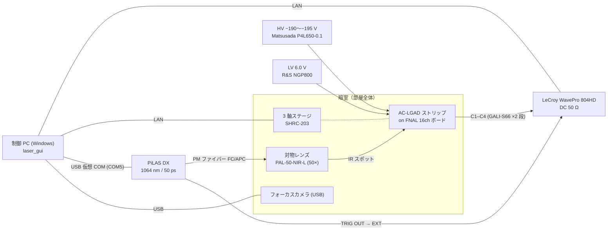
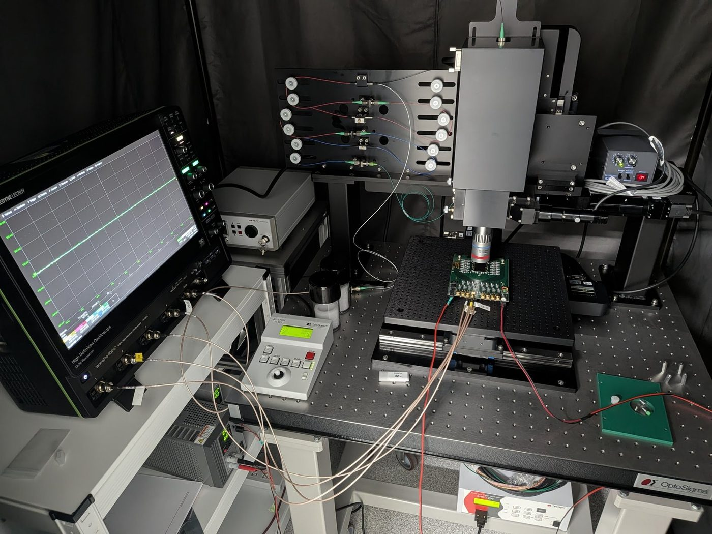

# システム構成

## 全体構成

パルスレーザーの光を偏波保持ファイバーで暗室内に導き、対物レンズでセンサー表面に集光します。
センサーを載せた読み出しボードは 3 軸ステージの上にあり、ステージを動かして照射位置を走査します。
読み出しは C1–C4 の 4 本のストリップで、ボード上のアンプを通してオシロスコープの DC 50 Ω 入力へ入れます。
時刻の基準はレーザーの **TRIG OUT** で、オシロの外部トリガー (EXT) に入れます。全機器は制御 PC の GUI から操作します。

## 写真

*左：暗室内の全景（左からオシロ、ファイバー・光学系、ステージ）。右：50 倍対物レンズと読み出しボード。*

## 構成機器

| 機器 | 型番・仕様 | 本測定での設定・実測 |
| --- | --- | --- |
| レーザー | NKT Photonics PiLAS DX（ヘッド NPIL1-106-40FC、コントローラ EGI-D2-40）。波長 1064 nm（試験成績 1063.4 nm）、パルス幅 50 ps、繰り返し 40 MHz まで可変、トリガージッター < 3 ps rms | 強度は TUNE [%] で調整（0 % が最強、100 % が最弱） |
| ファイバー | 偏波保持シングルモード（PANDA 型）、FC/APC | — |
| 対物レンズ | OptoSigma PAL-50-NIR-L：50 倍、NA 0.45、作動距離 15.1 mm、焦点距離 4 mm（10 倍の PAL-10-NIR-A もあるが、切り替えて使うことはない） | スポット σ ≲ 1.2 µm（焦点上） |
| ステージ | OptoSigma SHRC-203（3 軸、5 相ステッピングモーター）、ジョイスティック JS-301 | 2 µm/pulse（X・Y・Z、実機確認済み） |
| オシロスコープ | Teledyne LeCroy WavePro 804HD（8 GHz、12 bit） | 10 GS/s、シーケンスモード 2000 セグメント/点、50 mV/div、DC 50 Ω |
| センサー | HPK 製ストリップ型 AC-LGAD：ピッチ 500 µm、金属電極幅 50 µm、露出長 9318 µm、厚さ 50 µm、n+ シート抵抗 1600 Ω/□、結合容量 600 pF/mm²。6 本（C0–C5）のうち C1–C4 を読み出し | HV −190〜−195 V（センサー温度 33 °C のとき）。冷却はしない |
| 読み出しボード | FNAL 16 チャンネルボード。ストリップごとに Mini-Circuits GALI-S66 を 2 段。固定ジグに差し込んで載せる | LV 6.0 V |
| 信号ケーブル | MCX–BNC、長さ 75 cm | 見たいチャンネルに合わせて、ボード側の接続先を変える |
| LV 電源 | Rohde & Schwarz NGP800 シリーズ | 6.0 V（手動操作） |
| HV 電源 | Matsusada P4L650-0.1 | −190〜−195 V（手動操作、温度によって変える。上限 −220 V） |
| フォーカスカメラ | USB カメラ（手動フォーカスレンズ、オートフォーカス非対応） | OpenCV で取得、デバイス番号 0 |
| 制御 PC | Windows、Python 3.10 以上。16:9 横長モニター（EX-LDHU431DB）向けに GUI を配置 | 機器との LAN は固定 IP |

!!! note "解析ノートとの違い"
    解析ノート matome ではケーブル長を「1 m（要確認）」、センサー温度を「約 35 °C（未確定）」としていますが、
    実際はケーブル長 75 cm、センサー温度 33 °C です。

## 電源とスイッチ { #power }

各機器の電源は、どの順番で入れてもかまいません。ただし **センサーのバイアスは一番最後に、LV → HV の順** でかけます。

| 機器 | 場所 | 操作 |
| --- | --- | --- |
| レーザー（PiLAS コントローラ EGI-D2-40） | 左奥 | **鍵を右にひねって ON**。発振は基本的に GUI の [発振 ON (ld=1)] / [発振 OFF (ld=0)] で操作する。暗室内で作業したいときは本体の **赤色ボタン** で発振を操作する |
| ステージコントローラ SHRC-203 | 作業台の下 | 本体右下のスイッチ |
| カメラ用可視光（照明） | 右上側 | 本体右下のスイッチ。**測定中は必ず OFF** |
| オシロスコープ | 暗室の左側 | 左下の電源ボタン |
| LV 電源（R&S NGP800） | オシロスコープの下の台の左側 | 左下のボタンで ON → CH1 に設定 → **OUTPUT ボタンで出力 ON（青色に点灯）**。6 V 固定、電流制限 1.0 A |
| HV 電源（Matsusada P4L650-0.1） | オシロスコープの下の台の右側 | スイッチで電源 ON/OFF → 一番上の黒ボタンで HV を SET → **赤ボタンでバイアス ON**。昇圧は電源が自動で行う。上限 −220 V、電流制限 1.0 mA |

**電流の目安**：電流制限は HV 1.0 mA、LV 1.0 A に設定済みです。正常なときの電流は、HV が 0.4〜5 µA 程度（バイアス電圧に依存。電源の表示は 0.0 mA）、
LV が約 0.450 A です。これから大きく外れていたら、バイアスを OFF にして原因を確認してください。

**終了時** は、制御 PC 以外の電源（暗室内の機器すべて）を切ります。制御 PC はリモート操作のため電源を入れたままにします。

## 読み出しボードの載せ替え { #board-swap }

読み出しボードは固定ジグに差し込んで載せます。最初は経験者に取り付けてもらうことを勧めますが、特に危険な作業ではありません。

1. レーザーを [発振 OFF (ld=0)] にし、HV のバイアスを OFF にする。降圧は電源が自動で行うので、**HV の表示が 0 V になったのを確認してから** LV の OUTPUT を OFF にする。
2. MCX–BNC ケーブルを外す。
3. 赤色の固定棒は手では取りにくいので、**細いペンチで引き抜く**。このとき **センサーと対物レンズを傷つけないよう注意** する。
4. ボードを固定ジグから抜き、新しいボードを差し込む。ボードにテープなどが貼られていると差し込みにくいので、はがしておく。
5. 見たいチャンネルに MCX–BNC ケーブルをつなぐ。
6. GUI で、そのセンサーを選ぶ（新しいセンサーなら [登録](sensor.md#new-sensor)）。載せ替え後は位置が変わるので、[フル較正](../measurement/alignment.md#full-calibration) を行う。

## 接続とアドレス

GUI が制御する機器は 4 台で、画面のパネル 1 枚が機器 1 台に対応します。既定値は `config.py` にあり、
PC ごとの違いは `config_local.json` で上書きします（[制御 PC とソフトウェア](software.md#config)）。

| パネル | 機器 | 接続方式 | 既定アドレス |
| --- | --- | --- | --- |
| オシロスコープ | LeCroy WavePro | LAN。VICP（既定）または VXI-11。接続時に `*IDN?` の応答を確かめ、失敗したらもう一方を自動で試す | `VICP::<オシロの IP>::INSTR` |
| ステージ | SHRC-203（3 軸） | LAN (TCP) または RS-232C。SHOT 互換コマンド、デリミタ CRLF | `<ステージの IP>:<ポート>` |
| レーザー | PiLAS DX（EGI-D2-40） | USB 仮想 COM ポート（19200 baud、8N1、CR 終端）。FTDI VCP ドライバが必要 | `COM5` |
| カメラ | フォーカスカメラ | USB。OpenCV（Windows では DirectShow を優先） | デバイス番号 `0` |

- 各機器の IP アドレス・ポート・ユーザー名は [内部情報](../internal.md#network)（パスワード付き）にあります。
- オシロスコープは、レーザーの TRIG OUT を外部トリガー (EXT) に入れて同期させます。
- オシロのデータは SSH/SFTP で PC に回収します（ユーザー名は [内部情報](../internal.md#accounts)。パスワードは問い合わせ先に聞いてください）。

### 読み出しチャンネルの対応（標準センサー） { #readout-map }

| オシロ CH | ボードのパッド | ストリップ | 電極中心 Y（論理座標） |
| --- | --- | --- | --- |
| C1 | J8 | C1（基準 CH） | 0 µm |
| C2 | J7 | C2 | −500 µm |
| C3 | J6 | C3 | −1000 µm |
| C4 | J5 | C4 | −1500 µm |

C0（+500 µm）と C5（−2000 µm）は読み出していない外側のストリップです。
信号は MCX–BNC ケーブル（75 cm）でオシロにつなぎ、見たいチャンネルに合わせてボード側の接続先を変えます。
この対応はセンサープロファイルごとに設定でき、GUI のステータスバーとオシロパネルの CH ラベルに表示されます。

## 時間の基準 { #time-reference }

到達時刻は、オシロの各セグメントのトリガー時刻（LeCroy の TRIGTIME）を原点に測ります。
TRIG OUT を基準にした時間分解能には、レーザー同期とデジタイザのジッターが全チャンネル共通の床
\(\sigma_\text{ref} \approx 12.5\) ps として入ります。2 ストリップの時刻差ではこの床は消えます。

!!! warning "horiz_offset を時刻原点に使わない"
    `.trc` ファイルのヘッダーにある `horiz_offset` は 1 サンプル周期内の乱数なので、時刻原点に使うと
    約 29 ps の偽のジッターが乗ります。ROOT 変換したファイルでは `trig_offset` ブランチを使ってください。

## セットアップの性能（参考）

解析ノート matome の実測値です（数値はすべて preliminary）。

| 項目 | 値 |
| --- | --- |
| スポット径 | σ ≲ 1.2 µm（焦点上、金属端の誤差関数フィット）。焦点から 6–10 µm ずれると 1.3–1.5 µm |
| レーザー強度の安定性 | 1.3 %/h 程度のドリフト、全期間で ±2–3 % |
| ベースラインノイズ | RMS 約 1.7 mV（S/N 約 40） |
| ステージの再現性 | ストリップ中心の直線フィット残差 RMS 1.8–2.6 µm |
| 共通の時間の床 | \(\sigma_\text{ref} = 12.5 \pm 0.5\) ps |
