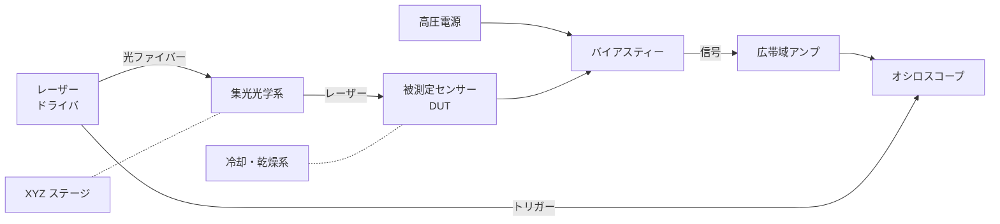

# ハードウェア

## 全体構成

制御 PC がステージ・高圧電源・オシロスコープ・レーザーを制御し、スキャンを自動化します。

## 構成機器と要求性能

| 機器 | 役割 | 要求性能の目安 |
| --- | --- | --- |
| パルスレーザー | 電荷の生成 | パルス幅 ≲ 100 ps、強度調整可能、外部トリガー出力 |
| 光ファイバー・集光光学系 | ビームの集光 | 焦点サイズ 数 µm〜十数 µm |
| XYZ ステージ | 照射位置の走査 | 繰り返し位置精度 ≲ 1 µm |
| 高圧電源 | センサーへのバイアス | 〜1 kV、電流制限機能、リーク電流のモニター |
| バイアスティー | 直流バイアスと高周波信号の分離 | 広帯域、耐圧が十分であること |
| 広帯域アンプ | 電流信号の増幅 | 帯域 ≳ 1 GHz、入力インピーダンス 50 Ω |
| オシロスコープ | 波形の記録 | 帯域 ≳ 1 GHz、サンプリング ≳ 5 GS/s、平均化機能 |
| 冷却系 | センサーの温度制御 | ペルチェ素子＋チラーなど、温度・湿度センサー |
| 暗箱 | 遮光・インターロック | 迷光の遮断、扉開放でレーザー停止 |

!!! tip "トリガー"
    オシロスコープのトリガーには、センサー信号ではなく **レーザーのトリガー出力** を使うのが基本です。
    信号の大小に関係なく一定のタイミングで波形を取得でき、ジッターも小さくなります。

## 本研究室の構成（要記入）

!!! note "TODO"
    実際に使用している機器の型番・設定値を記入してください。

| 機器 | 型番 | 備考 |
| --- | --- | --- |
| レーザー（赤色） | TODO | 波長、最大繰り返し周波数 |
| レーザー（赤外） | TODO | 波長、最大繰り返し周波数 |
| ステージ | TODO | ストローク、分解能 |
| 高圧電源 | TODO | 最大電圧、GPIB / USB アドレス |
| アンプ | TODO | 利得 (dB)、帯域 |
| オシロスコープ | TODO | 帯域、サンプリングレート、IP アドレス |
| 冷却系 | TODO | 最低温度、制御方法 |

## センサーの実装

- センサーは高周波特性のよいプリント基板（信号線は 50 Ω 伝送線路）に実装します。
- 信号線はできるだけ短くし、ワイヤーボンドも短くします。
- 測定しない隣接電極は、原則としてグラウンドに落とします（浮かせると重み電場が変わります）。
- ガードリングがある場合は接続方法を記録しておいてください。
