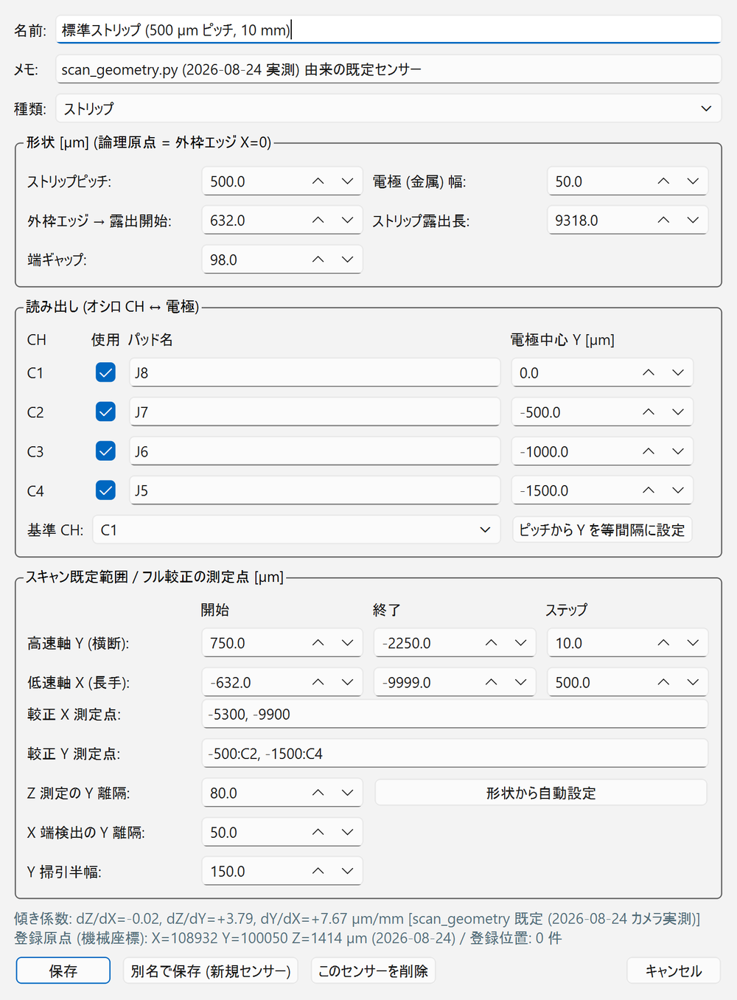
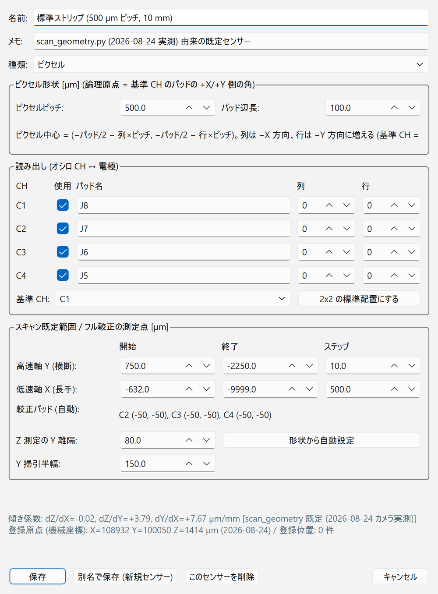

# センサーと座標系

GUI の座標・スキャン範囲・原点出しは、すべて「センサーの論理座標」で動きます。
GUI を正しく使うために、まずこのページの座標の決め方を理解してください。

センサーには **ストリップ型** と **ピクセル型** の 2 種類があり、センサー編集の [種類] で切り替えます（2026-10-16 版から）。
種類によって、論理原点の定義、原点出し・フル較正の手順、既定のスキャン範囲、ステージの [ストリップへ移動] / [ピクセルへ移動]、解析の種類が変わります。
以下、特に断りがなければ標準センサー（ストリップ型）の説明です。ピクセル型は [ピクセル型センサー](#pixel) を見てください。

## 標準センサーの幾何

標準センサーは HPK 製の 500 µm ピッチ・長さ約 10 mm のストリップ型 AC-LGAD です。
ストリップに沿う方向が X、ストリップを横切る方向が Y、光軸（フォーカス）方向が Z です。

X 方向には、読み出し側のセンサー外枠 (GND) のエッジから順に次の領域が並びます。

| 領域 | 幅 | 論理 X [µm] |
| --- | --- | --- |
| ⓪ 外枠とストリップ金属端の間 | 52 µm | 0 → −52 |
| ① スタブ | 380 µm | −52 → −432 |
| ② ボンディングパッド領域 | 200 µm | −432 → −632 |
| ③ ストリップ露出部 | 9318 µm | **−632 → −9950** |
| ④ 端ギャップ | 98 µm | −9950 → −10048 |
| その先 | — | 隣のストリップ領域（読み出していない） |

- **X = −10 mm は端ギャップ④の中央**（2 つのストリップ領域の境界）です。
- Y 方向には 6 本のストリップ C0–C5 が 500 µm ピッチで並び、C1–C4 を読み出します（[読み出しチャンネルの対応](hardware.md#readout-map)）。

## 論理座標と論理原点 { #logical }

画面に表示される位置、座標指定の移動、スキャン範囲はすべて **論理座標**（単位 µm）です。

| 軸 | 論理原点 (0) の定義 | 向き |
| --- | --- | --- |
| X | センサー外枠 (GND) のエッジ | ストリップは X の **負** の側に伸びる |
| Y | 基準 CH（標準は C1）の電極中心 | CH 番号が増えるほど負（C2 = −500 µm …） |
| Z | 合焦位置（焦点） | — |

論理原点は [原点出し](../measurement/alignment.md#origin) で自動的に決まり、その位置でコントローラの座標を 0 にリセット (R:W) します。
ステージの移動は、すべて論理座標への **相対移動 (M:W)** で行われます（絶対位置移動 A:W は不具合があったため使いません）。

## 機械座標 { #machine }

機械座標は **機械原点 (H:W)** を基準にした座標で、ステージパネルの論理座標の下に併記されます。

- R:W を実行するとコントローラの座標は 0 に戻るので、GUI が「論理原点の機械座標」を積算して
  `logs/stage_frame.json` に保存しています（H:W で 0 にリセットし、R:W のたびに直前の座標を加える）。
  この値は GUI を再起動しても引き継がれます。
- ジョイスティック JS-301 から M-ORG したとき、コントローラを再起動したとき、原点復帰を途中で止めたときは追跡が切れ、
  「機械座標: 不明」と表示されます。GUI から [機械原点復帰 (H:W)] をやり直してください。
- 機械座標は M-ORG のたびに変わり得るので、**粗寄せの目安** として使います。

## センサーの傾きと補正係数 { #tilt }

センサーは少し傾いて載っているので、3 つの係数で補正します。

| 係数 | 意味 | 標準センサーの既定値 |
| --- | --- | --- |
| dZ/dX | フォーカス面の X 方向の傾き | −0.02 µm/mm（ほぼ平坦） |
| dZ/dY | フォーカス面の Y 方向の傾き | +3.79 µm/mm |
| dY/dX | ストリップの面内回転 | +7.67 µm/mm |

回転を補正しないと、ストリップの全長（約 9.4 mm）で Y が約 72 µm ずれます。

- 画面の表示と [係数を手動入力...] の入力は **µm/mm**、`sensors.json` やスキャンログでのキー（`dzdx`、`dzdy`、`dydx`）は **µm/µm** です。
- 使われる係数の優先順位は、
    1. センサープロファイルに保存された値（[フル較正](../measurement/alignment.md#full-calibration) または手動入力）
    2. 標準センサーのみ `scan_geometry.py` の実測値（2026-08-24 カメラ実測）
    3. それ以外の未較正センサーは 0
- いま有効な係数とその出典は、ステージパネル [アライメント] タブと、自動スキャンパネルの [傾き補正] 欄の両方に表示されます。

## センサー辞書（センサープロファイル）

ボードやセンサーを替えてもコードを編集しなくて済むように、センサーごとの情報を 1 つのプロファイルにまとめ、
`logs/sensors.json` に保存しています。ツールバーの [センサー] で切り替えると、スキャンの既定範囲、傾き係数、
登録位置、オシロ CH と読み出しパッドの対応が、そのセンサーのものに入れ替わります。

| 項目 | 内容 |
| --- | --- |
| 名前・メモ | 一覧に出る名前と、自由記述のメモ |
| 種類 | ストリップ / ピクセル |
| 形状（ストリップ） | ストリップピッチ、電極（金属）の幅、外枠エッジから露出開始までのオフセット、ストリップ露出長、端ギャップ |
| 形状（ピクセル） | ピクセルピッチ、ボンディングパッドの辺長（信号の出ない正方形。原点出しの物差し） |
| 読み出し | オシロ CH ごとの使用の有無とパッド名、基準 CH。ストリップは電極中心 Y（基準 CH を 0）、ピクセルはピクセルの（列, 行） |
| スキャン既定範囲 | 高速軸 Y と低速軸 X の開始・終了・ステップ |
| フル較正の測定点 | ストリップ：X の測定点、Y の測定点（「Y:CH」の形式）、Z 測定と X 端検出の Y 離隔、Y 掃引の半幅。ピクセル：基準以外の読み出しピクセルのパッド中心（自動）、Z 測定の Y 離隔、Y 掃引の半幅 |
| 傾き係数 | dZ/dX、dZ/dY、dY/dX |
| 登録原点 | 論理原点の機械座標。原点出しのたびに自動で更新される |
| 登録位置 | 名前と座標（論理座標または機械座標） |

制御 PC の `sensors.json` には、2026-11-01 時点で次の 7 件が登録されています。

| センサー（ID） | 種類 | 状態・用途 |
| --- | --- | --- |
| 標準ストリップ (500 µm ピッチ, 10 mm)（`strip500_std`） | ストリップ | 実測値（`scan_geometry.py`）が入っている。通常はこれ |
| 4col (1000 µm ピッチ)（`4col_1000`） | ストリップ | **ピッチ以外の寸法は未確認のひな形**。使う前に実測値へ直す |
| 可変ピッチ (500 µm 部)（`varpitch_500`） | ストリップ | 同上 |
| 標準ストリップ 2x2 測定 (500 µm ピッチ, 10 mm)（`2x2_500_m_10_mm`） | ストリップ | 2×2 区画センサーの中央領域で、2 列（区画境界）を跨いでスキャンしたときのプロファイル（解析ノート matome の SEG スキャン `scan_20261008_151544_2dYX`、5 µm 行） |
| pixel#3 2x2 測定（`pixel_3_2x2`） | ピクセル | HPK S16694 のピクセルセンサーを 2×2 で読んだ測定（2026-10-15）。旧版で作ったものが、2026-10-16 版の起動時に自動でピクセル型へ移行された |
| pixel#4 2x2 測定（`pixel_4_2x2`） | ピクセル | 同じ型の pixel#4 を 2×2 で読んだ測定 |
| pixel#4 1x4 測定（`pixel_4_1x4`） | ピクセル | pixel#4 の 4 ピクセルを 1 行に並べて読んだ測定（C1→C4 が +X 方向に 1 ピッチずつ） |

GUI の初期登録（新しい PC で最初に起動したとき）は、上の上 3 件と、ピクセル型のひな形
「ピクセル 2x2 (500 µm ピッチ, パッド 100 µm)」（`pixel_2x2_500`、2026-10-15 の pixel#3 の配置）です。

## ピクセル型センサー { #pixel }

ピクセル型では、ストリップ型の「外枠エッジ・電極中心」の代わりに、**ボンディングパッド**（金属で覆われて信号の出ない正方形）を物差しにします。

| 量 | 定義 |
| --- | --- |
| 論理原点 | **基準 CH のパッドの +X/+Y 側の角**。パッドは x, y ∈ [−パッド辺長, 0] |
| ピクセル中心 | パッドの中心と同じ。（列, 行）のピクセルの中心 = (−パッド/2 − 列 × ピッチ, −パッド/2 − 行 × ピッチ) |
| 列・行 | 基準 CH が (0, 0)。列は −X 方向、行は −Y 方向に 1 ずつ増える |
| 4 ピクセルの交点 | (−パッド/2 − ピッチ/2, −パッド/2 − ピッチ/2) |
| 既定スキャン範囲 | パッドの角から 600 × 600 µm、10 µm 刻み |

2×2 の標準配置（ピッチ 500 µm、パッド 100 µm）では、C1 のパッド中心 = (−50, −50)、C2 は −X 隣、C3 は −Y 隣、C4 は斜め隣で、
4 ピクセルの交点は (−300, −300) µm です。

- 原点出しとフル較正の手順もピクセル用に切り替わります（[ピクセル型の原点出し](../measurement/alignment.md#pixel)）。
- ステージパネル [位置登録] タブの移動ボタンは [ピクセルへ移動] になり、「パッド横 (信号あり)」「パッド中心 (信号なし)」「4 ピクセル交点」へ動けます。
- TUNE 最適化の隣接 2ch の組と中間位置も、この形状から決まります。
- スキャンログのヘッダに `sensor_type=pixel` が書かれ、[解析] タブは自動で `pixel` 解析を選びます（[解析](../measurement/data.md#analysis)）。
- 解析（`tt_pixel.py`）はパッドの位置を振幅から自動検出するので、原点が多少ずれていても解析結果は変わりません。

### 新しい DUT を登録する { #new-sensor }

=== "ストリップ型"

    <figure markdown="span">
      { width="460" }
      <figcaption>標準ストリップを開いたところ</figcaption>
    </figure>

=== "ピクセル型"

    <figure markdown="span">
      { width="460" }
      <figcaption>[種類] をピクセルに切り替えたところ（説明用に標準ストリップのプロファイルで切り替えた画面。列・行はまだ 0 のまま）</figcaption>
    </figure>

ダイアログ最下部には、そのセンサーの傾き係数とその出典、登録原点（機械座標）、登録位置の件数が出ます。
画面例はシミュレーションで撮ったもので、数値は実機と違います。

1. ツールバーの [センサー] で、似たセンサーを選ぶ。
2. [編集...] を押す。
3. [名前] と [メモ] を書き換え、[種類] を選ぶ。
4. 形状を書き換える。
    - ストリップ：ピッチ、電極幅、外枠エッジ→露出開始オフセット、露出長、端ギャップ
    - ピクセル：ピクセルピッチ、パッド辺長
5. 読み出しを書き換える（CH ごとの使用の有無・パッド名、基準 CH）。
    - ストリップ：電極中心 Y。等間隔なら [ピッチから Y を等間隔に設定] が使える。
    - ピクセル：各 CH の（列, 行）。2×2 なら [2x2 の標準配置にする] で C1 (0,0)・C2 (1,0)・C3 (0,1)・C4 (1,1) が入る。
6. [形状から自動設定] でスキャン範囲と較正の測定点を作り直す。
7. [別名で保存 (新規センサー)] を押す。既存のセンサーを直すだけなら [保存]。

!!! note
    別名で保存したセンサーは、傾き係数・登録原点・登録位置を **引き継ぎません**。
    新しいセンサーでは最初に [フル較正](../measurement/alignment.md#full-calibration) を行ってください。

!!! tip "X 原点の実寸合わせ"
    原点出しは「信号が消える X エッジ（パッド領域と露出部の境界）+ 設計オフセット 632 µm」を外枠エッジとします。
    実寸が設計値と違う場合は、センサー編集の「外枠エッジ→露出開始オフセット」で合わせます。

