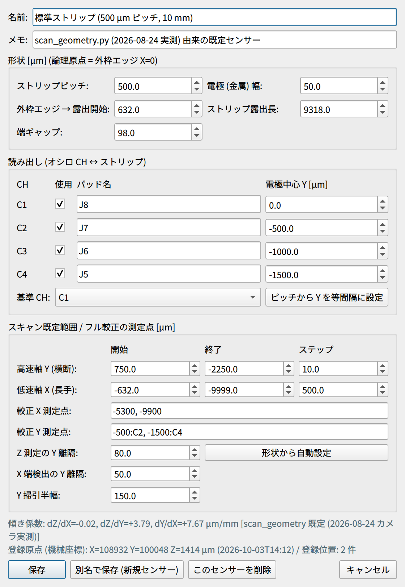

# センサーと座標系

GUI の座標・スキャン範囲・原点出しは、すべて「センサーの論理座標」で動きます。
GUI を正しく使うために、まずこのページの座標の決め方を理解してください。

## 標準センサーの幾何

標準センサーは HPK 製の 500 µm ピッチ・長さ約 10 mm のストリップ型 AC-LGAD です。
ストリップに沿う方向が X、ストリップを横切る方向が Y、光軸（フォーカス）方向が Z です。

X 方向には、読み出し側のセンサー外枠 (GND) のエッジから順に次の領域が並びます。

| 領域 | 幅 | 論理 X [µm] |
| --- | --- | --- |
| ⓪ 外枠とストリップ金属端の間 | 52 µm | 0 → −52 |
| ① スタブ | 380 µm | −52 → −432 |
| ② ボンディングパッド領域 | 200 µm | −432 → −632 |
| ③ ストリップ露出部 | 9318 µm | **−632 → −9950** |
| ④ 端ギャップ | 98 µm | −9950 → −10048 |
| その先 | — | 隣のストリップ領域（読み出していない） |

- **X = −10 mm は端ギャップ④の中央**（2 つのストリップ領域の境界）です。
- Y 方向には 6 本のストリップ C0–C5 が 500 µm ピッチで並び、C1–C4 を読み出します（[読み出しチャンネルの対応](hardware.md#readout-map)）。

## 論理座標と論理原点 { #logical }

画面に表示される位置、座標指定の移動、スキャン範囲はすべて **論理座標**（単位 µm）です。

| 軸 | 論理原点 (0) の定義 | 向き |
| --- | --- | --- |
| X | センサー外枠 (GND) のエッジ | ストリップは X の **負** の側に伸びる |
| Y | 基準 CH（標準は C1）の電極中心 | CH 番号が増えるほど負（C2 = −500 µm …） |
| Z | 合焦位置（焦点） | — |

論理原点は [原点出し](../measurement/alignment.md#origin) で自動的に決まり、その位置でコントローラの座標を 0 にリセット (R:W) します。
ステージの移動は、すべて論理座標への **相対移動 (M:W)** で行われます（絶対位置移動 A:W は不具合があったため使いません）。

## 機械座標 { #machine }

機械座標は **機械原点 (H:W)** を基準にした座標で、ステージパネルの論理座標の下に併記されます。

- R:W を実行するとコントローラの座標は 0 に戻るので、GUI が「論理原点の機械座標」を積算して
  `logs/stage_frame.json` に保存しています（H:W で 0 にリセットし、R:W のたびに直前の座標を加える）。
  この値は GUI を再起動しても引き継がれます。
- ジョイスティック JS-301 から M-ORG したとき、コントローラを再起動したとき、原点復帰を途中で止めたときは追跡が切れ、
  「機械座標: 不明」と表示されます。GUI から [機械原点復帰 (H:W)] をやり直してください。
- 機械座標は M-ORG のたびに変わり得るので、**粗寄せの目安** として使います。

## センサーの傾きと補正係数 { #tilt }

センサーは少し傾いて載っているので、3 つの係数で補正します。

| 係数 | 意味 | 標準センサーの既定値 |
| --- | --- | --- |
| dZ/dX | フォーカス面の X 方向の傾き | −0.02 µm/mm（ほぼ平坦） |
| dZ/dY | フォーカス面の Y 方向の傾き | +3.79 µm/mm |
| dY/dX | ストリップの面内回転 | +7.67 µm/mm |

回転を補正しないと、ストリップの全長（約 9.4 mm）で Y が約 72 µm ずれます。

- 画面の表示と [係数を手動入力...] の入力は **µm/mm**、`sensors.json` やスキャンログでのキー（`dzdx`、`dzdy`、`dydx`）は **µm/µm** です。
- 使われる係数の優先順位は、
    1. センサープロファイルに保存された値（[フル較正](../measurement/alignment.md#full-calibration) または手動入力）
    2. 標準センサーのみ `scan_geometry.py` の実測値（2026-08-24 カメラ実測）
    3. それ以外の未較正センサーは 0
- いま有効な係数とその出典は、ステージパネル [アライメント] タブと、自動スキャンパネルの [傾き補正] 欄の両方に表示されます。

## センサー辞書（センサープロファイル）

ボードやセンサーを替えてもコードを編集しなくて済むように、センサーごとの情報を 1 つのプロファイルにまとめ、
`logs/sensors.json` に保存しています。ツールバーの [センサー] で切り替えると、スキャンの既定範囲、傾き係数、
登録位置、オシロ CH と読み出しパッドの対応が、そのセンサーのものに入れ替わります。

| 項目 | 内容 |
| --- | --- |
| 形状 | ストリップピッチ、電極（金属）の幅、外枠エッジから露出開始までのオフセット、ストリップ露出長、端ギャップ |
| 読み出し | オシロ CH ごとのパッド名、電極中心 Y（基準 CH を 0 とする）、使用の有無、基準 CH |
| スキャン既定範囲 | 高速軸 Y と低速軸 X の開始・終了・ステップ |
| フル較正の測定点 | X の測定点、Y の測定点（「Y:CH」の形式）、Z 測定と X 端検出を行う位置の電極中心からの Y 離隔、Y 掃引の半幅 |
| 傾き係数 | dZ/dX、dZ/dY、dY/dX |
| 登録原点 | 論理原点の機械座標。原点出しのたびに自動で更新される |
| 登録位置 | 名前と座標（論理座標または機械座標） |

最初から登録されているのは次の 3 件です。

| センサー | 状態 |
| --- | --- |
| 標準ストリップ（500 µm ピッチ、10 mm） | 実測値（`scan_geometry.py`）が入っている |
| 4col（1000 µm ピッチ） | **ピッチ以外の寸法は未確認のひな形**。使う前に実測値へ直す |
| 可変ピッチ（500 µm 部） | 同上 |

制御 PC の `sensors.json` には、4 件目として「標準ストリップ 2x2 測定 (500 µm ピッチ, 10 mm)」（ID `2x2_500_m_10_mm`）も登録されています。
これは、2×2 区画センサーの中央領域で 2 列（区画境界）を跨いでスキャンしたときに使ったプロファイルです
（解析ノート matome の SEG スキャン `scan_20261008_151544_2dYX`、5 µm 行）。

### 新しい DUT を登録する { #new-sensor }

{ width="420" align=right }

1. ツールバーの [センサー] で、似たセンサーを選ぶ。
2. [編集...] を押す（右図）。
3. 形状（ピッチ、電極幅、外枠エッジ→露出開始オフセット、露出長、端ギャップ）を書き換える。
4. 読み出し（CH ごとのパッド名・電極中心 Y・使用の有無、基準 CH）を書き換える。
   等間隔なら [ピッチから Y を等間隔に設定] が使える。
5. [形状から自動設定] でスキャン範囲と較正の測定点を作り直す。
6. [別名で保存 (新規センサー)] を押す。

!!! note
    別名で保存したセンサーは、傾き係数・登録原点・登録位置を **引き継ぎません**。
    新しいセンサーでは最初に [フル較正](../measurement/alignment.md#full-calibration) を行ってください。

!!! tip "X 原点の実寸合わせ"
    原点出しは「信号が消える X エッジ（パッド領域と露出部の境界）+ 設計オフセット 632 µm」を外枠エッジとします。
    実寸が設計値と違う場合は、センサー編集の「外枠エッジ→露出開始オフセット」で合わせます。

